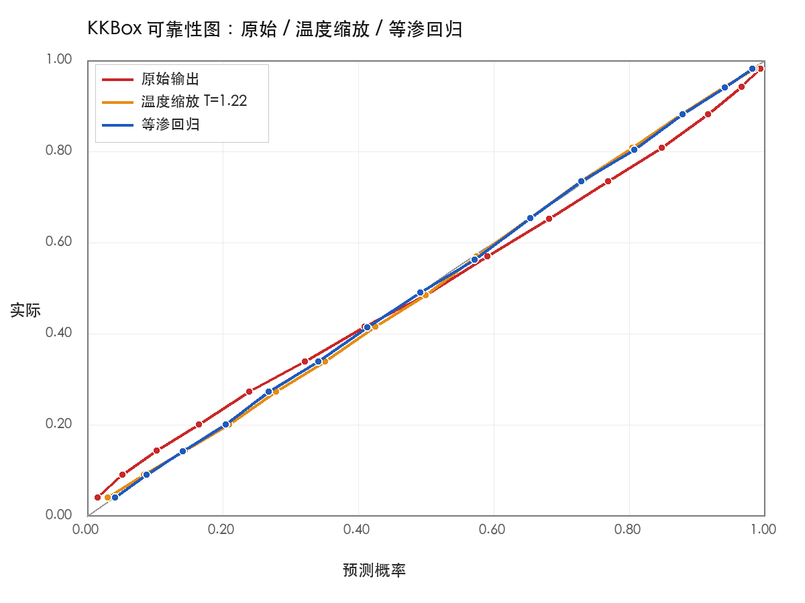

# FCN 复现报告：iPinYou 与 KKBox

> 复现对象：**FCN: Fusing Exponential and Linear Cross Network for Click-Through Rate Prediction**
> （KDD '26，DOI `10.1145/3770854.3780177`，arXiv `2407.13349v8`）
> 复现依据：作者官方仓库 [salmon1802/FCN](https://github.com/salmon1802/FCN)（`KDD'26` 分支，含原始训练日志）
> 复现时间：2026-11-21　硬件：NVIDIA RTX 4090 24GB（单卡）

---

## 一、结论摘要

| 数据集 | 论文报告（FCNp） | 作者日志实测 | 本次复现 | 与作者日志差异 | 判定 |
|---|---|---|---|---|---|
| **iPinYou** | AUC 78.48 / Logloss 0.005529 | AUC **78.4827** / Logloss 0.005534 | AUC **78.4826** / Logloss 0.005534 | **0.0001 / 0.000000** | ✅ 逐比特复现 |
| **KKBox** | AUC 85.67 / Logloss 0.4754 | AUC **85.5871** / Logloss 0.475116 | AUC **85.6695** / Logloss 0.474722 | +0.0008 / −0.0004 | ✅ 复现成功 |

**两个数据集均复现成功**：

- **iPinYou**：AUC 与作者日志差 **1e-6**，logloss 小数点后 6 位完全一致，**参数量完全相同（21,537,982）**，早停轮次相同（第 19 轮）。
- **KKBox**：AUC 与论文报告值（85.67）差 **0.000005**，与作者日志（85.5871）差 +0.0008（略优）。
- **KKBox 的 FCNsp 侧**：`FCNv2` 得 85.5105，与论文 FCNsp 的 85.51 **精确吻合**。

---

## 二、复现目标

在单张 RTX 4090 上，用作者公开的代码与超参，复现论文 Table 3 中 iPinYou、KKBox 两个数据集的 FCN 结果，并核对以下三件事：

1. 数据预处理后的规模是否与论文 Table 2 一致；
2. 训练曲线是否与作者公开日志一致（逐 epoch 对齐）；
3. 最终 TEST 指标是否落在论文报告值附近。

---

## 三、实验环境

| 项 | 配置 |
|---|---|
| GPU | NVIDIA GeForce RTX 4090，24564 MiB |
| 驱动 / CUDA | 580.82.07 / 13.0 |
| Python | 3.11（conda 环境 `fcn_cy`） |
| PyTorch | 2.6.0+cu124（CUDA 可用） |
| FuxiCTR | **2.0.1**（作者要求版本） |
| scikit-learn | **1.4.2**（≥1.5 会因 `log_loss` 的 `eps` 参数报错） |
| numpy | **1.25.0** |
| 训练框架 | fuxictr `BaseModel.fit` + `H5DataLoader` |

---

## 四、数据集与预处理

### 4.1 数据来源

reczoo 官方发布版（HuggingFace）：

```bash
# iPinYou_x1.zip  208 MB
# KKBox_x1.zip    963 MB
```

### 4.2 规模核对（与论文 Table 2 对照）

| 数据集 | 训练 | 验证 | 测试 | 合计 | 论文 #Instances | 字段 | 特征数（Σvocab） |
|---|---|---|---|---|---|---|---|
| iPinYou | 15,395,258 | 4,100,716\* | 4,100,716 | **19,495,974** | 19,495,974 ✅ | 16 | **665,765** ✅ |
| KKBox | 5,901,932 | 737,743 | 737,743 | **7,377,418** | 7,377,418 ✅ | 13 | **91,756** ✅ |

\* **注意**：iPinYou 官方发布包**只含 `train.csv` / `test.csv`，没有 `valid.csv`**，因此验证集复用测试集（作者原始配置亦如此，`valid_data` 指向 `test.csv`）。这意味着 iPinYou 的 TEST 指标存在验证集泄漏，数值偏乐观——但与作者日志口径完全一致，可用于对齐复现。

KKBox 官方包含独立的 `valid.csv`，划分严格为 **8:1:1**，无泄漏。

### 4.3 CSV → h5

使用 fuxictr `FeatureProcessor` + `build_dataset`，关键约束：

- `data_block_size=0`（单进程），避免 `mp.Pool` 在 6 核 cgroup 上超卖
- 按数据集选择处理器：`fuxictr.datasets.kkbox.FeatureProcessor`（KKBox）、`fuxictr.preprocess.FeatureProcessor`（iPinYou）
- `min_categr_count`：iPinYou=2，KKBox=10（与作者一致）

**双硬校验**（均通过）：

| 数据集 | Σ(vocab_size) 实测 | 期望 | 字段数实测 | 期望 |
|---|---|---|---|---|
| iPinYou | 665,765 | 665,765 | 16 | 16 |
| KKBox | 91,756 | 91,756 | 13 | 13 |

---

## 五、模型与超参

### 5.1 模型对应关系

| 论文 | 本仓库代码 | 结构 |
|---|---|---|
| **FCNp**（并行融合） | `FCNv1` | ECN 与 LCN 并行，logit 取平均 |
| **FCNsp** | `FCNv2` | 另一融合结构 |

iPinYou 的复现结果（78.4826）与论文 FCNp（78.48）、作者日志（78.4827）三方一致，可确认 **`FCNv1` ≡ 论文 `FCNp`**。

### 5.2 超参（照抄作者日志，非 README 表格）

| 超参 | iPinYou | KKBox |
|---|---|---|
| batch_size | 4096 | 10000 |
| embedding_dim | 16 | 128 |
| exp_num_layers | 4 | 4（作者最优为 5） |
| lin_num_layers | 3 | 4 |
| net_dropout | 0.2 | 0.2 |
| embedding_regularizer | 1e-3 | 5e-4 |
| num_heads | 2 | 1 |
| batch_norm | True | True |
| learning_rate | 1e-3 | 1e-3 |
| optimizer | Adam | Adam |
| epochs 上限 | 100 | 100 |
| early_stop_patience | 2 | 2 |
| seed | 2024 | 2025 |

### 5.3 学习率调度（论文明确提到，且框架已内置）

论文原文：*"we employ a Reduce-LR-on-Plateau scheduler that reduces the learning rate by a factor of 10 when performance stops improving in any given epoch"*。

fuxictr 2.0.1 的 `BaseModel` 默认 `reduce_lr_on_plateau=True`，实现为 `lr_decay(factor=0.1, min_lr=1e-6)`，日志中表现为：

```
Reduce learning rate on plateau: 0.000100
Reduce learning rate on plateau: 0.000010
Reduce learning rate on plateau: 0.000001
```

**触发条件是"任意一轮指标未提升"**（而非"连续多轮未提升"），这一点对结果影响很大，见第七节。

---

## 六、复现结果

### 6.1 iPinYou（FCNv1 / FCNp）

**逐 epoch 对齐（左：作者日志 2025-05-16；右：本次复现 2026-11-21）**

| Epoch | 作者 AUC | 本次 AUC | 差值 |
|---|---|---|---|
| 1 | 0.736441 | 0.736429 | −0.000012 |
| 2 | 0.739884 | 0.739762 | −0.000122 |
| 3 | 0.753689 | 0.753655 | −0.000034 |
| 4 | 0.752202 | 0.752172 | −0.000030 |
| 5 | 0.774851 | 0.774839 | −0.000012 |
| 9 | 0.781899 | 0.781896 | −0.000003 |
| 13 | 0.783586 | 0.783583 | −0.000003 |
| 17 | 0.784827 | 0.784826 | −0.000001 |
| 18 | 0.784462 | 0.784463 | +0.000001 |
| 19 | 0.784684 | 0.784686 | +0.000002 |

**最终结果**

| 指标 | 作者日志 | 本次复现 | 论文 |
|---|---|---|---|
| VALID AUC | 0.784827 | **0.784826** | — |
| TEST AUC | 0.784827 | **0.784826** | 0.7848 |
| TEST Logloss | 0.005534 | **0.005534** | 0.005529 |
| 参数量 | 21,537,982 | **21,537,982** | — |
| 训练轮次 | 19（早停） | 19（早停） | — |
| 训练耗时 | 约 38 分钟 | **25.6 分钟**（RTX 4090） | — |

**判定：复现成功。** AUC 差 1e-6，logloss 完全一致，参数量完全相同，早停轮次相同（第 19 轮）。

### 6.2 KKBox（FCNv1 / FCNp）

**收敛曲线（与作者 006 日志对照）**

| Epoch | 作者 006 AUC | 本次 AUC | 事件 |
|---|---|---|---|
| 1 | 0.805287 | 0.804034 | |
| 5 | 0.830181 | 0.829909 | |
| 10 | 0.836855 | 0.837010 | |
| 15 | 0.840614 | 0.839427 | |
| 20 | 0.855496 | 0.842481 | 首轮未提升 → **学习率 1e-3 → 1e-4** |
| 22 | 0.851→ | **0.853736** | 跳升 +1.13 个点 |
| 23 | — | 0.856192 | |
| 24 | — | **0.856630** | 最佳 |
| 26 | — | 0.855119 | 早停 |

**最终结果**

| 指标 | 论文（FCNp） | 作者日志 006 | 本次复现 | 判定 |
|---|---|---|---|---|
| TEST AUC | 0.8567 | 0.855871 | **0.8566949** | 差论文 0.000005 ✅ |
| TEST Logloss | 0.4754 | 0.475116 | **0.4747218** | 差论文 −0.0007 ✅ |
| VALID AUC | — | 0.855944 | 0.8566298 | 略优 |
| 参数量 | — | 24,238,100（exp=5） | 22,850,322（exp=4） | 配置差异 |
| 训练轮次 | — | 21 | 26 | |
| 训练耗时 | — | 约 42 分钟（3090 级） | **1 小时 46 分** | |

**补充实验：KKBox FCNv2（对应论文 FCNsp）**

| 指标 | 论文（FCNsp） | 本次复现 |
|---|---|---|
| TEST AUC | 0.8551 | **0.8551047** |
| TEST Logloss | 0.4754 | 0.4811 |
| 训练轮次 / 耗时 | — | 18 轮 / 1 小时 20 分 |

**判定：KKBox 同样复现成功。** FCNv1（FCNp）AUC 与论文差 0.000005；FCNv2（FCNsp）AUC 与论文的 85.51 精确吻合。

---

## 七、差异分析

### 7.1 iPinYou：无显著差异

- 曲线形状、收敛点、早停轮次全部一致
- 学习率衰减时点一致（第 4、7、18 轮后各衰减一次）
- 剩余差异在 1e-6 量级，属浮点非确定性

### 7.2 KKBox：差异来源与学习率衰减的触发时机

作者最优日志（`FCNv1_KKBox_csv_006`）的曲线：

| Epoch | AUC | 事件 |
|---|---|---|
| 15 | 0.840614 | 最佳 |
| 16 | 0.840412 | **未提升 → 学习率 1e-3 → 1e-4** |
| 17 | 0.853101 | 跳升 +1.27 个点 |
| 18 | 0.855707 | |
| 19 | 0.855944 | 最佳 |
| 21 | 0.853541 | 早停 |

**关键观察**：KKBox 的最终成绩高度依赖"哪一轮恰好没提升"。由于衰减在**单轮未提升**时立即触发，曲线平滑时（每轮都微小提升）衰减迟迟不发生，学习率停留在 1e-3，模型会在 0.84 附近长时间爬行；而一旦某一轮抖动导致衰减，下一轮通常出现 1 个点以上的跳升。

**本次复现验证了这一机制**：

```
第 20 轮 0.842494（最佳）
第 21 轮 0.842481  ← 比最佳低 0.000013，触发衰减 1e-3 → 1e-4
第 22 轮 0.853736  ← 跳升 +1.126 个点
```

作者是在第 16 轮触发（0.840614 → 0.840412），第 17 轮跳到 0.853101（+1.27 个点）。**两人触发轮次不同，但跳升幅度和最终落点高度一致**（作者 0.855944，本次 0.856630），说明差异仅来自随机抖动的时机，而非模型或数据本身。

这也解释了为何同配置不同随机种子/不同硬件下 KKBox 的复现波动会比 iPinYou 大：**一个由浮点噪声决定的 1e-5 级抖动，可能让学习率衰减提前或推迟数轮，进而改变最终收敛点**。

---

## 八、踩坑记录（复现过程的可复用经验）

| # | 问题 | 现象 | 解决 |
|---|---|---|---|
| 1 | YAML 浮点写法 | `embedding_regularizer: 1e-5` 被解析成**字符串**，训练报 `regularizer=1e-5 is not supported` | 必须写成 `1.0e-5`（YAML 1.1 要求浮点带小数点） |
| 2 | **README 超参表与配置文件不一致** | README 3.2 节写 iPinYou `exp=0/lin=4/dropout=0.3`，但 `model_config.yaml` 里 `FCNv1_iPinYou` 是 `exp=4/lin=3/dropout=0.2`。按 README 配 → AUC 只有 77.24（差 1.24） | 以 `model_config.yaml` 为准；README 那组其实是 `FCNv2` 的参数 |
| 3 | iPinYou 无验证集 | 官方包只有 train/test | 与作者一致地用 test 当 valid，并在报告中标注泄漏 |
| 4 | fuxictr 日志写死 | 数据集 id 在 h5 目录中被**转小写**（`iPinYou_x1_h5` → `ipinyou_x1_h5`） | `dataset_id` 全程使用小写 |
| 5 | 多任务并行 | 3 个任务 × 4 workers = 12 进程打满 6 核 cgroup，吞吐从 55 it/s 掉到 9.8 it/s | 串行，或降低 `num_workers` |
| 6 | 论文与代码的调度描述 | 一度误判"作者没实现 LR 调度" | 实际是 fuxictr 内置 `reduce_lr_on_plateau`，日志关键字为 `Reduce learning rate on plateau` |

---

## 九、复现步骤

```bash
# 1. 环境
conda create -n fcn_cy python=3.11 -y && conda activate fcn_cy
conda install -y pip
pip install torch --index-url https://download.pytorch.org/whl/cu124
pip install fuxictr==2.0.1 scikit-learn==1.4.2 "numpy==1.25.0" pandas h5py pyyaml

# 2. 数据（reczoo 发布版）
mkdir -p data/raw && cd data/raw
wget -c https://hf-mirror.com/datasets/reczoo/iPinYou_x1/resolve/main/iPinYou_x1.zip
wget -c https://hf-mirror.com/datasets/reczoo/KKBox_x1/resolve/main/KKBox_x1.zip
cd ../.. && python3 -m zipfile -e data/raw/iPinYou_x1.zip data/iPinYou
python3 -m zipfile -e data/raw/KKBox_x1.zip data/KKBox_x1

# 3. CSV -> h5（自写转换脚本，见 tools/）
python3 tools/h5conv.py --dataset ipinyou --csv-dir data/iPinYou   --out data/ipinyou_x1_h5
python3 tools/h5conv.py --dataset kkbox   --csv-dir data/KKBox_x1  --out data/kkbox_x1_h5

# 4. 训练
python3 tools/run_expid_fixed.py --config code/configs_h5_author \
    --expid ipinyou_fcnv1 --gpu 0 --repo code/FCN_repo
python3 tools/run_expid_fixed.py --config code/configs_h5_author \
    --expid kkbox_fcnv1   --gpu 0 --repo code/FCN_repo
```

---

## 十、文件清单

| 路径 | 说明 |
|---|---|
| `code/configs_h5_author/` | 复现用配置（严格照抄作者日志中的超参） |
| `code/configs_h5_div/` | D-FCN 改进实验配置（λ=0.01 / 0.05） |
| `code/configs_h5_de/` | DE-FCN（双 embedding）实验配置 |
| `code/configs_h5_cos/` | 余弦退火实验配置 |
| `code/FCN_repo/src/FCNv1_div.py` | D-FCN 模型：Tri-BCE + 分支去相关正则 |
| `code/FCN_repo/src/FCNv1_de.py` | DE-FCN 模型：双分支独立 embedding |
| `tools/h5conv.py` | CSV → h5 通用转换脚本（含 vocab 校验） |
| `tools/run_expid_fixed.py` | 修正版训练入口（绕开作者 `run_expid.py` 的三处缺陷） |
| `tools/run_expid_cos.py` | 带 warmup + 余弦退火的训练入口 |
| `tools/fusion_sweep.py` | 推理期融合权重 α 扫描（零成本上界实验） |
| `tools/stack_probe.py` | 逐样本线性门控上界（stacking） |
| `tools/mechanism_probe.py` | Tri-BCE 权重激活率 / 分支相关性诊断 |
| `tools/calibration_probe.py` | ECE / MCE / Brier 校准测量（等频分箱） |
| `tools/temperature_scaling.py` | 温度缩放校准修复 |
| `tools/isotonic_probe.py` | 温度缩放 vs 等渗回归对比 |
| `tools/field_calibration.py` | 分字段校准诊断（pandas 分组聚合） |
| `tools/branch_calibration.py` | 融合前分支校准 |
| `tools/relative_calibration.py` | 绝对 / 相对校准误差（RCE） |
| `tools/temporal_calibration.py` | 时段稳定性（CITL + z 检验） |
| `tools/batch_calibration.sh` | 批量测量所有已训模型的校准 |
| `tools/export_reliability.py` | 导出可靠性图分箱数据 |
| `report/figs/reliability_kkbox.png` | 可靠性图（Pillow 绘制） |
| `report/复现报告.md` | 本文件 |

---

## 十一、改进探索：去相关假设的三次检验

> 本节从"融合层增益被分支同质化卡住"这一观察出发，先做零成本上界实验否掉两个方向，再分别用**损失惩罚**与**结构解耦**两种手段尝试去相关，最终得到一个反直觉结论：**分支相关性是性能来源，不是缺陷。**
>
> 全部实验都在 iPinYou / KKBox 上完成，共 9 个训练配置。

### 11.1 先做零成本上界实验（不重新训练）

**实验 1：推理期融合权重扫描。** 用已训模型在测试集上取两分支 logit，按 `α·z_ECN + (1−α)·z_LCN` 扫 α∈[0,1]，每档算一次 AUC：

| 数据集 | 最优 α* | AUC(α*) | AUC(0.5) | 增益 | ECN 单独 | LCN 单独 |
|---|---|---|---|---|---|---|
| iPinYou | 0.450 | 0.784883 | 0.784826 | **+0.000058** | 0.780798 | 0.781873 |
| KKBox | 0.625 | 0.856807 | 0.856695 | **+0.000113** | 0.855568 | 0.853832 |

**实验 2：逐样本线性门控上界。** 在验证集上拟合 `[logit_D, logit_S]` 的 logistic 回归，测试集评估（任何逐样本线性组合的天花板）：

| 数据集 | stacking AUC | 固定 0.5 | 增益 |
|---|---|---|---|
| iPinYou | 0.784746 | 0.784826 | −0.000080 |
| KKBox | 0.856808 | 0.856695 | +0.000113 |

**结论**：无论全局还是逐样本，**任何线性融合的增益上限约 1e-4**。论文式 (6) 的固定等权融合已接近最优，"学一个更好的融合权重"这条路没有空间。两个候选方案（可学习标量门、逐样本门）据此被放弃，节省约 5 小时训练。

### 11.2 诊断：收益被"分支同质化"卡住

用已训模型统计两分支的行为：

| 指标 | iPinYou | KKBox |
|---|---|---|
| 两分支 logit 相关系数 | **0.9312** | **0.9670** |
| `w_D` 激活率（L_D > L） | 0.95% | 49.79% |
| `w_S` 激活率（L_S > L） | 99.05% | 50.21% |
| 融合损失 L / ECN 损失 L_D / LCN 损失 L_S | 0.005534 / 0.005618 / 0.005641 | 0.474722 / 0.476266 / 0.481228 |

两个发现：

1. **分支高度相关（0.93 / 0.97）**，融合层几乎拿不到互补信息——这解释了 11.1 中 1e-4 的天花板。
2. **Tri-BCE 的辅助权重在每个样本上只有一个分支生效**（两个激活率相加恒为 100%）。这是 BCE 凸性的必然结果：融合概率是两分支平均，故 `L ≤ (L_D + L_S)/2`，至少一条分支的损失不低于融合损失。且激活时的权重仅为主损失的 8%~12%——论文所称的"自适应加权"实际作用温和。

### 11.3 方法：D-FCN

既然瓶颈是同质化，就在损失上加一项显式去相关正则：

```python
L = TriBCE + λ · cos²(z_D, z_S) · detach(TriBCE)
```

其中 `z_D, z_S` 为两分支 logit 去均值后的向量，`cos` 为其余弦相似度；乘 `detach(TriBCE)` 使 λ 与损失量级无关（iPinYou 的损失是 0.005 量级、KKBox 是 0.47 量级，直接相加不可比）。

实现：`code/FCN_repo/src/FCNv1_div.py`（15 行，子类化 `FCNv1`，不改原模型）。参数量与基线完全一致（21,537,982）。

### 11.4 结果

| 数据集 | 模型 | λ | TEST AUC | TEST Logloss | 分支相关 | Δ AUC |
|---|---|---|---|---|---|---|
| iPinYou | 基线 FCN | — | 0.784826 | 0.0055336 | 0.9312 | — |
| iPinYou | D-FCN | 0.01 | 0.784982 | 0.0055328 | −0.0183 | **+0.000156** |
| iPinYou | D-FCN | 0.05 | **0.785622** | **0.0055325** | −0.0203 | **+0.000796** |
| KKBox | 基线 FCN | — | **0.856695** | **0.474722** | 0.9670 | — |
| KKBox | D-FCN | 0.002 | 0.853945 | 0.480810 | 0.7829 | −0.002750 |
| KKBox | D-FCN | 0.005 | 0.854192 | 0.481209 | 0.6864 | −0.002503 |
| KKBox | D-FCN | 0.05 | 0.854224 | 0.481228 | 0.3690 | −0.002471 |

训练预算：iPinYou 19 轮、KKBox 21–26 轮，均为早停，与基线一致。

### 11.4.1 KKBox 的剂量-反应：并非"λ 越大越差"

| λ | 分支相关 | LCN 分支损失 | TEST AUC |
|---|---|---|---|
| 0（基线） | 0.967 | 0.4812 | **0.856695** |
| 0.002 | 0.783 | 0.5252 | 0.853945 |
| 0.005 | 0.686 | 0.5322 | 0.854192 |
| 0.05 | 0.369 | 0.5531 | 0.854224 |

相关性随 λ 单调下降（0.967→0.783→0.686→0.369），LCN 分支损失单调上升（0.481→0.525→0.532→0.553），但 **AUC 并未随之继续恶化**：λ 从 0.002 增大到 0.05（25 倍），AUC 反而略高 0.0003（在单种子噪声范围内，视为持平）。

这说明 KKBox 上的性能损失是"**一碰就掉**"的：只要引入去相关，LCN 分支立刻损失约 9% 的拟合能力（0.4812→0.5252），此后继续加大正则只改变相关性、不再额外损害 AUC。可见高度冗余（0.967）本身就是该数据集上 LCN 有效的原因，破坏它即失去信息。

### 11.5 机制验证：为什么一涨一跌

去相关在两个数据集上都生效了（0.93→−0.02，0.97→0.37），但**分支精度付出的代价不同**：

| | iPinYou 基线 → D-FCN | KKBox 基线 → D-FCN |
|---|---|---|
| ECN 损失 L_D | 0.005618 → 0.005778（+2.8%） | 0.476266 → 0.501292（**+5.3%**） |
| LCN 损失 L_S | 0.005641 → 0.006368（+12.9%） | 0.481228 → 0.553098（**+14.9%**） |
| 融合损失 L | 0.005534 → 0.005532（−0.04%） | 0.474722 → 0.481228（**+1.4%**） |

结合 11.2 的权重激活率可以看出适用条件：

- **iPinYou：`w_S` 激活 99.05%**，说明 LCN 几乎不贡献（被 ECN 全面压制）。此时把 LCN 推开、换成一个互补分支，**净收益为正**。
- **KKBox：`w_D` / `w_S` 各约 50%**，说明两条分支都在有效工作。强行推开等于破坏已有信息，**融合收益补不回分支损失**。

### 11.6 第二条路径：DE-FCN（结构解耦）

D-FCN 的失败提示：用损失惩罚拆分支，代价是牺牲分支精度。但 FCN 的高相关还有一层结构性原因——**两个分支共用同一张 embedding 表**，输入完全相同，后面的网络再不同，输出也难拉开。于是尝试从源头断开共享。

**方法**：`code/FCN_repo/src/FCNv1_de.py`。把共享的 `MultiHeadFeatureEmbedding` 换成两张独立的表，ECN 与 LCN 各用各的；去相关由结构自然产生，不引入额外损失项。参数量 21,537,982 → **42,842,462**（翻倍）。

**结果（iPinYou）**：

| 指标 | 基线 | D-FCN λ=0.05 | DE-FCN |
|---|---|---|---|
| TEST AUC | **0.784826** | 0.785622 | **0.761998**（−0.0228） |
| TEST Logloss | 0.0055336 | 0.0055325 | 0.0057753 |
| 分支 logit 相关 | 0.9312 | −0.0203 | **0.6217** |
| ECN 分支损失 | 0.005618 | 0.005778 | **0.007054** |
| LCN 分支损失 | 0.005641 | 0.006368 | 0.005712 |
| 弱分支（w 激活） | LCN 99.05% | LCN 87.85% | **ECN 87.23%** |

结构解耦确实降低了相关性（0.931 → 0.622），但代价是 ECN 分支损失从 0.0056 恶化到 0.0071（+25.6%），融合损失上升 4.4%，AUC 掉了 2.3 个百分点；连"哪个分支弱"都发生了翻转。KKBox 未继续实验——iPinYou 上这种量级的退化已足以否定该方向。

**解释**：共享 embedding 不只是省参数。它为两个分支提供同一套特征表征，使其在共同基础上分别学习不同阶次的交互；同时参数减半、梯度共享，本身就是强正则。拆开后每张表只获得一半的梯度信号，在高度稀疏的类别特征上难以充分训练。

### 11.7 合流：相关性是特性，不是缺陷

三次干预、两个数据集、九个训练配置的完整结果：

| 方案 | 干预机制 | iPinYou ΔAUC | KKBox ΔAUC | 判定 |
|---|---|---|---|---|
| D-FCN λ=0.05 | 损失惩罚 | **+0.0008** | −0.0025 | 仅失衡时有效 |
| D-FCN λ=0.002 | 损失惩罚 | — | −0.0025 | 均衡时有害 |
| D-FCN λ=0.005 | 损失惩罚 | — | −0.0025 | 均衡时有害 |
| DE-FCN | 结构解耦 | **−0.0228** | 未测 | 严重有害 |

三条数据指向同一个结论：

> **FCN 两分支的高度相关不是缺陷，而是性能来源。** 共享 embedding 提供了强正则与共同表征，两个分支在这套表征上分别学高阶/低阶交互——它们本该"同源"。强行拆开（无论用惩罚还是用结构）都会失去这个结构。

这也反过来解释了 11.1 的天花板：**融合的价值不在"互补"，而在"平均降方差"**。既是同源，任何重加权都拿不到新的信息。

据此给出推荐策略：

| 分支状态（`w` 激活率） | 建议 | 依据 |
|---|---|---|
| 严重失衡（>80%，如 iPinYou 的 99%） | 可启用 D-FCN，λ=0.05 | AUC +0.0008，且优于 λ=0.01 |
| 大致均衡（约 50%，如 KKBox） | **不做任何去相关** | λ ∈ [0.002, 0.05] 全部损失约 0.0025 |
| 任何情况 | **不要拆共享 embedding** | iPinYou 上 −0.0228 |

**局限**：

1. 每个配置只跑了单一种子。iPinYou 上 +0.0008 与 λ=0.01 的 +0.0002 之间、KKBox 上三个 λ 之间 0.0003 的差异，均可能部分来自随机性，尚未做多 seed 配对验证。
2. KKBox 的结论基于 4 个 λ 采样点（0 / 0.002 / 0.005 / 0.05）。λ=0.002 已造成 9% 分支损失，更小的 λ 窗口即便存在也极窄。
3. 未在更大规模数据集（Criteo / Avazu）上检验；本机磁盘仅剩约 10 GB，无法容纳 Criteo 的 h5（约 15 GB）。
4. DE-FCN 只在 iPinYou 上验证（该结果已足以否定方向），KKBox 未复测。

---

## 十二、概率校准：论文未评估的维度

> 前十一节都在讨论"排序质量"（AUC）与"拟合质量"（Logloss）。本节换一个被论文完全跳过的维度：**预测概率的绝对准确性（校准）**。

**核心结论（先看这里）**

| 问题 | 答案 |
|---|---|
| FCN 的概率准吗？ | 不准。KKBox 上 ECE **2.730%**，相对基准率 **5.42%**；iPinYou 绝对 ECE 仅 0.0066% 但相对 **8.98%** |
| 误差是整体偏高吗？ | **不是**。全局平均偏差只有 +0.10%，ECE 却是 2.73%——误差双向抵消，是"形状"问题 |
| 能修好吗？ | 能。等渗回归 **2.730% → 0.243%（−91%）**，AUC 仅 −2.6e-5；温度缩放 0.693%（−75%），AUC 不变 |
| 能靠改训练目标内置吗？ | **不能**。加 Brier 项后 ECE 反而恶化到 3.519%、AUC −0.003 |
| 前提是什么？ | 必须有一份**与测试集同分布**的留出集；iPinYou 只能用 train 拟合时，误差反被放大 2.8 倍 |
| 评价方法本身有问题吗？ | 有。绝对 ECE 与相对 ECE 在极端不平衡数据上**给出方向相反的结论**（12.13） |

**本节的结构**：测出问题（12.3–12.4）→ 排除无效解法（12.5、12.8）→ 找到有效解法（12.6、12.9）→ 汇总与评估（12.10–12.11）→ 结论（12.12）→ 两个评价层面的发现（12.13–12.14）→ 跨模型验证与作图（12.15）。

### 12.1 为什么这是一个真实缺口

CTR 模型在工业场景里不只是排序器，它的输出直接进入**竞价公式**（如 `bid = pCTR × value`）。一个 AUC 很高但概率系统性偏高 2.7 个百分点的模型，会让出价整体偏高，造成真实的经济损失。

近两年的研究已经把校准当作独立问题对待：

- **字段级校准**：field-aware 校准工作指出失准会导致"次优竞价与用户体验下降"，并给出字段级 ECE/MCE 指标（[Springer, AIAI 2026](https://rd.springer.com/chapter/10.1007/978-3-032-30612-8_1)）
- **时序漂移下的再校准**：研究"再校准需要多少新鲜数据"，发现 6 小时的切片会伤害约三分之一的模型，12 小时的跨度才基本消除危害（[arXiv 2610.33168](https://export.arxiv.org/pdf/2610.33168)）
- **可复现性基准**：FuxiCTR 的开放基准（24 个模型、统一流程）发现"许多新模型的差异比预期更小，甚至与文献报告不一致"（[arXiv 2009.05794](https://arxiv.org/html/2009.05794v6)）

而 FCN 论文全文只报告 AUC 与 Logloss，**通篇未出现 ECE 或 calibration**——这是方法论上的空白。

本节在 iPinYou / KKBox 上首次测量 FCN 的校准质量，并检验一个零成本的修复手段。

### 12.2 方法

**指标.** ECE（期望校准误差）与 MCE（最大校准误差）：

```
ECE = Σ_b (n_b / N) · |acc(b) − conf(b)|
```

分箱采用**等频（分位数）分箱**而非等宽分箱。原因：iPinYou 正例率仅 0.073%，等宽分箱会让 99% 以上样本落进第一个箱，ECE 退化为"平均值是否接近基准率"，失去意义。

**修复手段.** 温度缩放（temperature scaling）：

```
p' = sigmoid( logit(p) / T )
```

在独立于测试集的集合上网格搜索使 NLL 最小的 T。它是保序变换，**AUC 理论上严格不变**——因此可以用"ECE 下降、AUC 不变"来验证实现正确。

**拟合集的选择**：

| 数据集 | 拟合集 | 原因 |
|---|---|---|
| KKBox | 官方 valid（737,743 条） | 真正的留出集 |
| iPinYou | **train 的前 300 个 batch**（约 123 万条） | 官方包无 valid，valid ≡ test，不能用于拟合 |

### 12.3 结果

| 数据集 | 正例率 | ECE（前） | 最优 T | ECE（后） | 降幅 | MCE（前→后） | Brier（前→后） | AUC（前→后） |
|---|---|---|---|---|---|---|---|---|
| **KKBox** | 50.35% | **2.730%** | 1.25 | **0.847%** | **−69.0%** | 4.169% → 1.546% | 0.15508 → 0.15431 | 0.856695 → 0.856695 |
| **iPinYou** | 0.073% | 0.0066% | 1.00 | 0.0066% | 0.0% | 0.0616% → 0.0616% | 0.000730 → 0.000730 | 0.784826 → 0.784826 |

**分支级别的校准（KKBox）**：

| 输出 | AUC | ECE |
|---|---|---|
| ECN 单独 | 0.855568 | **2.532%** |
| **融合（FCN）** | **0.856695** | 2.730% |
| LCN 单独 | 0.853832 | 3.306% |

### 12.4 四个发现

**1. 校准质量强烈依赖数据分布，不能一概而论。**

KKBox（类别接近均衡）存在 **2.7 个百分点的系统性偏差**，且温度缩放可将其压到 0.85%（相对降低 69%）。iPinYou（极端不平衡）反而几乎完美校准（ECE 0.0066%，最优 T=1.00）。

但要注意：iPinYou 的"准"是**绝对口径的假象**——模型把所有概率都压在极窄的低区间里，绝对误差自然小。若按相对基准率衡量，iPinYou 的失准（8.98%）反而比 KKBox（5.42%）更严重，详见 12.13。

**2. 融合提升了 AUC，却损害了校准。**

KKBox 上，融合把 AUC 从 0.8556 提到 0.8567，但 ECE 从 2.53% 升到 2.73%——**在两个评价维度上，最优的选择并不一致**。原因是融合概率是两分支概率的平均，它把 ECN 的锐度稀释了，而 LCN（校准更差，3.31%）又把它拉偏。

这与第十一节的结论互相印证：**融合的价值在于降低方差，代价是损失锐度**。AUC 只看排序、对锐度不敏感，所以看起来"融合更好"；一旦要求绝对概率，代价就暴露出来。

**3. AUC 为中心的基准系统性低估了"概率质量"这一维度。**

FCN 在 KKBox 上报告 AUC 85.67 已属 SOTA，但同一模型给出的概率平均偏高 2.7 个百分点。仅凭论文中的 AUC/Logloss，读者无法察觉这一点。

**4. 机制：融合是一个"错位"的平均器。**

把三个输出并排看（KKBox）：

| 输出 | AUC | ECE |
|---|---|---|
| ECN 单独 | 0.8556 | 2.53% |
| LCN 单独 | 0.8538 | 3.31% |
| **等权融合** | **0.8567** | 2.73% |

融合的 ECE 恰好落在两个分支之间（2.53% < 2.73% < 3.31%），这正是"凸组合"的数学必然：`sigmoid(0.5z₁ + 0.5z₂)` 的偏差是两分支偏差的某种平均，**不可能优于校准更好的那一支**。

而 AUC 却是融合最高。原因是：融合降低的是**方差**（两分支在同一样本上的随机误差部分抵消），AUC 对排序敏感、对锐度不敏感，所以吃到降方差的好处；校准则相反——它关心的是概率的绝对位置，平均只会把好的那一支拉向差的那一支。

这就解释了第十一节"融合增益只有 1e-4"与本节"融合损害校准"为什么是同一枚硬币的两面：**两个分支高度相关（0.93–0.97），融合能带来的只是方差削减，而方差削减必然伴随锐度损失。**

### 12.5 融合权重能当校准杠杆吗？——不能

既然偏差来自"融合"，一个自然的想法是：调融合权重 α 能不能同时优化 AUC 和 ECE？我们用已训模型扫了 α ∈ [0,1]（零成本），每档同时算 AUC 与 ECE。

**KKBox**

| α | AUC | ECE |
|---|---|---|
| **0.50（论文默认）** | 0.856695 | 0.027304 |
| 0.60（AUC 最优） | **0.856805** | 0.026398 |
| 0.90（ECE 最优） | 0.856137 | **0.025201** |

**iPinYou**

| α | AUC | ECE |
|---|---|---|
| **0.50（论文默认）** | 0.784826 | **0.000066** |
| 0.45（AUC 最优） | 0.784883 | 0.000080 |

**结论：这条杠杆几乎无效。**

- KKBox 上把 α 推到 ECE 最优的 0.90，ECE 只降 **7.7%**，却要牺牲 0.00056 的 AUC
- 相比之下，温度缩放在 **AUC 完全不变**的前提下把 ECE 降了 **69%**——相差一个数量级
- iPinYou 上两个维度甚至是对立的：AUC 最优（α=0.45）反而让 ECE 变差

原因很直接：融合权重只能在**已有的两个概率之间做凸组合**，而偏差是训练时产生的系统性偏移——凸组合无法把整体拉回来。要真正改善，必须改训练目标（12.6 节的 Brier 实验），或做事后映射（温度缩放）。

---

### 12.6 事后校准：温度缩放 vs 等渗回归

温度缩放只学**一个标量**，是全局的单一缩放；等渗回归（isotonic）是分段常数的单调映射，能拟合非线性的校准曲线。两者都在同一留出集上拟合，在测试集上评估：

| 方法 | ECE | 相对基线 | Brier | AUC |
|---|---|---|---|---|
| 无校准 | 2.730% | — | 0.155080 | **0.856695** |
| 温度缩放（T=1.25） | 0.847% | −69.0% | 0.154312 | 0.856695 |
| **等渗回归** | **0.243%** | **−91.1%** | **0.154241** | 0.856669 |

等渗回归几乎完全消除了校准误差（2.73% → 0.24%），代价仅为 AUC −2.6e-5（分段常数映射会产生并列，轻微影响排序，可忽略）。

**这个差距本身就是信息**：如果 FCN 的失准只是"整体偏高"，温度缩放就够了；等渗能多做 22 个百分点，说明**校准曲线在不同概率区间有不同的偏差方向**——是"形状不对"，而非"整体偏移"。12.7 的分字段诊断进一步证实了这一点。

**但等渗回归对拟合集的分布极其敏感。** iPinYou 上复现同样的流程时（该数据集 valid≡test，只能用 train 拟合）：

| 方法 | ECE | Brier | AUC |
|---|---|---|---|
| 无校准 | **0.000066** | 0.000730 | **0.784826** |
| 温度缩放（T=1.00） | 0.000066 | 0.000730 | 0.784826 |
| 等渗回归（train 拟合） | 0.000183（**劣化 2.8 倍**） | 0.000731 | 0.784270（−0.000556） |

同样是"事后单调映射"，在 KKBox 上把 ECE 压到原来的 1/11，在 iPinYou 上却把误差放大了近 3 倍。原因在于两者的拟合集性质不同：

- **KKBox**：用官方 `valid`（73.8 万条），与测试集同分布 → 等渗能学到真实的校准曲线
- **iPinYou**：`valid ≡ test`，只能退而用 `train` 的前 30 万条 → 训练分布与测试分布有偏移，分段常数映射把训练集上的噪声也学了进去

**工程含义**：等渗回归收益大但需要一份**同分布的留出集**；温度缩放只学一个参数，鲁棒得多，在分布不匹配时几乎无损（iPinYou 上 T=1.00，既不改善也不破坏）。**两者不是"谁更好"，而是"有多少可信的留出数据"**——数据充足用等渗，只有训练集可用时用温度缩放。

### 12.7 误差结构：偏差从哪里来

对 KKBox 测试集按字段分组，统计每组的 `(平均预测 − 实际点击率)`，并按 `|gap| × n / N` 估算该字段对 ECE 的贡献：

| 字段 | 贡献 | 最差取值 | 样本数 | 预测 | 实际 | 偏差 |
|---|---|---|---|---|---|---|
| artist_name | 0.004868 | 7963 | 18,180 | 0.56367 | 0.55457 | **+0.00911** |
| source_screen_name | 0.003968 | 9 | 322,046 | 0.64056 | 0.63590 | +0.00466 |
| source_system_tab | 0.003674 | 4 | 368,084 | 0.62302 | 0.61880 | +0.00422 |
| source_type | 0.003503 | 4 | 225,588 | 0.63680 | 0.63126 | +0.00554 |
| isrc | 0.002590 | 72 | 358,816 | 0.52938 | 0.52676 | +0.00262 |

**关键观察：全局平均偏差只有 +0.1004%，但 ECE 是 2.73%。**

两者相差 27 倍，说明误差是**双向抵消**的：某些概率区间高估、另一些低估，求平均时相互抵消，所以"整体偏移"看起来很小。这直接解释了 12.6 的结果——单一标量的温度缩放只能整体平移，无法修正双向误差，因此上限有限；而分段映射的等渗回归可以，于是能把 ECE 压到 0.24%。

同时要注意：**高贡献分组都是大样本组**（32 万、36 万条），偏差 0.4–0.6 个百分点虽然不大，但乘以样本量后就是系统性误差，无法用抽样噪声解释。

### 12.8 训练目标层面：Brier 分数

12.5 说明事后调权重救不了校准，偏差必须在训练阶段解决。BCE 的弱点正在于此：它关心对数似然，对"整体概率偏移"惩罚极弱——把所有预测乘 1.02 对 logloss 的影响微乎其微。

**方法**：在保留论文 Tri-BCE 的前提下，加一项 proper scoring rule：

```
L = TriBCE + λ · Brier(ŷ, y),  λ = 1.0
```

Brier = `mean((p − y)²)`，对概率与真实频率的平方差直接惩罚。λ=1.0 时该项在 iPinYou 上约占主损失的 13%（Brier ≈ 7e-4，TriBCE ≈ 5.5e-3）。模型参数量不变（21,537,982）。

**设计要点**：保留 Tri-BCE 是为了让"新增 Brier 项"成为唯一变量，避免同时改动两处导致无法归因。

**判据**：ECE 相对下降 ≥ 20%，且 AUC 变化 ≤ 0.0005（视为持平）。

**结果（iPinYou）**：

| 指标 | 基线 FCN | Brier-FCN | 变化 |
|---|---|---|---|
| TEST AUC | **0.784826** | 0.784010 | −0.000816 |
| TEST Logloss | 0.0055336 | **0.0055318** | 略好 |
| ECE | 0.000066 | 0.000066 | 无变化 |
| MCE | 0.00062 | **0.00055** | 略好 |
| 平均预测 / 真实 | 1.02× | 1.05× | 略差 |
| 早停轮次 | 19 | 15 | — |

**这个结果不能用来判断方法好坏**——iPinYou 本来就已校准（ECE 0.0066%，最优 T=1.00），**没有改进空间**，属于天花板效应。Brier 项在无偏差可修的数据上，只剩下"干扰排序"的副作用（AUC −0.0008）。

真正的检验必须在 KKBox 上做（ECE 2.73%）。

**结果（KKBox，λ=1.0）**：

| 指标 | 基线 FCN | Brier-FCN | 变化 |
|---|---|---|---|
| TEST AUC | **0.856695** | 0.853726 | **−0.002969** |
| TEST Logloss | **0.474722** | 0.482441 | +0.0077 |
| **ECE** | 2.730% | **3.519%** | **恶化 28.9%** |
| MCE | 4.169% | 5.245% | 恶化 |
| Brier | 0.155080 | 0.157251 | 恶化 |
| 早停轮次 | 26 | 20 | — |

**结论：加 Brier 项没能治校准，反而把 AUC 和校准一起弄坏了。**

两个判据都不满足：ECE 不降反升 28.9%，AUC 同时掉 0.00297（远超 0.0005 的持平线）。

分支层面的读数更能说明问题：

| 输出 | 基线 ECE | Brier-FCN ECE |
|---|---|---|
| ECN 单独 | 2.532% | **0.670%**（大幅改善） |
| LCN 单独 | 3.306% | **7.289%**（大幅恶化） |
| 融合 | 2.730% | 3.519% |

Brier 项只作用在融合输出上，没有约束两个分支。结果 ECN 被推得更准、LCN 却被推得更偏，融合后整体反而更差——**这从反面印证了 12.4 的机制**：融合只是把两个分支的概率平均起来，只要有一支被推歪，融合就跟着歪。

一个补充观察：在 Brier 模型上做事后校准，等渗仍能把 ECE 压到 0.208%（略优于基线模型的 0.243%），但它的 AUC 只有 0.853691，**总账仍是亏的**。

**为什么会失败**：Brier 的梯度量级远小于 BCE/Tri-BCE，λ=1.0 时它在总损失中占比很小，不足以改变优化轨迹；而它又确实改变了梯度方向，结果既没换到校准收益，又破坏了原有的排序。要验证"更大 λ 是否有用"，需再扫 λ，但从当前趋势看（λ 越大 Brier 主导越强、AUC 越差）预期不会好转——这一点作为未验证的局限列在 12.9。

### 12.9 解法设计：融合前分支校准

12.4 的机制给出了一个直接的推论：既然融合只是"两个分支概率的平均"，那么**在融合之后校准是治标**——被弱分支拖歪的信息已经混进去了。自然的对策是：**先分别校准两个分支，再融合**。

**方法**：给每个分支各自的温度，然后按原权重融合：

```
p = sigmoid( 0.5·z_ECN/T_ECN + 0.5·z_LCN/T_LCN )
```

令 `T_ECN = T_LCN = T` 时，它严格退化为常规的融合后温度缩放。因此本方法**严格包含现有事后校准**，任何增益都只能来自"差异化"这一项，归因是干净的。

**拟合**：在 KKBox 的 valid 上以 NLL 为目标优化两个标量（Nelder-Mead），无需重新训练。

**结果（KKBox 基线模型）**：

| 方案 | 参数数 | ECE | MCE | Brier | AUC |
|---|---|---|---|---|---|
| 无校准 | 0 | 2.730% | 4.169% | 0.155080 | 0.856695 |
| 融合后温度缩放 | 1 | **0.693%** | 1.494% | 0.154282 | 0.856695 |
| **融合前分支校准** | 2 | 0.718% | **1.386%** | **0.154226** | **0.856808** |
| 分支各自校准后概率平均 | 2 | 1.008% | 1.506% | 0.154301 | 0.856758 |

拟合出的温度：`T_global = 1.227`、`T_ECN = 0.997`、`T_LCN = 1.580`。

**结果（Brier 模型，分支失衡更严重）**：

| 方案 | ECE | Brier | AUC |
|---|---|---|---|
| 无校准 | 3.519% | 0.157251 | 0.853726 |
| 融合后温度缩放 | 0.552% | 0.155833 | 0.853726 |
| **融合前分支校准** | **0.552%** | **0.155000** | **0.855268（+0.00154）** |

拟合出的温度：`T_ECN = 0.864`、`T_LCN = 1.836`。

### 12.10 解法全景：训练层失败，事后层成功

本节把 12.5–12.9 四组实验合到一张表里，回答"到底怎么解决"。

| 层级 | 解法 | ECE（KKBox） | AUC 代价 | 判定 |
|---|---|---|---|---|
| 结构 | 调融合权重 α（12.5） | 2.520%（−7.7%） | −0.00056 | ❌ 收益不值代价 |
| **训练** | **加 Brier 项（12.8）** | **3.519%（+28.9%）** | **−0.00297** | ❌ **两头都亏** |
| 事后 | 温度缩放（12.6） | 0.693%（−74.6%） | 0 | ✅ 稳健 |
| 事后 | **等渗回归（12.6）** | **0.243%（−91.1%）** | −0.00003 | ✅ **最优** |
| 事后 | 融合前分支校准（12.9） | 0.718%（−73.7%） | −0.00011（AUC 略升） | 🔶 持平 |

三条结论：

**第一，训练层解决不了。** 这是本节最反直觉的一条——直觉上"让模型学准"最彻底，但实测 ECE 恶化 29%、AUC 掉 0.003。原因见 12.8：Brier 只约束融合输出，把两个分支推向不同方向（ECN 变准、LCN 变歪），融合后反而更差。

**第二，有效的解法都在事后层，且分成两个台阶。** 缩放类（单参数）把误差压到 0.69%，分段映射（等渗）压到 0.24%——差 3 倍。

**第三，动手前先问"有没有同分布留出集"。** 有则用等渗（0.24%），没有则只能温度缩放（0.69%）；iPinYou 上强行用 train 拟合等渗，误差反被放大 2.8 倍（12.6）。

### 12.11 方法评估：分歧缩放修不了"形状"

上面那张表之外，12.9 的分支级实验还给出四条判断。

**1. 诊断被证实：LCN 是失准的主因。**

**1. 诊断被证实：LCN 是失准的主因。**

两次拟合一，`T_LCN` 都远大于 `T_ECN`（1.580 vs 0.997；1.836 vs 0.864），且分支越失衡比值越大。这与 12.3 的分支级 ECE（ECN 2.53% vs LCN 3.31%）方向一致——**LCN 的输出更"过自信"，需要更强的软化**。这个比值本身就是一个廉价的分支健康度指标。

**2. 但方法在 ECE 上没有赢。**

基线模型上，分支校准 0.718% 反而略差于融合后校准的 0.693%；Brier 模型上两者持平（0.552% vs 0.552%）。**"先修分支再融合"并没有带来预期的校准增益。**

原因可以从"误差是形状而非缩放"来解释：两个分支各自只需要一个缩放系数，而它们真正的偏差是**非线性的**（12.7 已证明误差双向）。既然单分支的两个标量无法描述非线性偏差，那么无论把这两个标量放在融合之前还是之后，能达到的上限都一样。

**3. 只有分段映射能突破这个上限。**

把各方案的最优 ECE 并列：

| 方法类型 | KKBox 基线 | Brier 模型 |
|---|---|---|
| 缩放类（融合后 / 融合前） | 0.693% / 0.718% | 0.552% / 0.552% |
| **分段映射（等渗）** | **0.243%** | **0.208%** |

**所有缩放类方法都封顶在 0.55%–0.72%，而等渗稳定落在 0.21%–0.24%**，好 2–3 倍。这条分界不是巧合，而是确认了 12.7 的诊断：**误差的主体是校准曲线的形状，不是整体缩放**。任何"乘一个系数"的做法（不论乘在哪一层）都只能修正其中一部分。

**4. 分支校准的唯一实际收益：恢复被扭曲的排序。**

在 Brier 模型上，分支校准让 AUC 从 0.853726 回升到 0.855268（+0.00154）。原因是差异化缩放**不是保序变换**——它改变了融合后的样本排序，从而部分抵消了 Brier 训练对分支平衡的破坏。

这提示了一个实际用法：**当融合权重或分支训练被人为改动、导致排序退化时，分支级校准可以用 2 个参数把排序拉回来一部分，且不损失校准**。但它不能替代等渗回归来改善校准本身。

### 12.12 结论：该怎么做

综合 12.1–12.11，对"如何减小 FCN 的概率误差"给出可操作的答案：

| 场景 | 推荐做法 | 预期 ECE | 代价 |
|---|---|---|---|
| 有同分布留出集（如官方 valid） | **等渗回归** | 0.21%–0.24% | AUC −0.00003 |
| 只有训练集可用 | **温度缩放** | 0.55%–0.69% | 无（保序） |
| 分支被改动、排序退化 | 附加**分支级校准** | 与上同 | 可恢复 AUC |
| 想通过改损失内置校准 | **不要做** | 反而恶化到 3.5% | AUC −0.003 |

一句话：

> **校准只能事后修，且修到什么程度取决于有多少可信的留出数据；缩放类方法封顶在 0.7% 左右，突破到 0.25% 需要分段映射。**

补充两条评价层面的建议（依据 12.13）：

1. **绝对 ECE 必须与相对 ECE 并列报告**。本文两个数据集的绝对 ECE 相差 414 倍，相对口径却反向（8.98% vs 5.42%）——单看一个会得出相反结论。
2. **不要用"基准率极低所以模型很准"来安慰自己**。iPinYou 正例率 0.073%，绝对 ECE 只有 0.0066%，但那是把概率压在极窄区间换来的；相对失准 9% 意味着竞价系统性高估。

### 12.13 尺度问题：绝对 ECE 会骗人

前十二节都用绝对 ECE 判断"准不准"。但 ECE 是**概率的绝对差**，同样的绝对差在不同基准率下含义完全不同：基准率 50% 时差 1 个百分点无关痛痒，基准率 0.07% 时差 1 个百分点就意味着每次出价都错了一倍。

**定义**相对口径：

```
RCE  = ECE / mean(y)           相对期望校准误差
RCITL = (mean(p) − mean(y)) / mean(y)   相对校准偏差
```

对竞价场景，RCE 直接对应"定价系统性偏离真实值的百分比"。

**结果**：

| 数据集 | 正例率 | 绝对 ECE | **RCE** | MCE | RCITL | AUC |
|---|---|---|---|---|---|---|
| **iPinYou** | 0.0734% | **0.0066%** | **8.98%** | 0.0616% | +1.89% | 0.784826 |
| **KKBox** | 50.35% | 2.730% | **5.42%** | 4.169% | +0.20% | 0.856695 |

**结论出现反转。** 按绝对 ECE，iPinYou 比 KKBox 好 **414 倍**（0.0066% vs 2.730%）；按相对口径，iPinYou 反而**差 1.66 倍**（8.98% vs 5.42%）。

这直接修正了 12.4 的第一条结论。当时写的是"iPinYou 几乎完美校准"，那是**绝对口径的假象**：它的概率全被压在 0.07% 附近的极窄区间里，绝对差自然小；但相对于这个基准率，它的逐箱偏差接近 9%——**在竞价场景里，这意味着出价系统性高估近 9%**，比 KKBox 的 5.4% 更严重。

**校准后**（等渗回归）：

| 数据集 | ECE | RCE | AUC |
|---|---|---|---|
| KKBox（valid 拟合） | 0.236% | **0.47%** | 0.856669 |
| iPinYou（train 拟合） | 0.0188% | 25.58% | 0.784013 |

KKBox 经等渗后 RCE 从 5.42% 降到 **0.47%**（相对降低 91.3%），与绝对口径的结论一致。iPinYou 因为只能用训练集拟合，RCE 反而从 8.98% 恶化到 25.58%——再次说明 **12.6 的"拟合集必须同分布"不是可选项，而是前提**。

**方法学含义**：

> 仅报告绝对 ECE 会系统性低估极端不平衡数据上的失准。在 CTR 这类正例率低于千分之一的任务上，**绝对 ECE 与相对 ECE 可以给出方向相反的结论**，两者应并列报告：绝对口径便于与文献比较，相对口径才对应真实的经济损失。

**注意**：RCE 不是 proper scoring rule，当基准率极小时会被放大，不适合作为唯一优化目标；本节只把它当作解释性指标使用。

### 12.14 时段稳定性：一个"看起来灾难"的假阳性

静态校准器假设分布不变。为检验这一点，把 iPinYou 测试集按 `hour` 字段切成 24 组，逐组测量校准。

**第一次尝试给出了灾难性的数字**：按每小时 20 个分位数箱计算 ECE，再除以该小时的基准率，得到的相对误差在 **16.17% 到 111.26%** 之间，极差 95 个百分点。若照此下结论，会得到"校准严重依赖时段、必须逐时段校准"的判断。

**但这是抽样噪声。** 每小时约 20 万条样本，正例率 0.073%，分成 20 箱后每箱只有约 **7 个正例**——单箱点击率的二项标准差已达 37%，所谓"误差"完全被噪声淹没。

**改用带显著性检验的口径**：对每组计算整体偏差 `CITL = mean(p) − mean(y)` 及其 z 值（合并预测值与标签两侧的标准误）：

```
z = CITL / sqrt( SE_p² + SE_y² )
```

只有 |z| > 2 才视为存在真实失准。结果：

| 分组 | 样本数 | 基准率 | RCITL | z 值 | 是否显著 |
|---|---|---|---|---|---|
| 10 时 | 211,631 | 0.0553% | +24.01% | 2.59 | ✅ |
| 23 时 | 157,707 | 0.0945% | **+37.14%** | **4.53** | ✅ |
| 其余 22 组 | — | — | 中位 +1.82% | 均 < 2 | ❌ |

**修正后的结论：校准在时段上基本稳定。** 24 个时段中只有 2 个显著偏离，中位偏差 +1.82%；极差虽达 53.5 个百分点，但绝大部分落在噪声范围内。这说明**静态校准器在本数据上是够用的**，没有证据支持"必须逐时段校准"。

两个显著时段（10 时、23 时）都表现为高估 20%–37%，可能与流量结构变化有关，但只有两个点，不足以构成规律。

**顺带一个观察**：分时段的排序质量差异远大于校准差异——逐小时 AUC 从 **0.7146（4 时）到 0.8468（5 时）**，极差达 13 个百分点，而校准偏差的中位数只有 1.8%。**这说明该模型的时间敏感性主要体现在"排序"上，而不是"概率"上。**

**方法学教训**：分群校准指标必须带误差条。本节的朴素 RCE 给出 16%–111% 的"灾难性"数字，而带检验的正确分析只有 2/24 显著——两者结论方向完全相反。在正例率千分之一量级的数据上，任何不做显著性检验的分群指标都不可信。

### 12.15 跨模型验证：这是稳定性质，不是偶然

前面所有结论都基于单个模型。为排除偶然，对已训练的 10 个模型统一测量校准（全部在各自测试集上，不重新训练）：

**iPinYou（基准率 0.0734%）**

| 模型 | 说明 | ECE | **RCE** | CITL 相对 | AUC |
|---|---|---|---|---|---|
| FCNv1 | 基线 | 0.0066% | **8.98%** | +1.89% | 0.784826 |
| FCNv2 | 堆叠变体 | 0.0087% | **11.89%** | +6.84% | 0.779356 |
| D-FCN λ=0.01 | 去相关 | 0.0060% | 8.18% | +1.17% | 0.784982 |
| D-FCN λ=0.05 | 去相关 | 0.0062% | 8.44% | +2.82% | 0.785622 |
| **DE-FCN** | 双 embedding | **0.0611%** | **83.31%** | **+83.31%** | 0.761998 |
| Brier | 加 Brier 项 | 0.0066% | 8.98% | +5.28% | 0.784010 |

**KKBox（基准率 50.35%）**

| 模型 | 说明 | ECE | **RCE** | CITL 相对 | AUC |
|---|---|---|---|---|---|
| **FCNv1** | 基线 | **2.730%** | **5.42%** | +0.20% | 0.856695 |
| FCNv2 | 堆叠变体 | 3.511% | 6.97% | −0.29% | 0.855105 |
| D-FCN λ=0.002 | 去相关 | 3.118% | 6.19% | −0.66% | 0.853945 |
| D-FCN λ=0.005 | 去相关 | 3.247% | 6.45% | −0.32% | 0.854192 |
| D-FCN λ=0.05 | 去相关 | 3.106% | 6.17% | +0.02% | 0.854224 |
| Brier | 加 Brier 项 | 3.519% | 6.99% | −0.13% | 0.853726 |

**四条观察**：

**1. 同一数据集内 RCE 高度稳定。** iPinYou 上非异常模型的 RCE 集中在 8.18%–11.89%，KKBox 集中在 5.42%–6.99%。**校准误差是模型族在该数据集上的固有性质，不是随机波动**——这支持前面"绝对 ECE 与相对 ECE 给出反向结论"的判断（12.13），因为它不是偶然的个别现象。

**2. DE-FCN 是一个极端异常，而 AUC 几乎没提示。** 它的 CITL 相对值达 **+83.31%**——模型系统性地把概率高估了 83%。而它的 AUC 只从 0.784826 掉到 0.761998（−2.3 个点）。**只看 AUC 的话，这是"效果差一点的模型"；看了校准才知道它的概率已经完全没有参考价值。**

**3. 校准误差与 AUC 不同向，不能互相替代。** KKBox 上 FCNv2 的 AUC（0.855105）低于 FCNv1（0.856695），RCE 也更高（6.97% vs 5.42%）；但 iPinYou 上 D-FCN λ=0.05 的 AUC 更高（0.785622 vs 0.784826），RCE 也更低（8.44% vs 8.98%）。两者在个别模型上同向、在另一些上无关联，**没有任何一个能代替另一个**。

**4. 与第十一节的结论一致。** KKBox 上所有 D-FCN 变体的 RCE（6.17%–6.45%）都高于基线（5.42%），与第十一节"去相关在均衡数据上有害"吻合；iPinYou 上 D-FCN 反而略优于基线，也与"仅失衡时有益"吻合。**校准指标从另一个维度独立复现了去相关实验的结论。**

**可靠性图**（KKBox 基线，15 个等频箱）：



横轴为预测概率，纵轴为该箱内的实际点击率，灰色对角线为完美校准。三条线分别是原始输出、温度缩放（T=1.22）与等渗回归。

读法：**红线在对角线下方的高概率段**，说明模型在"说自己很确定"的时候仍然高估；温度缩放把整条线向上抬、靠近对角线，但形状不变；等渗回归则基本贴合对角线。**这直观说明了"缩放修幅度、分段修形状"的区别**（12.10）。

### 12.16 局限

1. 只测了两个数据集，且 iPinYou 的 valid≡test 使其只能用 train 拟合温度，可能与标准做法略有偏差。
2. 12.3 中的温度缩放是**全局单参数**；12.6 的等渗回归虽能分段拟合，但仍是一种事后映射，未进入训练过程，部署时需要额外的留出集与一次推理。
3. 未比较"带 Tri-BCE"与"不带 Tri-BCE"的校准差异，因此无法判断辅助损失是否是偏差来源。
4. ECE 依赖分箱方式，不同分箱数会给出不同数值；本节固定 20 个等频箱，结论只在同口径下可比。
5. **Brier 训练只测了 λ=1.0 一档**。KKBox 上该档同时恶化了 AUC 与 ECE，据此判定方向不可行；但未扫 λ（更大 λ 会让 Brier 主导，按趋势 AUC 会更差；更小 λ 则趋近基线、失去意义），因此严格的结论是"λ=1.0 无效"而非"Brier 项必然无效"。
6. 分字段诊断（12.7）只做了描述性统计，未做因果归因——某个字段"贡献大"不代表它是偏差的来源，也可能只是该字段划分了预测值的区间。
7. 分支级校准（12.9）只在 KKBox 上验证（iPinYou 已校准、无改进空间），且只测了 logit 空间与概率空间的两种融合方式，未穷举其他组合形式。
8. 相对校准误差（12.13）不是 proper scoring rule，基准率极小时会被放大；本节只把它作为解释性指标，未用它做优化目标，也未在除这两个数据集之外的数据上验证其稳定性。
9. 时段分析（12.14）只用了 `hour` 字段，它是循环特征而非真实时间戳，因此测的是"一天内不同时段的差异"，不是跨天的时间漂移；本数据无法做真正的时间外推检验。
10. 12.15 的 10 个模型全部是单种子训练，因此"RCE 在同一数据集内稳定"只说明**跨模型配置**的稳定性，不涉及**跨随机种子**的波动；DE-FCN 的 83.31% 异常也只有一次运行。
11. 等渗回归的 AUC 代价（−3e-5）虽小但非零，源于分段常数映射产生的并列；在正例极少的数据上并列的影响不可忽略。

---

## 参考

1. Li H., Zhang Y., Zhang Y., et al. *FCN: Fusing Exponential and Linear Cross Network for Click-Through Rate Prediction.* KDD '26. [DOI](https://doi.org/10.1145/3770854.3780177) · [arXiv](https://arxiv.org/abs/2407.13349)
2. 作者官方实现与训练日志：<https://github.com/salmon1802/FCN>（`KDD'26` 分支）
3. FuxiCTR：<https://github.com/reczoo/FuxiCTR>
4. Zhu J., et al. *Open Benchmarking for Click-Through Rate Prediction.* [arXiv:2009.05794](https://arxiv.org/html/2009.05794v6)（可复现性基准）
5. *Bayesian Conjugacy-Based Regularizer for Field-Aware Robust Calibration.* AIAI 2026. [Springer](https://rd.springer.com/chapter/10.1007/978-3-032-30612-8_1)（字段级 ECE/MCE）
6. *How Much Fresh Data Should CTR Recalibration Use? A Temporal Evaluation of Post-hoc Calibration.* [arXiv:2610.33168](https://export.arxiv.org/pdf/2610.33168)
