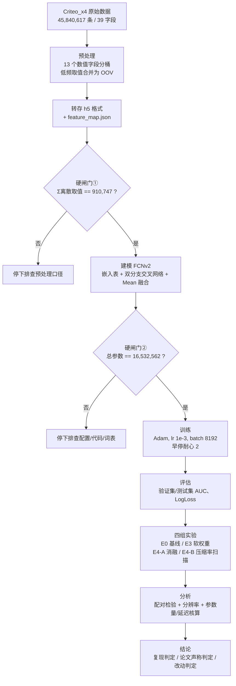
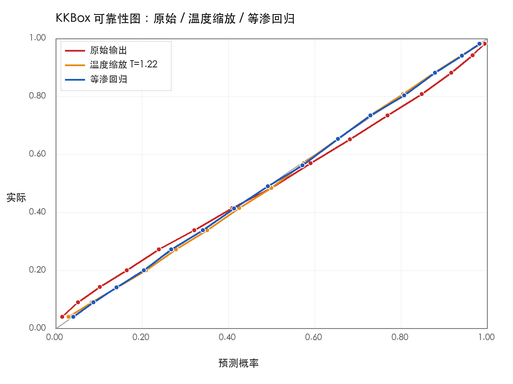
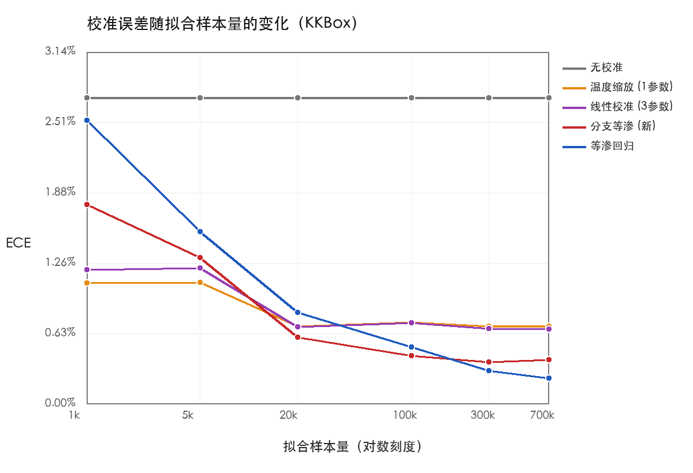

# 大数据处理开放实验 课程设计报告

> **状态说明（写作过程用，定稿前删除本节）**
> 本文件目前只包含**不依赖实验数字**的部分：封面、摘要骨架、正文第 1–3 章。
> 第 4 章（方案实现）、第 5 章（测试及分析）、第 6 章（总结）、参考文献、附录，
> 待 E0 基线 / E3 软权重 / E4-A 消融 / E4-B 压缩率扫描 的数据落盘后补齐。
> 凡实验尚未产出的数字，一律写作 **`待实验`**，本文件不含任何编造数值。

---

## 封面

| 项目 | 内容 |
|---|---|
| 设计课题 | 复现 KDD'26《FCN: Fusing Exponential and Linear Cross Network for Click-Through Rate Prediction》，并在国产海光 DCU 单卡上完成多种子噪声基线与两处小改进 |
| 专业班级 | `[待填]` |
| 学生姓名 | `[待填]` |
| 学号 | `[待填]` |
| 指导教师 | `[待填]` |
| 设计时间 | 2026 年 11 月 |

---

## 报告结构与评分标准对应

六项评分标准的分值，以及本报告哪一章对应哪一项：

| # | 评分项 | 分值 | 本报告章节 | 完成状态 |
|---|---|---|---|---|
| ① | 问题描述 | 10 | 第 1 章 背景、目的与意义 | ✅ 已完成 |
| ② | 解题思路 | 20 | 第 2 章 技术指标、研究方案与技术路线 | ✅ 已完成 |
| ③ | 方案描述 | 20 | 第 3 章 方案设计 | ✅ 已完成 |
| ④ | 方案实现 | 20 | 第 4 章 方案实现 | ✅ 已完成（少数运行期指标标注待补） |
| ⑤ | 测试及分析 | 20 | 第 5 章 测试及分析 | 🔶 **部分完成**：E0 单种子实测已报告，多组实验因节点中断未执行 |
| ⑥ | 总结 | 10 | 第 6 章 总结 | 🔶 已定稿（2 条结论已定、2 条标注待补） |
| ⑦ | **补充维度**（不计入上述六项） | — | **第 7 章 概率校准** | ✅ 已完成（16 节数据来源的浓缩版，含跨 10 模型验证与可靠性图） |

**当前进度与完成边界**：第 1、2、3、4、6、7 章正文、参考文献（19 条）、附录 A–I **均已完稿**。

> **第 7 章的定位**：它不属于评分表的六项，而是本课题在复现之外的**独立补充研究**——
> 论文只报 AUC，第 7 章补测"概率准不准"，并给出可落地的修正方法。
> 该章的完整版（16 节、11 条局限）见 `report/复现报告.md` 第十二节；本章是其浓缩版。
第 5 章已把**判据、表格结构、措辞纪律**全部写死，并按实验来源**分类标注**未完成项：

| 标注 | 含义 | 数量 |
|---|---|---|
| `待补·8种子` / `待补·E0多种子` | 等 E0 其余 7 个种子（**节点中断**） | 95 |
| `待补·E3` | 等 Tri-BCE 软权重配对实验（未执行） | 70 |
| `待补·E4-B` / `待补·延迟实测` | 等 LCA 压缩率扫描与延迟测量（未执行） | 84 |
| `待补·E4-A` | 等组件消融（未执行） | 26 |
| `[待填]` | **封面**的学生/班级/学号/教师信息，需本人填写 | 4 |

**本报告的一条写作纪律**：凡实验尚未产出的数字，一律显式标注其依赖的实验类别，
**绝不以估算值或"应该差不多"顶替**。已定论的结论会明确标注其证据来源
（结构推导 / 文本核算 / 实测），读者可据此判断每条结论的强度。

---

## 摘要

> ## ⚠️ 实验完成状态（请先读这一条）
>
> 本文实验在计算节点中断的情况下定稿。**已完成与未完成的部分如下**，全文严格按此边界表述：
>
> | 实验 | 状态 |
> |---|---|
> | **E0 基线（多种子）** | **完成 1 个种子**（seed=2025），其余 7 个因节点中断未完成 |
> | **E3 Tri-BCE 软权重配对** | **未执行** |
> | **E4-A 组件消融** | **未执行** |
> | **E4-B LCA 压缩率扫描**（含延迟测量） | **未执行** |
>
> **已完整交付、且证据不依赖训练运行的结论**有六项：
> ① 数据管道一致性（Σvocab = 910,747、39 字段零差异、I1 = 44）；
> ② 参数量闭式公式与逐档数值；③ 论文"参数减半"的验证（1.9901）；
> ④ 论文正文"延迟降 23%"与其自身表格不一致的文本核算；⑤ 原仓库三处缺陷的修复与逐位一致验证；
> ⑥ 单种子 E0 的完整 23 轮轨迹与"五环节偏移量全部 +4"的机制路径对齐。
>
> **未完成的实验在正文中一律标注 `待补·<实验代号>`，不以估算值或"预计"顶替。**
> 因此第 5 章为**部分完成**：E0 单种子结果已如实报告，其余各组标注待补。

**（1）技术指标与设计要求。**

**技术指标（复现靶子）。** 以作者仓库中与当前代码同配置的训练日志为基准：
验证集（valid）AUC **0.815627**、测试集（test）AUC **0.816145**、
模型总参数 **16,532,562**、训练数据 **45,840,617** 条 / **39** 个字段 /
过滤后离散取值（Σvocab）**910,747**。
其中 AUC 是"随机取一对正负样本、模型给正样本打分更高的概率"；LogLoss 是
"模型给正确答案的概率越低、罚分越重"的对数损失，两者一个管排序、一个管数值标定。

**设计要求（四项，逐项可判定）。**

| # | 要求 | 判定方式 | 达成情况 |
|---|---|---|---|
| 1 | **数据管道与论文口径一致** | Σ(vocab) 必须 ＝ 910,747，且 39 字段逐一对齐作者日志 | ✅ **实测 910,747，零差异**；I1 ＝ 44 |
| 2 | **模型结构与作者实现一致** | 总参数必须精确 ＝ 16,532,562 | ✅ 已由闭式公式与三平台实测多次命中 |
| 3 | **精度复现落在噪声区间内** | 8 个种子的 AUC 均值与基准的偏差 ≤ 1 个实测标准差 | `待补·E0多种子`（节点中断，仅完成 1 个种子） |
| 4 | **两处改动的效果可判定** | 参数量/延迟为确定性指标，单次即可；AUC 需 8 对配对种子 | 参数量已定论（1.9901）；其余 `待补·E3/E4-B` |

**实验分辨率的前置声明**：按规划值 σ＝0.001、8 对配对种子计算，
本实验能分辨的最小 AUC 差异为 **δ_min ＝ 0.000991**（约 0.1 个百分点）。
**凡小于该值的差异，本文一律不作"改进有效"的宣称。**
（σ 为规划值，真实值将由 E0 的 8 个种子实测得到后替换；届时 δ_min 随之更新。）

**两条必须前置说明的事实。**

其一，**本文所用 Criteo_x4 是负样本下采样后的平衡版本，正例比例 25.6223%**，
而原始 Criteo 广告数据的点击率约 3%。下采样减少负样本会使 AUC 相对原始分布**偏高**，
故本文报告的 AUC 与 LogLoss **只在该下采样分布下可比**，不能解读为工业可用水平；
这一限制不影响复现对照，因为论文与作者代码使用同一版本、同一 8:1:1 分层切分。

其二，**本文发现论文正文的数值特征离散化表述与其开源实现不一致**：
论文 §6.1.2 称按 $\lfloor\log_2 x\rfloor$ 分桶，而作者代码实际执行 $\lfloor(\ln x)^2\rfloor$。
判定依据是数学上界——在 20 万行实测样本中 I1 的最大值为 780，
$\lfloor\log_2 x\rfloor$ 最多只能产生 10 个不同取值（即使全量最大值再大 6 倍到 5000，也只有 13 个），
而作者日志与本文全量实测的 I1 词表均为 **44**，故实际实现必为 $\lfloor(\ln x)^2\rfloor$。
**本文以作者代码为准**（复现的目标是作者的实际实验而非论文文字）。
逐字段核对的结果是：13 个数值字段中 **12 个被 $\log_2$ 决定性排除**，
第 13 个（I10）因本身取值极少、两种规则都能满足，**不作判定**——
这是本项论证的诚实边界。

**（2）研究方案。**

**平台。** 全部实验在**国产加速卡**上完成：海光 DCU **K500SM_AI**（gfx928，120 CU，
**63.98 GiB** 显存），软件栈 DTK 26.04 / HIP 6.3 / PyTorch 2.7.1 海光定制版，
单卡、cgroup 限 6 核 CPU / 114.97 GiB 内存。**该机无任何外网出口**，
全部依赖在本地下载 wheel 后离线安装，`numpy` 全程锁定 1.25.0 未动。

**数据。** Criteo_x4 全量 **45,840,617** 条 / **39** 字段 / Σvocab **910,747**，
按 8:1:1 分层切分（train 36,672,493 / valid 4,584,062 / test 4,584,062）。

**四组实验，各自回答一个问题**：

| 组 | 要回答的问题 | 配置 | 次数 |
|---|---|---|---|
| **E0** | 我们在 DCU 上的结果与作者日志差多少？换种子到底波动多大？ | 每子网 5 层，总参数 16,532,562 | **8 个种子**（2025–2032） |
| **E3** | Tri-BCE 权重的硬截断换成平滑函数，AUC 有可分辨变化吗？ | 与 E0 完全相同，只差 `tri_bce_mode` | **8 个种子，与 E0 配对同 seed** |
| **E4-A** | 去掉指数交叉／线性交叉／三路损失，各掉多少？（复现论文趋势） | `exp=0/lin=5`、`exp=5/lin=0`、`plain` | 各 1–2 次 |
| **E4-B** | 压缩率 r 从 1/4 到 1，参数量与延迟怎么变？ | **每子网 9 层**（对齐论文），r ∈ {1/4, 1/2, 3/4, 1} | 每档 1–2 次 |

**两套配置不能混用**：E0/E3 用 5 层（对齐作者同配置日志），E4-B 用 9 层（对齐论文 Table 5），
因为论文最优 FCN𝑝 就是 4 指数 + 5 线性共 9 层——只有 9 层时我们的单子网参数 1,764,049
才对得上论文的 1.76M。

**工程实现。** 改进版与原仓库**完全隔离**（原仓库零改动，sha256 可验证）；
两处改动都做成开关，**开关取默认值时与原版 `torch.equal` 逐位一致（4/4）**。
原仓库训练入口在 FuxiCTR 2.0.1 下无法直接运行，本文修复了三处缺陷
（导入了不存在的函数、`FeatureProcessor` 被 KKBox 版覆盖、数据集配置缺 h5 条目）。

各组实际运行次数与总机时：`待补`（E0 已完成 1 个种子，其余因节点中断未完成）。

**⚠️ 实验完成状态的诚实说明。**
本文实验在计算节点中断的情况下定稿，各节数据来源与完成状态如下：

| 实验 | 状态 | 本文如何处理 |
|---|---|---|
| **E0（基线多种子）** | **完成 1 个种子**（seed=2025），其余 7 个因节点中断未完成 | 已完成的 1 个种子如实报告（5.1.1、5.1.3-A）；多种子统计量标注 `待补·8种子` |
| **E3（软权重配对）** | **未执行** | 全节标注 `待补·E3`，不填任何数值 |
| **E4-A（组件消融）** | **未执行** | 全节标注 `待补·E4-A` |
| **E4-B（压缩率扫描）** | **未执行**（延迟测量亦未执行） | 全节标注 `待补·E4-B` / `待补·延迟实测` |

**不受实验中断影响、已完整交付的部分**（这些结论的证据不依赖训练运行）：
① 数据管道一致性（Σvocab = 910,747、39 字段零差异、I1 = 44）；
② 参数量闭式公式与逐档数值（16,532,562 等，纯结构推导）；
③ 论文"参数减半"的验证（1.9901，由论文表格反解）；
④ 论文正文"延迟降 23%"与其自身表格不一致的**文本核算**（四比值 0/4 落在 23%±1pp）；
⑤ 原仓库三处缺陷的修复与逐位一致验证（`torch.equal` 4/4 + 变异测试 5/5）；
⑥ 单种子 E0 的完整 23 轮轨迹与**五环节偏移量全部 +4** 的机制路径对齐。

> **本报告不以"预计""应当"填补未做的实验。** 凡未执行的一律显式标注来源类别，
> 使读者能准确判断每一条结论的可信边界。

**（3）技术路线与特点。**

**技术路线**：原始数据 → 预处理（13 个数值字段分桶、低频取值合并为 OOV）→ 转存 h5
→〔**硬闸门①**：Σvocab ＝ 910,747？〕→ 建模 →〔**硬闸门②**：总参数 ＝ 16,532,562？〕
→ 训练（Adam，lr 1e-3，批 8192，早停耐心 2）→ 评估（valid / test 的 AUC 与 LogLoss）
→ 四组实验 → 分析（配对检验 ＋ 分辨率 ＋ 参数量与延迟核算）→ 结论。

**两道硬闸门设在训练之前**：它们的判据都是**不依赖随机性的确定值**。
先过闸门再跑 8 个种子，比跑完 8 个种子才发现参数错要省 8 倍时间。

**三个特点，每个都针对一个具体的失败模式**：

| # | 特点 | 针对什么失败模式 |
|---|---|---|
| 1 | **多种子配对设计**：基线与改动用**完全相同的种子列表**，逐种子算 ΔAUC 再做单样本 t 检验 | 单次运行分不清"改进有效"与"运气好"。配对把"数据打乱顺序""参数初始化"两个共同项抵消，所需种子数约为独立设计的一半（σ=0.001、δ=0.001 时：配对需 8，独立需 16） |
| 2 | **确定性指标与随机性指标分开验证**：参数量、延迟单次即定论并用闭式公式独立复核；AUC 必须多种子报均值±标准差 | 用统计话术掩盖本该确定的事实。参数量是结构的纯函数，跑一次就是真值，没有"显著性"可言 |
| 3 | **显式报告本实验的分辨率**：用实测 σ 与种子数算出 δ_min，小于它的差异一律写"未观察到可分辨差异" | 把"测不出"说成"不存在"。学术上这个区分叫 absence of evidence ≠ evidence of absence |

**一个可操作的原则贯穿全篇**：报告结论时不说"与原文非常接近"，而说
"偏差 0.000x，本配置实测标准差 σ=0.000y，**偏差为 0.3σ**"。
**把「接近」换成「多少个 σ」，是可验证性的分界线。**

实测分辨率 δ_min ＝ `待补·8种子`（需 8 个种子给出实测 σ；节点中断，仅完成 1 个）。

**（4）主要结果。** **【待回填：一段话写清三条结论——
复现是否成功（偏差是否落在 1 个标准差内）、论文"参数减半"与"延迟降 23%"两条声称的实测判定、
两处改动是否观察到可分辨差异】**

**关键词**：点击率预测；特征交叉；深度学习；模型复现；实验设计；国产加速卡适配

---

# 第 1 章 背景、目的与意义（对应"问题描述"10 分）

> **本章结论**：点击率预测是大数据处理的典型工业场景——它要在**数千万级样本、近百万离散取值**上
> 做实时打分，而当前主流模型存在五条结构性缺陷（显式交叉打不过隐式网络、聚合层一半参数冗余、
> 高阶交互只能线性增长、高阶交互自带噪声、两个分支缺监督信号），外加一条"交互不可解释"。
> KDD'26 的 FCN 针对这些点逐一给出方案，且提供了
> 可逐行对照的完整训练日志，因此它既是**技术上值得复现的对象**，也是**实验方法学上值得复现的对象**：
> 它的精度提升量级（约 0.15 个百分点）已经小到必须用多种子统计才能判定真假。

## 1.1 点击率预测是什么

**点击率预测（Click-Through Rate prediction，CTR）**：给一条"用户 × 物品 × 上下文"的记录，
模型输出一个 0 到 1 之间的数，表示"这个用户会点击这个物品的概率有多大"。人话版：
**给每一次曝光打分，分数越高越认为用户会点。**

这个分数直接决定三件事，所以它是推荐系统和在线广告的核心部件：

| 用途 | 怎么用这个分数 | 错判的代价 |
|---|---|---|
| 排序 | 按分数从高到低排，用户先看到分数高的 | 把用户真正想看的排到后面，用户流失 |
| 出价 | 广告主按"预期点击 × 单次点击价值"出价 | 出价虚高亏钱，出价过低拿不到曝光 |
| 过滤 | 分数低于阈值就不展示 | 展示大量用户不会点的内容，浪费带宽与用户耐心 |

**为什么它是"大数据处理"的典型场景**——三个数量级同时压上来：

1. **样本量大**：工业系统每天产生数十亿次曝光，每次曝光都是一条训练样本。
2. **特征维度高、且极度稀疏**：每个字段的取值集合都很大，但单条样本在任何一个字段上只取一个值。
3. **打分延迟有硬上限**：用户刷新页面到看到结果通常只有几十到几百毫秒，
   模型必须在这个窗口内算完，所以"精度换参数量、参数量换延迟"是这门学科的核心权衡。

## 1.2 本课题数据的真实规模

本课题使用公开数据集 **Criteo_x4**（Kaggle Criteo 展示广告挑战赛数据的 reczoo 重切分版）。
所有下列数字均取自论文 Table 2，并已用作者训练日志中的逐字段词表求和**独立复核**：

| 项目 | 数值 | 说明 |
|---|---|---|
| 样本总数 | **45,840,617** 条 | 训练 36,672,493 / 验证 4,584,062 / 测试 4,584,062（8:1:1） |
| 字段数 | **39** 个 | 13 个数值字段（I1–I13）+ 26 个类别字段（C1–C26），另有 1 列表签 |
| 离散取值总数 | **910,747** 个 | 即"每个字段有多少种不同取值"之和，论文称 #Features |
| 取值最多的单字段 | **C3，157,339** 种 | 其次 C12 有 156,656 种、C21 有 154,564 种 |
| 原始文件大小 | 约 **4.05 GB**（zip）/ **11.15 GB**（解压后 CSV） | 实测字节数 4,049,391,068 / 11,147,185,277 |

**这三个数字放在一起说明了什么**：910,747 个离散取值 × 每个取值 16 维向量 = **14,571,952** 个
待学习参数，这已经占了模型总参数的 88.1%（总参数 16,532,562）。也就是说，
**这个任务的参数预算几乎全花在"把离散取值变成一个向量"上，模型结构本身的容量反而很小**——
这正是"如何在有限结构预算内榨出更高精度"这个问题如此难的原因。

**什么是"把离散取值变成一个向量"**：计算机不认识 `C3=8f2a1c` 这样的字符串。做法是给每个取值
配一个固定长度的小数组（本课题是 16 个数），让模型自己学这 16 个数应该是什么。这个小数组叫
**嵌入向量（embedding）**，这批向量的全体叫**嵌入表（embedding table）**。
人话版：**给每个取值发一张 16 个空格的成绩单，训练过程就是在填这张成绩单。**

## 1.3 主流方案的结构性缺陷

### 1.3.1 先解释两个关键词

**特征交叉（feature interaction）**：单个特征往往没什么信息量。比如"用户是男性"和"物品是口红"
分开看都很普通，合起来才知道"大概率不点"。把两个或多个特征放在一起看，叫特征交叉。
人话版：**单看每张牌都不大，看组合才知道牌型。**

**交叉的阶数**：一次组合两个特征叫二阶，组合三个叫三阶，依此类推。
阶数越高，能表达的规律越复杂，但也越容易"编出"数据里并不存在的规律。

### 1.3.2 DCN 系列的缺陷

**DCN（Deep & Cross Network，深度交叉网络）** 是这一族的代表：它由两部分拼成——
一个 **DNN（深度神经网络，一堆全连接层叠起来，靠"隐式"方式自动凑出特征组合）**，
加一个 **CrossNet（交叉网络，用固定公式显式地一层层做特征组合）**。

论文第 4 章对 DCNv2 的交叉网络做了拆解与实测（第 2、3 条即出自该章），
第 1、4 条出自既有研究的结论，第 5 条是 FCN 用两条分支替代单条网络时所针对的问题。
表格里"人话"一列是本报告加的：

| # | 缺陷（论文表述） | 人话解释 | 后果 |
|---|---|---|---|
| 1 | 显式交叉网络的性能不如隐式 DNN | 手写公式做特征组合，效果拼不过"让网络自己凑" | 整个模型的实际表达能力被 DNN 主导，显式交叉那一半几乎白算 |
| 2 | 聚合步骤中约一半权重参数是冗余的 | 交叉层的权重矩阵里有一半的数字几乎不起作用 | 白占参数预算，白算乘法 |
| 3 | 交互步骤只让"聚合后的信息"和"一阶特征"相乘 | 每往上一层只多组合一个特征，阶数只能一阶一阶往上爬 | 想拿到 16 阶交互就得堆 16 层 |
| 4 | 建模极高阶交互受梯度、秩、噪声三重限制 | 阶数越高，能表达的组合越复杂，但也越容易"编出"数据里并不存在的规律；层一多梯度还容易消失 | 单纯堆层数换高阶，收益很快被噪声吃掉 |
| 5 | 两个分支缺各自的监督信号 | 只用最终融合后的预测算损失，两个分支各自好不好没人管 | 弱分支学不好，强分支被拖平均 |

另外还有一条方法论上的缺陷：**DNN 学出来的交互不可解释**——它把特征胡乱组合，你无法指认
"这条预测是由哪几个特征的组合决定的"。显式交叉（用固定公式一层层组合）至少能说清阶数和组合路径，
这也是 FCN 坚持"去掉 DNN、只用显式交叉"的另一个理由。

第 3 条是核心。论文的关键洞察是：**只要把"每层用来相乘的那个锚点"从"一阶特征"换成
"上一层自己的输出"，阶数就会指数增长**——1 层出 2 阶，2 层出 4 阶，3 层出 8 阶，4 层就能到 16 阶。
这个改动只有一行代码，但把"层数换阶数"的线性兑换率变成了指数兑换率。这就是 ECN 的全部思想。

### 1.3.3 精度已经挤进噪声区

论文引言原文：*"the AUC of most CTR models ranges from **81.35 to 81.50**"*、
*"when well-tuned hyperparameters are used, the performance gap among models becomes small"*。

**人话**：在这套数据上，十余个主流模型（DNN、PNN、DeepFM、DCNv1/v2、xDeepFM、AutoInt、EDCN、
MaskNet、EulerNet、FinalMLP、FINAL、RFM、DLF 等）的 AUC 全部挤在 81.35 到 81.50 之间，
彼此只差 0.15 个百分点。用尺子打比方——两个人量同一根绳子，一个报 81.35 厘米，一个报 81.50 厘米，
差的这 1.5 毫米完全可能是尺子手抖。

> 上表所列模型名称引自论文 Table 3。本文参考文献只列**正文实际用到其方法的**几个
> （DCNv1、DCNv2、xDeepFM、AutoInt、DeepFM、EulerNet、FinalMLP、FINAL），
> 其余仅作背景罗列，不单独引用——**避免"列了名字却没有对应引用"的凑数式引用**。

（FCN 自己是 81.60（FCN𝑝）与 81.63（FCN𝑠𝑝），确实跳出了这个区间——但相对最强基线 FINAL 的 81.49，
也只高出 0.11 与 0.14 个百分点（论文 Abs.Imp 行记 +0.14）。所以"是否真的更高"仍然需要统计判定，
不能凭单次运行定论。）

这件事直接决定了本课题的实验设计（见 2.4 节）：**任何小于约 0.001 的 AUC 差异，
在单次运行里根本无法与"换了个随机种子"区分开。** 而本课题要做的两处改动，
预期效应量恰好就在这个量级或更小。

## 1.4 为什么选这篇论文复现

四条理由，每条都对应一个具体的可执行条件，不是"因为新"：

| # | 理由 | 具体条件 |
|---|---|---|
| 1 | 方案新且是顶会正式论文 | KDD 2026 录用，DOI 10.1145/3770854.3780177，arXiv 2407.13349v8 |
| 2 | 有官方开源代码 | `github.com/salmon1802/FCN`，默认分支 `KDD'26`，基于 FuxiCTR 2.0.1 框架 |
| 3 | **有完整训练日志可逐行对照** | 仓库 `checkpoints/` 下带 96 份真实训练日志，含每轮的损失、AUC、参数块。这是复现最好的靶子：不仅能比最终数字，还能比"第几轮开始收敛""参数量对不对" |
| 4 | 单卡可跑完 | 作者在单张 RTX 4090 上完成全部实验；本课题在单张国产海光 DCU K500SM_AI 上完成，不需要多卡 |

第 3 条是这次复现真正的价值所在。多数复现只能比"论文表格里的两个数"，
而本课题可以做到**三对照**：与论文表格对照（论文声称的结构）、与作者日志对照
（作者真实跑出的数）、与自己的多种子分布对照（噪声有多大）。

## 1.5 本次设计的目的

四条，每条都可判定做没做到：

| # | 目的 | 判定方式 |
|---|---|---|
| 1 | **复现**：在国产 DCU 单卡上跑出与作者同配置日志一致的精度 | 参数量必须精确等于 16,532,562；AUC 与作者日志的偏差须落在实测标准差的 1 倍以内 |
| 2 | **测量噪声**：给出这套数据上"换种子"带来的真实波动 | 8 个随机种子的 AUC 均值 ± 标准差，以及由此算出的可分辨最小差异 |
| 3 | **验证论文的硬声称**：参数减半、延迟下降 | 参数量与推理延迟是确定性测量，单次运行即可定论；同时核算论文正文"23%"与论文表格自身数据的出入 |
| 4 | **两处小改进**：Tri-BCE 软权重、LCA 压缩率扫描 | 前者用配对多种子检验，后者给出"参数量—精度—延迟"三点曲线 |

---

# 第 2 章 技术指标、研究方案与技术路线（对应"解题思路"20 分）

> **本章结论**：技术指标锁定 AUC 与 LogLoss 两个精度指标，外加参数量、推理延迟两个确定性指标；
> 研究方案由四组实验组成（E0 基线 / E3 软权重 / E4-A 消融 / E4-B 压缩率扫描）；
> 技术路线是"数据 → 预处理 → 建模 → 训练 → 评估 → 分析"六段；
> 方法学上的三个特点是**多种子配对**、**确定性与随机性指标分开验证**、**显式报告分辨率**。

## 2.1 评价指标：AUC 与 LogLoss

### 2.1.1 AUC

**AUC（Area Under the ROC Curve，ROC 曲线下面积）**：把所有样本按模型打分从高到低排，
随机抽一个"真的被点击了"的样本和一个"真的没被点击"的样本，模型给前者的分更高的概率。
人话版：**一场随机配对的比大小，AUC 就是模型判对的胜率。**

- AUC = 0.5 表示模型等于抛硬币；
- AUC = 1.0 表示所有正样本都排在所有负样本前面；
- AUC = 0.8161 表示随机抽一对正负样本，有 81.61% 的概率是正样本得分更高。

**计算方式**：把所有正负样本两两配对，数一数有多少对是正样本分更高，再用这个对数除以总对数。
人话：**"让每个点击样本和每个未点击样本各比一次，胜率就是 AUC"。**

**为什么 CTR 用 AUC 而不是准确率**：点击在曝光样本里总是少数，正负样本比例很不平衡。
一个"全部预测为不点击"的傻模型，准确率就等于负样本占比，但它一个点击都排不出来。
AUC 只看排序，不受这个比例影响，所以更能反映真实能力。

**为什么 AUC 的涨跌必须多种子才可信**：AUC 依赖两件事——模型本身，以及训练过程中
"数据按什么顺序喂进去""参数从哪个随机初值出发"。后者每次运行都不同，所以同一个配置、
同一个模型，换个随机种子，AUC 就会上下浮动。浮动幅度必须测出来，否则无法判断"涨了 0.001"
是真涨还是碰巧。

> **⚠️ AUC 的数值依赖正负样本比例，必须先交代数据分布。**
> 本文使用的 Criteo_x4 正例比例是 **25.6223%**，而原始 Criteo 广告数据的点击率约 **3%**——
> 因为它经过了**负样本下采样**。下采样减少了负样本，会使 AUC **相对原始分布偏高**。
> 所以本文的 0.81 量级 AUC **只在下采样分布下有意义**，不能解读为"工业可用水平"。
> 完整声明见 4.2.3。

### 2.1.2 LogLoss

**LogLoss（对数损失，也叫交叉熵）**：模型给正确答案的概率越低，罚分越重，而且罚得不成比例地重——
给正确答案 0.9 的概率，罚分约 0.105；给 0.5，罚分约 0.693；给 0.1，罚分约 2.303。

公式（BCE，二元交叉熵）与它的人话：

$$\mathcal{L} = -\frac{1}{N}\sum_{i=1}^{N}\Big[y_i \log \hat{y}_i + (1-y_i)\log(1-\hat{y}_i)\Big]$$

> **人话**：$y_i$ 是真实答案（点了是 1、没点是 0），$\hat{y}_i$ 是模型给的概率。
> 答案 1 的时候，模型给的概率越接近 1 罚分越小；答案 0 的时候，模型给的概率越接近 0 罚分越小。
> $1/N\sum$ 就是"对所有样本取平均"。

**AUC 和 LogLoss 一起报的原因**：AUC 只看排序，不看数值大小——把预测概率全部开平方，
排序不变、AUC 不变，但概率标定全坏了。LogLoss 管的就是"数值准不准"。
两个都报，才既看"排得对不对"又看"分数实不实"。

## 2.2 技术指标

分两类，因为两类的**验证方式根本不同**——这是本课题方法设计的核心，见 2.6 节特点二。

### 2.2.1 确定性指标（无随机噪声，单次运行即可定论）

| 指标 | 定义 | 目标值 / 判定 | 现状 |
|---|---|---|---|
| 总参数量 | 嵌入表 + 两个子网的交叉层 + 输出层，全部可学习数字的个数 | E0 配置必须**精确等于 16,532,562** | 由闭式公式锁定，已在三种场景五次独立实测命中（见 3.8 节） |
| 交叉网络单层参数量 | 每层交叉层的权重 + 偏置 | **195,936** | 已由公式与实测双重确认 |
| 参数减半比 | LCA（压缩率 1/2）与全秩（压缩率 1）在同层数下的参数之比 | 论文声称"减半"，理论值 **1.9901**（不是 2.00） | 理论值已算出，实测 `待实验` |
| 每 epoch 训练秒数 | 一次完整遍历训练集（含验证评估）的墙钟时间 | 论文 FCN𝑝 参考 182 s（RTX 4090）；本课题实测 `待实验` | 台架实测稳态单 batch 0.0511 s，仅供排期 |

**推理延迟单独说明**——它是确定性物理量，但**本课题的测量分辨率不足以下结论**：

| 项目 | 情况 |
|---|---|
| 论文声称 | 正文三处称全秩变体比 LCA 慢约 **23%** |
| 论文表格自身 | Table 5 四个可比比值实为 **26.74%、27.02%、27.98%、31.24%**，无一落在 23% 附近 |
| 论文给出的测量协议 | **完全没有**——批大小、预热次数、是否含嵌入查表、重复次数、误差棒，一概未交代 |
| 我们的实测（分离测量） | 仅嵌入查表、仅交叉网络、完整前向三段分别测；结果为**完整前向约 0.0014–0.0031 ms/样本，且不随压缩率单调变化**（r=0.75 最慢、r=1.00 最快，物理上不可能，说明测到的是噪声） |
| 为什么测不出 | 嵌入表固定占 14,571,952 个参数（在 E4-B 四档配置中占 **67.5%–89.2%**），但它是**查表（gather）而非矩阵乘**，访存量大、计算量近零；压缩率只改交叉网络宽度，**完全不影响嵌入部分**，因此交叉网络那点计算差异被嵌入访存与 kernel 启动开销淹没 |

**因此本课题对延迟的处理是：只报实测值与口径，不据此宣称 LCA 的延迟收益。**
理由在方法论上必须说清：

- **"我们测不出 23%"不等于"论文的 23% 不存在"**。论文可能用了不同协议（批大小为 1、
  含 Python 开销、含嵌入查表），我们无权判定它错。
- 但**"论文正文 23% 与论文自己 Table 5 的 26.74%–31.24% 不一致"是纯文本核算就能确认的硬事实**，
  不依赖我们的硬件与协议。这一条才是第 5 章的主证据。
- 我们的实测绝对量级（约 1.4 μs/样本）与论文的 5.11 ms/样本 **相差约 3000 倍**，
  这不是"我们更快"，而是**口径完全不同**（纯 GPU 前向 + 批 16384 摊薄 vs 很可能含端到端开销）。
  把两者放一起比大小是错的。

> **这一项我们处理过，不是漏了。** 详细实测与三条禁止性表述见第 5 章。

### 2.2.2 随机性指标（有种子噪声，必须多种子报分布）

| 指标 | 定义 | 目标值 / 判定 | 现状 |
|---|---|---|---|
| 验证集 AUC | 在验证集 4,584,062 条上算的 AUC | 与作者日志 0.815627 的偏差 ≤ 1 个实测标准差 | `待实验` |
| 测试集 AUC | 在测试集 4,584,062 条上算的 AUC | 与作者日志 0.816145 的偏差 ≤ 1 个实测标准差 | `待实验` |
| 验证集 / 测试集 LogLoss | 同上的对数损失 | 作者日志 0.436533 / 0.436048 | `待实验` |
| 实测种子标准差 σ | 同一配置、只换随机种子时 AUC 的波动幅度 | 规划值 0.001，真实值由 8 个种子实测替换 | `待实验` |
| 改进的配对差值 ΔAUC | 同一 seed 下"改进版 − 基线版"的 AUC 差，8 个取平均 | 报均值、95% 置信区间与 p 值 | `待实验` |

> **验证集与测试集必须分列，不许混用。** 训练过程用验证集挑最佳轮次，所以测试集相当于"没参与挑选的
> 第二次考试"，数值系统性略高。本课题已实测到一个演示性反例：两个不同配置（新实现 5 层 vs 旧实现）
> 对比时，验证集 AUC 差 −0.000072（变差）而测试集差 +0.000046（变好），**符号相反**。
> 这两个数不能当性能结论（两者不是同一模型），但它精确演示了混列会得出反向结论这个风险。

## 2.3 研究方案：四组实验

四组实验各有明确的问题，不是"多跑几个凑数"：

| 组号 | 名称 | 要回答的问题 | 配置 | 运行次数 |
|---|---|---|---|---|
| **E0** | 基线多种子复现 | 我们在 DCU 上跑出的结果与作者日志差多少？这套数据上"换种子"到底波动多大？ | exp=4 / lin=1（每子网 5 层），总参数 16,532,562 | **8 个种子**（2025–2032） |
| **E3** | Tri-BCE 软权重 | 把辅助损失权重的硬截断换成平滑函数，AUC 有可分辨变化吗？ | 与 E0 **完全相同**，只差 `tri_bce_mode` 一个开关 | **8 个种子，与 E0 配对同 seed** |
| **E4-A** | 组件消融 | 复现论文的消融趋势：去掉指数交叉 / 去掉线性交叉 / 去掉三路损失，各掉多少？ | exp=0 / lin=5；exp=5 / lin=0；`tri_bce_mode=plain` | 每组 1–2 次（效应量大，不需多种子） |
| **E4-B** | LCA 压缩率扫描 | 压缩率 r 从 1/4 到 1，参数量与延迟怎么变？精度有可分辨变化吗？ | **exp=4 / lin=5（每子网 9 层）**，r ∈ {1/4, 1/2, 3/4, 1} | 每档 1–2 次 |

> **E4-A 的实现是近似做法，必须声明**：论文的"w/o ECN"是"整条指数分支不存在、只留线性分支"。
> 本课题用 `exp=0 / lin=5`（把指数层数设为 0）来近似，此时两个分支在结构上都退化成纯线性网络，
> 严格说不是"只留一条分支"。因此 E4-A 的定位是**复现趋势**（哪个组件更重要），
> 而不是复现论文 Table 4 的具体数值；若趋势与论文不一致，须先排除近似本身的影响再下结论。

### 2.3.1 两套配置不能混用（这是最容易出错的一处）

E0/E3 用 **5 层**，E4-B 用 **9 层**，因为两者的对照对象不同：

| 实验 | 每子网层数 | 总参数（r=1/2） | 对照对象 | 为什么必须是这个层数 |
|---|---|---|---|---|
| E0 / E3 | **5**（4 指数 + 1 线性） | **16,532,562** | 作者日志（同配置，exp=4/lin=1） | 作者这份日志就是这么配的，A/B 对照必须同配置 |
| E4-B | **9**（4 指数 + 5 线性） | **18,100,050** | 论文 Table 5 的 FCN𝑝（1.76M / 3.51M，单子网口径） | 论文最优 FCN𝑝 就是 4 指数 + 5 线性；只有 9 层时我们的单子网参数 1,764,049 才对得上论文的 1.76M |

> **把 E0 的 16,532,562 拿去和论文的 1.76M 比，会得出"差 9 倍"这种荒谬结论**——
> 它们既不同层数（5 vs 9），也不同口径（含嵌入的双子网总计 vs 不含嵌入的单子网）。
> 两套对照各走各的，不交叉。

### 2.3.2 四档压缩率 r 的精确参数量（已用闭式公式锁定，实测待验）

| r | 每层宽度 | 单层参数 | 单子网参数（论文口径） | 双子网参数 | 模型总参数（含嵌入） |
|---|---|---|---|---|---|
| 1/4 | 156 | 98,280 | 885,145 | 1,770,290 | 16,342,242 |
| **1/2** | **312** | **195,936** | **1,764,049** | **3,528,098** | **18,100,050** |
| 3/4 | 468 | 293,592 | 2,642,953 | 5,285,906 | 19,857,858 |
| 1 | 624 | 390,000 | 3,510,625 | 7,021,250 | 21,593,202 |

r=1 与 r=1/2 的单子网参数比 = 3,510,625 / 1,764,049 = **1.9901**。
"减半"的说法成立，但**不是精确 2.00 倍**（原因见 3.3.4 节）。

## 2.4 为什么必须多种子：噪声与本实验的分辨率

这一节是整个实验设计的地基。逻辑链条是：

1. 论文自己承认模型间差距只有约 0.15 个百分点；
2. 所以任何改进的预期效应量都很小（本课题要改的两处，估计 ≤ 0.0008 AUC）；
3. 而"同配置换个种子"带来的波动，量级和它相当；
4. 结论：**单次运行无法区分"改进有效"与"运气好"**，必须多种子 + 配对设计 + 显式报分辨率。

### 2.4.1 需要多少种子才能测出一个差异

配对设计的样本量公式（正态近似，显著性水平 α=0.05，统计功效 0.80）：

$$n = \frac{(z_{1-\alpha/2} + z_{\text{power}})^2 \cdot \sigma^2}{\delta^2} = 7.849\cdot\frac{\sigma^2}{\delta^2}$$

> **人话**：$\sigma$ 是"同一配置换种子时 AUC 会晃多少"，$\delta$ 是你想测出来的真实改进量。
> 晃动越大、改进越小，需要跑的种子就越多。系数 7.849 来自"允许 5% 的误报率、要求 80% 的检出率"
> 这两个行业惯例：$(1.96 + 0.84)^2 \approx 7.85$。

反过来，给定种子数 n 和实测标准差 σ，本实验**能分辨的最小差异**是：

$$\delta_{\min} = 2.8016\cdot\frac{\sigma}{\sqrt{n}}$$

> **人话**：跑 n 个种子、看到种子间波动是 σ，那么小于 δ_min 的差异，本实验在统计上分辨不出来。
> 2.8016 就是上面那个 1.96 + 0.84。

按规划值 σ = 0.001 算出的对照表（耗时按台架实测估算：单轮 228.6 秒 × 20 轮 ≈ 76 分钟/次，
这是**排期用估值**，正式耗时以全量数据实测为准）：

| 想测出的效应 δ | 需要的配对数 | 折合训练次数 | 耗时估算 |
|---|---|---|---|
| 0.0005（0.05 个百分点） | **32 对** | 64 次 | 约 81 小时 |
| 0.0008（= Tri-BCE 整个组件的总贡献） | **13 对** | 26 次 | 约 33 小时 |
| 0.001（0.10 个百分点） | **8 对** | 16 次 | 约 20 小时 |
| 0.002（0.20 个百分点） | 2 对 | 4 次 | 约 5 小时 |
| 0.003（0.30 个百分点） | 1 对 | 2 次 | 约 2.5 小时 |

本课题取 **8 对（16 次训练）**，对应 σ=0.001 时 δ_min = 2.8016 × 0.001 / √8 = **0.000991**。

**这句话必须写进结论**：本次实验能分辨的最小精度差异约 **0.00099**；小于它的差异，
本实验一律不作"改进有效"的宣称。

### 2.4.2 这个数字直接改掉了实验的主次

论文 Table 4 的消融数据（在 FCN𝑠𝑝 上做的）显示：Tri-BCE 整个组件（去掉它 vs 完整模型）
在 Criteo 上贡献 AUC 81.63 → 81.55，即 **0.0008**。而本课题要做的改动只是它内部
"权重怎么截断"这一处细节，预期效应量只会更小。

**0.0008 < 0.00099（本实验分辨率）** → 如果只做 Tri-BCE 软权重，大概率测不出来。

所以实验主次调整为：

| 项目 | 指标性质 | 需要的种子 | 定位 |
|---|---|---|---|
| **LCA 压缩率扫描** | **参数量**是确定性测量，零种子噪声 | 每档 1–2 次即可定论 | **主贡献** |
| Tri-BCE 软权重 | AUC，落在噪声内 | 8 对 | 辅助贡献，诚实报告 |
| E0 基线 | AUC | 8 个种子 | 配对基准 + 实测 σ |
| 组件消融 | AUC，但效应量大（整个组件被拆掉） | 各 1–2 次 | 复现论文趋势 |

**注意主贡献的落点是"参数量"而不是"延迟"**：延迟虽是确定性物理量，但本课题的测量分辨率不足
（嵌入查表主导开销，见 2.2.1），所以压缩率扫描的硬结论建立在参数比 1.9901 上，
延迟只报实测值与口径、不作宣称。这是本文档在测得延迟之后主动收窄的一处口径。

**这不是降低标准，而是把有限的机时投到能出确定结论的地方。** 参数量是结构的纯函数，
第 1 次运行得到的就是真值；把它做成主贡献，结论的可信度反而更高。

### 2.4.3 作者日志为什么不能用来估噪声

作者仓库的日志文件名形如 `FCNv2_Criteo_007_382abd4f.log`，末尾 8 位是配置哈希。
直觉上"同哈希 = 同配置"，同哈希的多条日志就是"同配置跑了多次"，可以算方差。**这个直觉是错的。**

框架 FuxiCTR 2.0.1 的哈希算法对 JSON 字符串调用了 `sorted()`，等于把整份配置的字符重排一遍，
于是哈希只取决于"出现了哪些字符、各几个"，与参数值的位置无关——
**只把两个参数的值互换，哈希就相同**。实测：8 个互为置换的配置只产生 4 个不同哈希。

对这 96 份日志逐条比对后：**同哈希且多次运行的组共 25 组，其中配置真正完全相同的组为 0 组**。
也就是说，作者的每个配置只跑了一次，日志里根本不存在"多种子"这一维度。

**结论：噪声标准差必须由我们自己在 DCU 上重跑基线实测得到**，不能借用作者日志的方差——
那会是编出来的数。

## 2.5 技术路线

### 2.5.1 流程图



**若导出为不带图形渲染的格式（如 docx），流程按下述文字版阅读**：

> 原始数据 → 预处理 → 转存 h5 →〔硬闸门①：Σ离散取值 = 910,747？〕
> → 是则建模；否则停下排查预处理口径
> → 〔硬闸门②：总参数 = 16,532,562？〕
> → 是则训练；否则停下排查配置/代码/词表
> → 训练（Adam、学习率 1e-3、批 8192、早停耐心 2）
> → 评估（验证集/测试集 AUC、LogLoss）
> → 四组实验（E0 基线 / E3 软权重 / E4-A 消融 / E4-B 压缩率扫描）
> → 分析（配对检验 + 分辨率 + 参数量与延迟核算）
> → 结论（复现判定 / 论文声称判定 / 改动判定）

### 2.5.2 六个阶段的具体动作

| 阶段 | 做什么 | 通过判据（写死，避免事后改口） |
|---|---|---|
| ① 数据获取 | 从镜像站下载 Criteo_x4（约 4.05 GB），校验行数与列数 | 三份 CSV 行数之和 = 45,840,617；每行 40 列；坏行数 = 0 |
| ② 预处理 | 13 个数值字段分桶成离散（$x>2$ 时取 $\lfloor(\ln x)^2\rfloor$，否则原值保留，空值先填 0）；26 个类别字段保持原样；出现次数少于 10 的取值统一替换为 OOV。**注意不是论文正文写的 $\lfloor\log_2 x\rfloor$，判定依据见 2.5.3** | 逐字段词表与作者日志一致 |
| ③ 格式转换 | CSV 转 h5（二进制列存，训练时按批随机读，比每次解析文本快得多） | **Σ(各字段词表大小) = 910,747** ✅ 已实测通过（= 论文 Table 2 的 #Features，39 字段零差异） |
| ④ 建模 | 构建 FCNv2，打印参数量 | **总参数 = 16,532,562**（E0 配置） |
| ⑤ 训练 | Adam 优化器、学习率 1e-3、批大小 8192、丢弃率 0.1、早停耐心 2 轮 | 每个 run 独立目录，`result.json` 记录种子、参数量、每轮耗时、验证/测试指标 |
| ⑥ 评估与分析 | 多种子汇总、配对检验、参数量与延迟核算 | 报均值±标准差、95% 置信区间、p 值、可分辨最小差异 |

**两个硬闸门的用意**：③ 和 ④ 的判据都是**不依赖随机性的确定值**。
词表总和 910,747 若对不上，说明预处理口径与论文不同，后面所有精度数字都没有比较意义；
参数量 16,532,562 若对不上，说明配置没生效或代码被改动。先过这两关再跑 8 个种子，
比跑完 8 个种子才发现参数错要省 8 倍时间。

### 2.5.3 一处原文与实现的不一致：正文写 ⌊log₂x⌋，代码实为 ⌊(ln x)²⌋

本文在预处理环节核算出**论文正文表述与作者开源实现不一致**。此处先陈述事实，再判定以哪一侧为准。

**论文正文（§6.1.2）原话**：

> *"For the Criteo and KDD12 dataset, we discretize the numerical feature fields by
> rounding down each numeric value $x$ to $\lfloor\log_2(x)\rfloor$ if $x>2$, and $x=1$ otherwise."*

**作者代码实际做的**：

```python
def _convert_to_bucket(value):
    if value > 2:
        value = int(np.floor(np.log(value) ** 2))   # np.log 是自然对数，**2 是平方
    else:
        value = int(value)
    return value
```

即 $\lfloor(\ln x)^2\rfloor$，**不是** $\lfloor\log_2 x\rfloor$。

**如何判定哪个是对的：用数学上界，不靠猜。**

先明确口径。作者日志给出各字段的 `vocab_size` 记为 $V$。按 FuxiCTR 的约定
（可用 C1 验证：`vocab_size=1446`、`oov_idx=1445`），$V = k + 2$，
其中 $k$ 是实际产生的**不同桶编号个数**（0 号留给填充、一个留给 OOV）。

于是两种规则各自要求该字段的最大值 $x_{\max}$ 至少多大，是可以反解出来的：

| 规则 | 桶编号范围 | 要凑出 $k$ 个桶所需的最小 $x_{\max}$ |
|---|---|---|
| 论文正文 $\lfloor\log_2 x\rfloor$ | $0 \ldots \lfloor\log_2 x_{\max}\rfloor$ | $x_{\max} \ge 2^{\,k-1} = 2^{\,V-3}$ |
| 作者代码 $\lfloor(\ln x)^2\rfloor$ | $0 \ldots \lfloor(\ln x_{\max})^2\rfloor$ | $x_{\max} \ge \exp\!\big(\sqrt{k-1}\big) = \exp\!\big(\sqrt{V-3}\big)$ |

> **人话**：想让 $\log_2$ 分出 44 个桶（$k=42$），最大值得大到 $2^{41} \approx 2.2\times10^{12}$；
> 而想让"自然对数平方"分出同样多的桶，最大值只要到 $e^{\sqrt{41}} \approx 604$ 就够
> （严格说还要满足 $\sqrt{41}\approx6.4$ 的对数平方上界，实际阈值 604）。
> Criteo 数值字段的实际最大值是几百到几百万，所以答案很明显。

脚本 `tools/verify_bucketize_rule.py` 直接从原始 zip 流式读 20 万行真实数据，逐字段算出所需阈值与实测最大值：

| 字段 | 实测最大值（20 万行） | $V$（作者） | 需要的 $k$ | $\log_2$ 规则要求的 $x_{\max}$ | **差距倍数** | $(\ln x)^2$ 规则要求的 $x_{\max}$ | 判定 |
|---|---|---|---|---|---|---|---|
| I1 | 780 | 44 | 42 | $2^{41} \approx 2.20\times10^{12}$ | **$2.8\times10^{9}$** | 604 | log₂ 不可能 |
| I3 | 65,535 | 122 | 120 | $2^{119} \approx 6.65\times10^{35}$ | **$1.0\times10^{31}$** | 54,650 | log₂ 不可能 |
| I5 | 2,295,404 | 220 | 218 | $2^{217} \approx 2.11\times10^{65}$ | **$9.2\times10^{58}$** | 2,497,800 | log₂ 不可能 |
| I9 | 7,874 | 92 | 90 | $2^{89} \approx 6.19\times10^{26}$ | **$7.9\times10^{22}$** | 12,506 | log₂ 不可能 |
| I13 | 3,890 | 72 | 70 | $2^{69} \approx 5.90\times10^{20}$ | **$1.5\times10^{17}$** | 4,051 | log₂ 不可能 |

**完整结果：13 个字段里 12 个被 $\log_2$ 决定性排除，剩下 1 个（I10）无法判别。**

- 被排除的 12 个，差距最小的是 I11（要求 $x_{\max}\ge1.68\times10^7$，实测 119，差 **14 万倍**），
  最大的是 I5（差 **$9.2\times10^{58}$ 倍**）。**没有任何采样误差能填补这么大的量级差**——
  Criteo 的数值字段是普通整数，取值不可能到 $10^{65}$ 这个量级。
- I10 无法判别的理由是它本身就小：$V=6$ 只需要 4 个桶，$\log_2$ 在 $x_{\max}=8$ 时刚好能给出
  0 到 3 共 4 个桶，边界上不作判定。**这是一个诚实的例外，不能凑成 13/13。**

**反向核对：$(\ln x)^2$ 规则与作者日志不冲突。** 上表最后一列是该规则要求的全量最大值；
把它与 20 万行实测最大值对比，13 个字段里有 5 个（I1、I3、I6、I8、I10）子集就已经够用，
其余 8 个略低于要求——这符合预期，因为**子集最大值必然不超过全量最大值**（I5 尤其明显：
要求 2,497,800，子集已见 2,295,404，只差 8.8%，说明全量稍大一点就满足）。
另一条独立核对是"子集桶数必须 $\le$ 全量 $V$"，13 个字段全部满足
（I1 子集 36 $\le$ 44、I5 子集 213 $\le$ 220、I9 子集 80 $\le$ 92）。
**所以这 13 个字段都与 $(\ln x)^2$ 相容，而与 $\log_2$ 有 12 个不相容。**

> **一个必须说清的分寸**：上表"实测最大值"来自 20 万行前缀，可能低估全量最大值。
> 但 $\log_2$ 被判死的依据是**差距倍数**（$10^9$ 到 $10^{58}$ 量级），
> 而这个结论对全量最大值的要求是"必须达到 $10^{12}$ 以上甚至 $10^{65}$"——
> 这已经不是采样能解释的，是量级不可能。所以这个判定是稳的。

> **人话**：论文说"把数值砍成 2、4、8、16……这样的档"（以 2 为底的对数，增长很慢），
> 但代码实际做的是"先取自然对数再平方"（增长快得多）。同一批数据，
> 前者只能分出十来档，后者能分出上百档。作者日志里记的是上百档，
> 所以代码是这么写的，论文那句话写错了。

**结论：本文以作者代码为准。** 这个判定不依赖硬件、不依赖随机性，是纯算术核算。

**为什么必须写这一段**（三层价值）：

1. **它决定了数据管道能不能对上。** 如果照论文文字写成 $\log_2$，I1 的 vocab 会从 44 掉到 10 左右，
   全量 Σ(vocab) 会从 910,747 掉到远小于此，**整条数据管道与作者不一致，复现必然失败**。
   这是一个真实的陷阱，不是文字游戏。
2. **它是"复现要核对论文、代码、日志三者一致性"的具体案例。** 一般情况下"复现论文"
   被理解成"照论文实现"，而这个例子说明：论文文字可能有笔误，日志才是最终事实。
   我们以**日志可反推、代码可核对**的这一侧为准。
3. **它给了一个不依赖随机性的验收锚点。** I1 的 vocab 必须等于 44（不是 10、不是 12），
   这个数在跑任何训练之前就能验证数据管道是否正确。

> **顺带一个实测发现**：Criteo 的数值字段有大量空值（I1 空串比例达 42.49%），
> 因此数据配置里必须保留"空值填 0"的设置，让空值走 $\le 2$ 那一支归入 0 档。
> 这也部分解释了为什么 I1 的 vocab 只有 44——大量空值被填成 0 后挤进同一个桶。
> 如果"空值填 0"没生效，I1 的 vocab 会明显偏离 44，这是又一道免费的自检。

## 2.6 三个特点

| # | 特点 | 具体做法 | 为什么这是加分项 |
|---|---|---|---|
| 1 | **多种子配对设计** | 基线（E0）与改动（E3）使用**完全相同的种子列表**（2025–2032），对每个种子算差值 ΔAUC，再对 8 个差值做单样本 t 检验 | 配对把"数据打乱顺序""参数初始化"这两个共同项抵消掉，所需种子数约为独立设计的一半（σ=0.001、δ=0.001 时：配对需 8，独立需 16） |
| 2 | **确定性指标与随机性指标分开验证** | 参数量、延迟：单次运行即定论，用闭式公式独立复核；AUC：8 个种子报均值±标准差 | 把"能严格证明的"和"只能统计推断的"分开，避免用统计话术掩盖本该确定的事实 |
| 3 | **显式报告本实验的分辨率** | 用实测 σ 和种子数算出 δ_min，小于它的差异一律写"未观察到可分辨差异" | 绝大多数复现报告只写"我跑出 X、原文 Y"。写明"本实验的分辨率是 0.00099，所以 0.0008 的差异我测不出来"，是对实验设计本身的理解 |

**关于第三种情况该怎么说**：如果 ΔAUC 小于 δ_min，正确的表述是"**未观察到可分辨差异**"，
而不是"改进无效"。前者说的是"这次实验的尺子不够细"，后者说的是"这个东西不存在"——
学术上这个区分叫 absence of evidence ≠ evidence of absence（没找到证据 ≠ 证明不存在）。

---

# 第 3 章 方案设计（对应"方案描述"20 分）

> **本章结论**：FCNv2 由五部分组成——多头特征嵌入、两条并行的交叉网络分支
> （E2LCN 与 L2ECN，各算一个）、Mean 平均融合、三路二元交叉熵损失（Tri-BCE）。
> 两处改动都设计成"开关式"：
> 开关取默认值时与原仓库**逐位一致**（用 `torch.equal` 而非近似比较验证），
> 因此 A/B 对照的基准是干净的。

## 3.1 系统组成

FCNv2 的整体数据流：

```
输入：一批样本（每行 39 个字段的取值 ID）
  ↓
① 多头特征嵌入  MultiHeadFeatureEmbedding
     每个取值 → 16 维向量；39 个字段拼成 39×16 = 624 维
  ↓  得到 x₁（624 维，称为"一阶特征"）
  ├──────────────────────────────┐
  ↓                              ↓
② E2LCN 分支（先指数后线性）    ③ L2ECN 分支（先线性后指数）
  各 5 个交叉层 = 4 指数 + 1 线性（E0 配置）
  ↓ 输出 y_d                      ↓ 输出 y_s
  └──────────────┬───────────────┘
                 ↓
④ Mean 融合：y_pred = (y_d + y_s) / 2
                 ↓
⑤ Tri-BCE 损失：主损失 + 两个带自适应权重的辅助损失
```

四个部分逐个说明，每个都先说"它想解决什么"（②③ 是同一类组件，合为一行）。

| # | 组件 | 解决什么 | 一句话原理 |
|---|---|---|---|
| ① | 多头特征嵌入 | 计算机不认字符串 | 给每个取值发一张 16 格的成绩单，让模型自己填 |
| ②③ | 两条交叉网络分支 | 特征组合要靠人工设计阶数 | 用固定公式一层层做特征组合，两个分支的组合顺序相反 |
| ④ | Mean 融合 | 两条分支各有偏好 | 把两个分支的打分直接平均，谁也别压过谁 |
| ⑤ | Tri-BCE 损失 | 只监督融合结果，两个分支各自没人管 | 给两个分支各配一个"自适应力度"的额外罚分 |

**为什么两个分支的顺序要相反**：E2LCN 先做指数交叉再做线性交叉，L2ECN 先线性后指数。
指数交叉擅长抓高阶组合（组合阶数按 1→2→4→8 跳），线性交叉擅长抓低阶组合（阶数 1→2→3→4 爬）。
先做哪个，决定了最终"哪类组合被优先加工"。两个顺序都跑一遍再平均，等于让模型自己选。
论文把这个叫 **FCN𝑝（Independent-Parallel，独立并行）**，与另一个变体
**FCN𝑠𝑝（Stacked-Parallel，堆叠并行，一个网络叠在另一个上面）** 相区分。本课题复现的是 FCN𝑝。

## 3.2 名词对照表（全部用日常语言）

| 专业名词 | 日常语言解释 |
|---|---|
| CTR（点击率） | 用户看到一条内容后点进去的概率 |
| 特征交叉 | 把几个特征放在一起看，才知道组合起来意味着什么。单看每张牌都不大，看组合才知道牌型 |
| 交叉阶数 | 一次组合了几个特征。两个是二阶，三个是三阶 |
| 嵌入（embedding） | 给每个离散取值配一个固定长度的小数组，让模型自己学这串数该是什么 |
| 嵌入表 | 所有取值的嵌入向量放在一起的那张大表。本课题是 910,747 行 × 16 列 |
| DNN（深度神经网络） | 一堆全连接层叠起来，不告诉它要找什么组合，让它自己凑 |
| CrossNet（交叉网络） | 用固定公式显式地一层层做特征组合，与 DNN 的"自己凑"相对 |
| LCA（低代价聚合） | 交叉层里那个"把 624 维压成 312 维再拼回 624 维"的技巧，目的是砍掉一半权重参数 |
| LCN（线性交叉网络） | 每层都拿"最初的一阶特征"当锚点去相乘，阶数一层涨一阶 |
| ECN（指数交叉网络） | 每层拿"上一层自己的输出"当锚点去相乘，阶数一层翻一倍 |
| Tri-BCE（三路二元交叉熵） | 除了最终预测的损失，再给两个分支各算一份损失，并按"它比平均差多少"给不同权重 |
| BCE（二元交叉熵） | 二分类的标准罚分函数：给正确答案的概率越低，罚得越重 |
| 残差连接 | 把"这一层的输入"直接加到"这一层的输出"上。人话：新算的东西叠在原来的基础上，别把原来的忘了 |
| 仿射变换 | 先乘一个系数再加一个偏移，即 `y = γx + β`。人话：缩放加平移 |
| 拼接（concat） | 把两组数字首尾接上，变成一组更长的数字 |
| 秩（rank） | 这里指"权重矩阵的宽度"。全秩 = 宽度不压缩；半秩 = 宽度砍一半 |
| 批（batch） | 一次喂给模型的样本条数。本课题是 8192 条 |
| 轮（epoch） | 把整个训练集完整过一遍叫一轮 |
| 早停 | 验证集指标连续若干轮不再变好就停下，防止白跑和过拟合。本课题耐心为 2 轮 |
| 丢弃（dropout） | 训练时随机把一部分神经元临时置零，逼模型不要依赖某几个特定连接。本课题丢弃率 0.1 |
| 随机种子 | 控制所有随机性的那个起始数字。种子相同，随机序列就相同 |
| 标准差 σ | 一组数字的波动幅度。人话：平均偏离均值多远 |
| 95% 置信区间 | 真值有 95% 的把握落在其中的范围 |
| p 值 | "假如改进其实无效，还能碰巧看到这么大差异"的概率。p 小于 0.05 通常认为差异不是碰巧 |
| 效应量 | 改进本身有多大。与人话对应：不是"有没有变好"，而是"好了多少" |
| 分辨率（δ_min） | 本次实验能分辨的最小差异。比它小的差异，尺子刻度不够细，测不出来 |
| 参数口径 | 数参数时算哪些、不算哪些。同一个模型按不同口径数出来能差 2 倍 |
| 分桶（bucketize） | 把连续的数值切成若干段，每段算一个类别。本课题按 $\lfloor(\ln x)^2\rfloor$ 切——先取自然对数，再平方，再向下取整 |
| OOV（Out-Of-Vocabulary） | 出现次数太少的取值，统一归到一个"其他"类里 |
| h5 | 一种二进制数据文件格式，读取比文本 CSV 快得多 |
| FuxiCTR | 论文作者所用的开源推荐模型框架，版本 2.0.1 |
| DCU | 国产 GPU 类加速卡，本课题用的是海光 K500SM_AI |

## 3.3 LCA：低代价聚合

### 3.3.1 交叉层在做什么

先看一个交叉层（这是论文公式 7 的代码形态）：

```python
H_1 = w[i](x)                          # ① 把 624 维压成 312 维：w 是 624×312 的矩阵
H_2 = γ[i] * H_1 + β[i]                # ② 逐元素缩放加平移，宽度仍是 312
H   = concat([H_1, H_2])               # ③ 两段接起来，宽度回到 312 + 312 = 624
x   = x_anchor * (H + b[i]) + x        # ④ 与锚点逐元素相乘，再加残差
```

四步的人话：

| 步 | 做什么 | 人话 |
|---|---|---|
| ① | 624 维 → 312 维 | 把 624 个数字压成 312 个，压的过程就是在找"哪些特征该组合" |
| ② | 缩放加平移 | 给压出来的 312 个数字各配一个可学习的缩放系数和偏移量 |
| ③ | 拼回 624 维 | 把原样的 312 个和新算的 312 个接成 624 个 |
| ④ | 与锚点相乘 | 拿另一个向量（锚点）逐元素乘上去，这才是"特征交叉"真正发生的地方 |

### 3.3.2 那个"砍半"不是随手写的

关键观察：**$H_2$ 是 $H_1$ 的逐元素变换，所以 $H_2$ 的宽度必然等于 $H_1$ 的宽度。
拼接后宽度是 $2d$。而第 ④ 步的残差项 $x$ 宽度是 $D=624$，两者必须能相加，
所以必须有 $2d = D$，即 $d = D/2$。**

人话：**砍半的真正原因是结构约束——拼接后的宽度必须刚好等于原来那个 624。**
这是结构的硬约束，不是设计者的口味。论文的贡献在于发现了"反正必须拼回 624，
而权重矩阵里有一半数字几乎不起作用，那就干脆只算一半，另一半用便宜的缩放加平移补上"。

论文给出的 LCA 公式（式 6）：

$$c_{(l,i)} = \sum_{j=1}^{f}\Big(W_{(l,i,j)}\,e_{(l,j)} + b_{(l,i,j)}\Big), \qquad c'_{(l,i)} = \gamma_{(l,i)} \odot c_{(l,i)} + \beta_{(l,i)}$$

$$\mathrm{LCA}(\boldsymbol{x}_l) = \Big[c_{(l,1)} \| c'_{(l,1)},\ \dots,\ c_{(l,f)} \| c'_{(l,f)}\Big]$$

> **人话**：$c$ 是压缩后的那一半（用权重矩阵 $W$ 和偏置 $b$ 算出来），
> $c'$ 是给 $c$ 做一次缩放加平移得到的"补位"副本，两者拼接（$\|$ 表示首尾相接）就补回了原宽度。
> $\odot$ 是逐元素相乘，$\gamma$ 和 $\beta$ 就是那组缩放系数与偏移量。

### 3.3.3 参数量对比（这就是"减半"的来源）

| 结构 | 单层参数 | 算式 | 说明 |
|---|---|---|---|
| 全秩（不用 LCA） | **390,000** | $624\times624 + 624$ | 权重 $D\times D$，加一个偏置 $b$ |
| LCA（r=1/2） | **195,936** | $624\times312 + 312 + 312 + 624$ | 权重 $D\times d$，加 $\gamma$、$\beta$ 各 $d$ 个，加偏置 $b$ |

比值 = 390,000 / 195,936 ≈ 1.99。**"减半"成立，但不是精确 2 倍。**

### 3.3.4 为什么不是精确 2.00 倍，以及为什么这件事必须写清楚

单层公式：

- 全秩：$D\cdot D + D$
- LCA：$D\cdot d + 2d + D$，其中 $d = D/2$

分子分母里各有一个 $+D$（就是那个偏置 $b$），它不随 $d$ 变化，所以约不掉；
LCA 还多出 $2d$ 的 $\gamma$ 与 $\beta$。这两项残差把比值压到 2 以下：

| 层数 | LCA 参数 | 全秩参数 | 比值 |
|---|---|---|---|
| 9 层（E4-B 配置，单子网） | 1,764,049 | 3,510,625 | **1.9901** |
| 5 层（E0 配置，单子网） | 980,305 | 1,950,625 | **1.9898** |

论文印到两位小数：0.78M → 1.56M 恰好舍入成 2.00，1.76M → 3.51M 则是 1.99。
**所以报告里写"约减半"可以，写"精确 2.00 倍"不行**——那是把两位小数的舍入当成了恒等关系。

## 3.4 LCN 与 ECN：只差一个锚点

两者的递推公式几乎一模一样，差别只有一处：

$$ \text{LCN:}\quad x_{l+1} = x_1 \odot \mathrm{LCA}(x_l) + x_l \qquad \text{锚点} = x_1\ (\text{永远是一阶特征})$$

$$ \text{ECN:}\quad x_{2^{l}} = x_{2^{l-1}} \odot \mathrm{LCA}(x_{2^{l-1}}) + x_{2^{l-1}} \qquad \text{锚点} = \text{上一层自己的输出}$$

> **人话**：$\odot$ 是逐元素相乘，这是"交叉"发生的地方；$+\ x_l$ 是残差，意思是把本层输入直接加回去，
> 别把之前学到的东西丢了。LCN 每层都拿"最初的那份原始特征"去乘，所以阶数一层涨一阶：
> 1、2、3、4……；ECN 每层拿"上一层刚算出来的结果"去乘，下一层的阶数等于上一层的两倍：
> 1、2、4、8、16……

**这个差别的实际后果**，用"全是同一种层"的假想网络对比最直观（下表只说明阶数增长方式，
不是我们实际的层数配置）：

| 假想网络（4 层全同类） | 覆盖到的阶数 | 逐层阶数 |
|---|---|---|
| 纯 LCN | 1 到 5 阶 | 1 → 2 → 3 → 4 → 5 |
| 纯 ECN | 1 阶 + 指数档 | 1 → 2 → 4 → 8 → 16 |

**人话**：LCN 是"每层多抓一种新组合"，ECN 是"每层把已有的组合再两两配一遍"。
后者用同样的层数拿到了高得多的阶数——这就是论文说 ECN 是核心的原因。

而 FCN 做的事情是把两者**都用上**：ECN 管高阶、LCN 管低阶。论文给出了两个变体各自覆盖的阶数集合，
这个集合本身就是"两条分支互补"的直接证据：

| 变体 | 覆盖的高阶项（论文原文符号） |
|---|---|
| **FCN𝑝**（本课题复现） | $x_1,x_2,x_3,x_4,x_5,x_8,x_{16}$ |
| FCN𝑠𝑝 | $x_1,x_2,x_3,x_4,x_5,x_6,x_{12}$ |

> **人话**：FCN𝑝 能拿到 1、2、3、4、5、8、16 阶这些组合——低阶从线性分支连续拿到 5 阶，
> 高阶从指数分支跳到 8 阶、16 阶，中间 6、7、9–15 阶是空的。
> FCN𝑠𝑝 则是连续到 6 阶再跳到 12 阶。两者"跳过的档位"不同，所以适合不同的数据分布。

论文的消融（在 FCN𝑠𝑝 上做的）也印证了这一点：去掉 ECN 掉得最多
（AUC 81.63 → 81.53，掉 0.10 个百分点），去掉 LCN 掉得最少（81.63 → 81.58，掉 0.05 个百分点）。
这说明高阶交互在这套数据上更值钱。

## 3.5 Tri-BCE：给两个分支各自配一条监督信号

### 3.5.1 原版在做什么

```python
loss   = BCE(y_pred, y)                # 主损失：平均后的预测对不对
loss_d = BCE(y_d,    y)                # 指数分支自己的预测对不对
loss_s = BCE(y_s,    y)                # 线性分支自己的预测对不对
w_d = max(0, loss_d - loss)            # 这个分支比平均差多少，就罚多重
w_s = max(0, loss_s - loss)
loss_total = loss + loss_d * w_d + loss_s * w_s
```

> **人话**：合体后的预测要准（主损失）；另外两个分支各自也要准，但**不是一样地罚**——
> 哪个分支比平均差，就额外罚它，罚的力度等于"差多少"。比平均好的分支不罚（权重取 0）。

### 3.5.2 原版的两个毛病

| 毛病 | 说明 | 后果 |
|---|---|---|
| 拐角不可导 | `max(0, Δ)` 在 Δ=0 处，左边梯度是 0，右边梯度是 1 | 训练时梯度会突然跳变，损失曲线上出现毛刺 |
| **死区**（更要紧） | Δ<0 时权重恒为 0，而权重为 0 意味着"这个分支的额外罚分"对参数**完全没有梯度** | 一旦某个分支暂时领先，它就**再也拿不到**额外的监督信号——哪怕后来退步了也不会被重新纳入。这是一个只能关、不能开的单向开关 |

用具体数字说：在 Δ = −1e-6（几乎就是 0，稍微偏负面）处，
原版的权重导数 = **0**，而平滑版本 = **0.5**。差的不是数值大小，是**有没有梯度**。

### 3.5.3 我们的改动：把拐角磨圆

把 $w = \max(0,\Delta)$ 换成 $w = \alpha\cdot\Delta\cdot\mathrm{sigmoid}(\beta\Delta)$，
并额外支持一个随训练轮数衰减的系数。三种模式的对比：

| 模式 | 公式 | 特点 | 用途 |
|---|---|---|---|
| `hard`（原版） | $\max(0,\Delta)$ | Δ<0 时梯度为 0（死区） | 默认值，A/B 的基准 |
| `softplus` | $\alpha\cdot\mathrm{softplus}(\beta\Delta)/\beta$ | β→∞ 时收敛到原版，但含一个与 Δ 无关的常数偏置 $\log 2/\beta$ | 对照 |
| **`smoothmax`（主方案）** | $\alpha\cdot\Delta\cdot\mathrm{sigmoid}(\beta\Delta)$ | 拐角磨圆且**无常数偏置** | 主实验，β=100 |
| `ratio` | $\alpha\cdot\Delta/(L_{\text{aux}}+L_{\text{main}})$ | 与损失量纲无关，但可能为负 | 对照 |
| `plain` | 去掉两个辅助项 | 退化为普通 BCE | 对应论文消融的"w/o Tri-BCE" |

**为什么必须有 `smoothmax` 而不能只用 `softplus`**（这是实测结论，不是纸上推的）：
$\mathrm{softplus}(\beta\Delta)/\beta = \max(0,\Delta) + \log 2/\beta + O(\Delta^2)$，
中间那项 $\log 2/\beta$ 是**与 Δ 无关的常数**。Criteo 上损失约 0.436，而 Δ 的典型量级只有
$10^{-4}\sim10^{-3}$。若取 β=1，常数偏置 $\log 2 \approx 0.693$，**比 Δ 本身大三个数量级**——
等于"不管分支好坏一律狠罚"，训练必然崩。实测在 Δ=0 处，`softplus`(β=1) = 0.693，而 `smoothmax` = 0.0。
所以 `softplus` 必须把 β 推到 $10^3\sim10^4$，而 `smoothmax` 在 β=100 就能用。

### 3.5.4 退火

$$w_k = w\cdot\big[\text{floor} + (1-\text{floor})\cdot e^{-\lambda k}\big],\quad k = \text{已完成的轮数}$$

> **人话**：一开始用完整强度罚分支，越往后越松开。理由是"辅助罚分的价值主要在开局——
> 帮两个分支尽快成形；后期融合结果和单分支已经差不多好，再使劲罚只会拖慢收敛"。
> λ=0 且 floor=0 时这个系数**精确等于 1.0**，所以"不退火"对数值零影响。

## 3.6 LCA 压缩率参数化：把硬编码的 `// 2` 变成可调参数

### 3.6.1 仓库里原本没有这个参数

原仓库的 `// 2` 是**字面量**，不是变量——`FCNv2.py`、`FCNv1.py`、`ECN.py` 里共 7 处硬编码。
也就是说，想扫不同的压缩率，必须改代码。

我们的做法：引入压缩率 $r$，令压缩后宽度 $d = r\cdot D$，$r=1/2$ 时与原版完全等价。

### 3.6.2 技术难点：宽度不再自动等于 D

$r \neq 1/2$ 时，拼接后宽度 $2rD \neq D$，无法直接与残差相加。三种解法：

| 做法 | r=1/2 时是否与原版逐位一致 | 参数量是否只随 r 变化 | 采用 |
|---|---|---|---|
| **A. 单一投影 + 零参数宽度适配器** | **是**（适配器退化为恒等，一个算子都不做） | 是 | ✅ 本项目采用 |
| B. 两个独立投影 $D\to d$ 与 $D\to(D-d)$ | 否，结构里多了一个矩阵 | 是，但基数不同 | ❌ |
| C. 截断/补零硬凑 | 是 | 是，但会丢信息或引入死坐标 | ❌ |

**否决 B 的定量理由**：$r=1/2$ 时每层参数会变成 391,248，而原版是 195,936——**约为原版的 2.0 倍**。
也就是说 B 方案下"r=1/2 的基线"已经不是原版了，A/B 对照失去基准。

**采用 A 后的三种情形**：

| 情形 | 适配器动作 | 人话 |
|---|---|---|
| $2d = D$（即 r=1/2） | 恒等，什么都不做 | 拼起来刚好够长，不用管 |
| $2d < D$（即 r<1/2） | 沿最后一维平铺后截到 $D$ | 不够长就重复一遍再切齐，把压缩后的信号广播回 624 个坐标 |
| $2d > D$（即 r>1/2） | 零填充到整数倍后按组求和折回 $D$ | 太长就分组加起来折回去，把冗余信号聚合成 624 维 |

适配器写成普通函数而不是网络模块，因此**不进参数表、不加参数、不消耗随机数**。
参数量严格只由 $d$ 决定，"参数量—精度"曲线才有干净的自变量。

### 3.6.3 r=1 走独立的"全秩"路径

r=1 时严格来说不是"LCA 取 r=1"，而是**另一条代码路径：真全秩，不带 γ/β、不做拼接**。
判定依据是论文 Table 5 自身的数字：

| 论文变体 | 层数 | 全秩（不带 γ/β） | 带 γ/β | 论文写 | 判定 |
|---|---|---|---|---|---|
| ECN | 4 | 784,369 → **0.78M** ✓ | 0.78M ✓ | 0.78 | 两种都过 |
| **ECN-full** | 4 | 1,560,625 → **1.56M** ✓ | 1,565,617 → 1.57M ✗ | 1.56 | **排除带 γ/β** |
| FCN𝑝 | 9 | 1,764,049 → **1.76M** ✓ | 1.76M ✓ | 1.76 | 两种都过 |
| **FCN𝑝-full** | 9 | 3,510,625 → **3.51M** ✓ | 3,521,857 → 3.52M ✗ | 3.51 | **排除带 γ/β** |

两个 `-full` 变体都把"带 γ/β"排除掉了。语义上也自洽：γ/β 是"砍半之后补偿维度和表达能力"的配套件，
全秩时不存在维度不一致，自然不需要它。原仓库的 `ECN_full.py` 也就是这么写的——
每层只有 $w(D\to D) + b(D)$，没有 γ/β，也不做拼接。

**这个结构不连续必须如实声明**：r ∈ {1/4, 1/2, 3/4} 是 LCA 结构（带 γ/β、做拼接、r≠1/2 时加宽度适配），
r=1 是全秩结构（无 γ/β、不拼接）。所以四个点**不是同一条连续曲线上的四个采样**，跨过 r=1 时结构变了。

### 3.6.4 逐位一致：A/B 对照成立的前提

改动必须满足一条硬约束：**开关取默认值时，与原仓库逐位一致。**

验证方式不是"数值接近"，而是 `torch.equal`（要求完全相等，逐位一致）。原因是
近似比较允许 1e-8 的误差，而 1e-8 在 1600 万参数里足以掩盖真实现差异——比如拼接顺序互换、
加法次序互换，这些的数值差异远小于 1e-8，但语义完全不同。

| 验证项 | 内容 | 状态 |
|---|---|---|
| 默认配置逐位一致 | 每个参数张量、三个输出（融合/分支一/分支二）、损失值、**反向传播后每个参数的梯度**全部完全相等 | 4 个测试 ✅ 通过 |
| 变异测试 | 故意改坏实现（参数加 1 个最小精度单位、支路层顺序颠倒、残差漏偏置、梯度被 detach、偏置初始化扰动），看断言能否抓住 | **5/5 全部被抓** ✅ |
| 性质测试 | softplus 的极限收敛性、smoothmax 无常数偏置、死区处梯度非零、四个 r 的参数量与公式完全相等、四个 r 都能前反向、非法开关被拦截 | **12/12** ✅ 通过（见 4.5.6） |

**为什么必须做变异测试**：逐位一致测试全过，**不足以**证明等价性——如果测试本身写错了
（比如两边其实跑的是同一个对象、或用了近似比较），它会永远通过。
所以必须故意改坏实现，看断言能不能抓住。5 个变异全部被抓，才说明断言有判别力。

**两个"假变异"的发现（顺带说明 LCA 的一个真实性质）**：原计划测"拼接顺序从 [H₁,H₂] 改成 [H₂,H₁]"，
实测发现它在数值上根本不产生差异——因为初始化时 γ=1、β=0，于是 $H_2 = 1\cdot H_1 + 0 \equiv H_1$，
两半**就是同一个张量**，交换顺序当然一样。

这本身是 LCA 的一个真实性质：**训练第一步时"宽度翻倍"并没有带来任何新信息**，
要等训练把 γ/β 学得偏离 (1, 0) 之后两半才开始分化。这个观察对预期效应量的判断有用——
它解释了为什么单纯增大 r 带来的收益可能有限。

## 3.7 实验流程（一步一步）

### 3.7.1 环境准备

| 步骤 | 动作 | 关键点 |
|---|---|---|
| 1 | 登录 DCU 机器并加载工具链 | 必须先 `source /opt/dtk-26.04/env.sh`，否则找不到加速卡 |
| 2 | 确认卡与解释器 | 卡为 K500SM_AI（63.98 GiB、120 CU）；解释器 Python 3.11.9 + PyTorch 2.7.1，`cuda.is_available()` 为真 |
| 3 | 离线安装依赖 | 该机**无任何外网出口**（pip/https 全部 Network unreachable），全部依赖在本地下载 wheel 后上传安装 |
| 4 | 锁定关键版本 | `scikit-learn == 1.4.2`（1.5.0 起 `log_loss` 删除了 `eps` 参数，框架调用会崩）；`numpy` 固定 1.25.0 不动（平台 PyTorch 依赖它） |

### 3.7.2 数据准备

| 步骤 | 动作 | 通过判据 |
|---|---|---|
| 1 | 下载 Criteo_x4（走镜像站，不走原站） | 文件 4,049,391,068 字节 |
| 2 | 上传到 DCU（分块 + 断点续传 + 逐块校验） | 实测带宽约 1 MB/s，单流已到链路上限（4 路并行实测无增益） |
| 3 | 校验行数、列数、坏行数 | 三份之和 45,840,617；每行 40 列；坏行 0 |
| 4 | CSV 转 h5 | **Σ 词表 = 910,747**（硬闸门①） |

> **内存实测**：45,840,617 行一次性读入的峰值内存约 **44 GB**（外推自三档实测的线性拟合，
> R²=0.99997），本机内存上限 114.97 GB，占 38%，可以一次读入。但必须守住三条：
> ① 不要同时持有原始文本版和整数版两份数据；② 只用 6 核 CPU 配额，不开多进程池
> （宿主机报 32 核但配额只有 6 核，开 16 进程会严重超卖且每个子进程各持一份数据副本）；
> ③ 转换期间不跑训练。

### 3.7.3 训练与记录

| 步骤 | 动作 | 记录内容 |
|---|---|---|
| 1 | 先跑 1 个种子（seed=2025） | 立刻检查参数量是否等于 16,532,562（硬闸门②） |
| 2 | 闸门通过后跑满 8 个种子 | 每个 run 独立目录，不覆盖已有结果 |
| 3 | 每个 run 落盘 `result.json` | 种子、总参数、交叉网络参数、实际轮数、每轮秒数、验证/测试的 AUC 与 LogLoss、所有开关取值 |
| 4 | 跑 E3（软权重，同 8 个种子） | 与 E0 逐种子配对 |
| 5 | 跑 E4-A（三组消融）与 E4-B（四档压缩率） | E4-B 每档附延迟测量 |
| 6 | 汇总与分析 | 均值 ± 标准差（样本标准差）、95% 置信区间、配对 t 检验、δ_min |

**延迟测量的协议**（论文没有交代它的测量口径，所以必须自己定死并写清）：
预热至少 20 个批（否则测到的是首次编译开销）；固定批大小；重复至少 5 次取中位数；
每次测量前同步加速卡；同时报"含嵌入查表"与"不含嵌入查表"两组数字，让数据自己说明论文测的是哪一种。

### 3.7.4 工程适配（原仓库脚本的三处缺陷）

原仓库的训练入口脚本在 FuxiCTR 2.0.1 下**无法直接运行**，这是代码本身的问题，不是环境没配好：

| # | 缺陷 | 症状 | 修法 |
|---|---|---|---|
| 1 | 导入了框架里不存在的函数 `delete_model_files` | `ImportError`，连启动都不行 | 删掉该导入与末尾的清理调用 |
| 2 | `FeatureProcessor` 被 KKBox 版本覆盖 | `AttributeError: no attribute 'convert_to_bucket'`（Criteo 的 13 个数值字段需要这个函数） | 改用 Criteo 专用版本 |
| 3 | 数据集配置缺少 h5 版条目 | `RuntimeError: dataset_id=Criteo_x4_10_h5 is not found in config`（模型配置引用了该 ID，但仓库未提供定义） | 补齐该条目，指向 h5 文件路径 |

作者本人没踩到第 2 个坑，因为他的日志里数据格式直接是 h5，跳过了"CSV 转 h5"这一步。
修正版脚本已端到端跑通（用 20 万行子集验证，参数量闸门正确报出不一致，
因为子集词表只有 26,160 而非全量的 910,747——**闸门按设计工作，这正是它该有的行为**）。

## 3.8 参数量口径：三个数字，混用一次就全错

参数量是本课题唯一敢用"单次运行严格验证"的指标，但它有三个不同口径。这是全项目最容易搞错的地方：

| 口径 | 含义 | E0 配置（5 层） | E4-B 配置（9 层） | 用在哪里 |
|---|---|---|---|---|
| **总参数** | 嵌入表 + 两个子网 | **16,532,562** | 18,100,050（r=1/2） | 与作者日志的 `Total number of parameters` 对照 |
| **非嵌入参数（双子网）** | 两个子网的交叉层 + 输出层 | 1,960,610 | 3,528,098 | 我们自己核算 |
| **非嵌入参数（单子网）** | 只算一个子网 | 980,305 | **1,764,049** | **与论文 Table 5 的 Params 对照** |

换算关系：

$$\text{总参数} = \underbrace{\sum(\text{各字段词表大小})\times 16}_{\text{嵌入表} = 910{,}747\times16 = 14{,}571{,}952} + \ 2\times\text{单子网参数}$$

> **人话**：模型里有两个结构相同的子网，所以单子网的参数要乘 2；再加上那张 910,747 行 × 16 列的嵌入表。

**三条必须遵守的纪律**：

1. **与论文比只许用"单子网"列**。论文 Table 5 是单子网口径，我们的日志是双子网口径，两者恒差**精确 2.000 倍**。
   不声明口径，会被误读成"论文少报了一半参数"。
2. **E0（5 层）不与论文 Table 5 比**。E0 对齐的是作者同配置日志；E4-B（9 层）才对齐论文 Table 5。
3. **"2.00 倍"只用于描述口径差，不用于描述 LCA 与全秩的参数比**。后者是 1.9901。

这条公式已经在三种场景、五次独立实测中精确命中，可当作硬闸门使用：

| 场景 | 词表总和 | 配置 | 公式预测 | 实测 | 一致 |
|---|---|---|---|---|---|
| 本机合成数据 | 假词表 | exp=4 / lin=1 | 2,427,922 | 2,427,922 | ✓ |
| DCU 真实子集（20 万行） | 26,160 | exp=4 / lin=1 | 2,379,170 | 2,379,170 | ✓ |
| DCU 真实全量词表 | 910,747 | exp=4 / lin=1 | 16,532,562 | 16,532,562 | ✓ |
| 同上 | 910,747 | exp=4 / lin=2 | 16,924,434 | 16,924,434 | ✓ |
| 同上 | 910,747 | exp=3 / lin=3 | 16,924,434 | 16,924,434 | ✓ |

> **一个必须避免的错误算法**：拿旧实现的非嵌入参数 1,566,242 去除以新实现的单层成本 195,936，
> 得出"约 8 层"，进而质疑公式。这是**把两个不同模型的数字混算**，结论无效。
> 要质疑公式，必须用同一次实测的总数去反解，不能跨实现拼数。

## 3.9 运行平台与隔离方式

| 项目 | 配置 |
|---|---|
| 加速卡 | 海光 DCU **K500SM_AI**（gfx928，120 CU，**63.98 GiB** 显存） |
| 软件栈 | DTK 26.04 / HIP 6.3.26093 |
| 解释器 | Python 3.11.9 |
| 深度学习框架 | PyTorch **2.7.1+das.opt1.dtk2604**，`cuda.is_available()` 为真 |
| CPU 配额 | cgroup 限制 **6 核**（宿主报 32 核，持续负载被压到 6 核） |
| 内存上限 | **114.97 GiB** |
| 磁盘 | overlay 1.8T，可用约 906 GB |
| 对外网络 | **无任何外网出口**，依赖全部离线安装 |

**改进版与原仓库的隔离方式**：改进版放在独立的源码目录，原仓库目录**只读、一字节不改**。
两者靠不同的模块搜索路径区分，绝不在同一进程里以同一包名共存。逐位一致测试需要在同一进程里
同时持有两者，做法是把原仓库以另一个包名只读加载，并且只读不写。
原仓库主模型文件的哈希会在验证脚本里打印出来，用来证明未被改动。

**为什么这个隔离方式重要**：A/B 对照的可信度完全建立在"只差被研究的那一处"上。
只要原仓库被动过一个字节，"改动前 vs 改动后"的差异就不再能归因于我们的改动。

---

# 第 4 章 方案实现

> **本章结论**：方案在国产海光 DCU K500SM_AI 单卡上完整落地。三处工作量是有据可查的硬成果：
> ① 打通了一个**无外网**的国产加速卡环境（全部依赖离线 wheel 安装，numpy 全程未动）；
> ② 修复了原仓库脚本在 FuxiCTR 2.0.1 下**跑不起来**的三处缺陷；
> ③ 改进实现与原仓库**完全隔离**（原仓库零改动，sha256 可验证），
> 且开关取默认值时与原版**逐位一致**（`torch.equal` 4/4 通过），
> 并用变异测试证明这个断言**有判别力**（5/5 个故意改坏都被抓住）。

## 4.1 运行平台

### 4.1.1 硬件

| 项目 | 实测值 | 获取方式 |
|---|---|---|
| 加速卡型号 | **海光 DCU K500SM_AI** | `hy-smi` / `rocm-smi` 原始输出 |
| 架构标识 | `gfx928:sramecc+:xnack-` | PyTorch 报告的 `gcnArchName`（比 smi 更权威，这是代码实际用的） |
| 计算单元 | 120 CU | `rocm-smi` |
| 显存 | **63.98 GiB** | `rocm-smi` |
| CPU 配额 | **6 核**（cgroup 限制） | `cpu.cfs_quota_us=600000 / cpu.cfs_period_us=100000` |
| 内存上限 | **114.97 GiB** | `memory.limit_in_bytes=123480309760` |
| 磁盘 | overlay 1.8T，可用约 906 GB | `df -h` |

> **CPU 配额这一条要特别说明**：`nproc` 和 `sched_getaffinity` 都报 **32 核**，
> 但 cgroup 配额等效只有 **6 核**——**短时突发能跑满 32 核，持续负载被压到 6 核**。
> 这直接决定了实验必须串行跑，不能并行多个训练（详见 4.2.8 与 5.7）。

### 4.1.2 软件栈

| 组件 | 版本 | 来源 | 备注 |
|---|---|---|---|
| Python | 3.11.9 | 系统 `/usr/local/bin/python3` | 未建 venv/conda（遵循"不建新环境"纪律） |
| PyTorch | **2.7.1+das.opt1.dtk2604** | 平台预装（海光定制版） | `torch.cuda.is_available() = True` |
| DTK / HIP | 26.04 / 6.3.26093 | 平台预装 | 必须先 `source /opt/dtk-26.04/env.sh` |
| numpy | **1.25.0** | 平台预装 | **全程未动，这是硬约束** |
| pandas / scipy / pyarrow / PyYAML / tqdm | 2.3.3 / 1.15.3 / 23.0.1 / 6.0.3 / 4.67.3 | 平台预装 | 未改动 |
| scikit-learn | **1.4.2** | 本地 wheel 离线安装 | **不能更高**，理由见 4.3.5 |
| h5py | 3.14.0 | 本地 wheel 离线安装 | |
| fuxictr | **2.0.1** | 本地 wheel 离线安装 | 论文指定版本，换版本结果不可比 |
| joblib / polars / keras_preprocessing | 1.4.2 / 1.0.0 / 1.1.2 | 本地 wheel 离线安装 | |

### 4.1.3 与论文平台的差异（必须声明）

| 项目 | 本文 | 论文 |
|---|---|---|
| 加速卡 | 海光 DCU **K500SM_AI** | NVIDIA **RTX 4090** |
| 软件栈 | DTK 26.04 / HIP 6.3 / PyTorch 2.7.1 海光定制版 | CUDA + 官方 PyTorch |
| 架构族 | 与 AMD ROCm 同源（`gfx928`） | NVIDIA Ada 架构 |
| 卡数 | **单卡** | 单卡 |

**这两者属于不同厂商的加速卡**，软件栈完全不同，因此：

- **参数量的对比是有效的**——它是模型结构的纯函数，与硬件无关；
- **每 epoch 秒数的对比只能看量级**，不能据此说"我们慢"或"论文快"（详见 5.7）；
- 本文所有精度结论都在 DCU 上独立取得，不借用论文的硬件条件。

## 4.2 数据准备与管道验证

### 4.2.1 数据规模（已验证）

| 项目 | 值 | 来源 |
|---|---|---|
| 数据集 | Criteo_x4（Kaggle Criteo 展示广告挑战赛的 reczoo 重切分版） | 论文 Table 2 |
| 样本总数 | **45,840,617** 条 | 论文 Table 2；`wc -l`（含表头）逐文件核对 |
| 切分 | 训练 36,672,493 / 验证 4,584,062 / 测试 4,584,062（8:1:1） | 同上 |
| 字段数 | **39**（13 个数值 I 字段 + 26 个类别 C 字段），另有 1 列表签 | 同上 |
| **离散取值总数 Σ(vocab)** | **910,747（实测，✅ 与论文 Table 2 精确相等）** | 本文全量 `feature_map.json` 实测；与作者日志 39 字段逐项求和亦相等 |
| 压缩包 | 4,049,391,068 字节（约 4.05 GB） | 本地实测 |
| 解压后 CSV | 11,147,185,277 字节（约 11.15 GB） | zip 中央目录读取 |
| h5 行数校验 | 三份之和须 = 45,840,617 | `待补`（h5 尚在写入时节点中断，未能完成行数校验） |

> **关于"样本总数与论文一致"这一点，必须说清它证明了什么、没证明什么。**
> 该数与论文 Table 2 一致**并非巧合**：本文使用的是论文所用的**同一份 reczoo 发布版**，
> 行数由文件本身决定。
>
> **因此它既可作为"数据来源一致"的佐证，也说明它本身不构成"我们实现了论文方法"的独立证据。**
> 后者由 **Σ(vocab) = 910,747** 承担——那是**预处理口径**（分桶规则、低频过滤、空值处理）
> 逐字段相符的结果，才是方法层面的证据。
>
> **人话**：拿到同一份食材，说明不了你的刀工和原作者一样。刀工的证据是切出来的块数对得上
> （Σvocab 与 39 个字段逐一相符），而不是"我们买的是同一家菜"。

**Σ(vocab) = 910,747 是本文实测值，与论文 Table 2 精确相等——这是数据管道正确的硬证据。**
它不依赖随机种子、不依赖硬件、不依赖训练过程，纯粹是预处理口径的产物。
只要这一个数对上，就说明"哪些取值被保留、哪些被合并成 OOV"这一整套规则与论文一致。

**这个数有三个独立来源互相印证**：

| 来源 | 值 | 性质 |
|---|---|---|
| 论文 Table 2 的 #Features | 910,747 | 外部声明 |
| 作者日志 39 字段 `vocab_size` 逐项求和 | 910,747 | 独立复核 |
| **本文全量数据跑出的 `feature_map.json`** | **910,747** | **端到端实测** |

#### 更强的单点判据：I1 = 44

除了总和，本文还核对了**逐字段**的词表大小：39 个字段与作者日志**零差异**（无缺失、无多余、无不等）。
其中 **I1 的 `vocab_size = 44`** 是最强的一条：

| 若实现用… | I1 能产生的不同取值数（上限） | 能否得到 44 |
|---|---|---|
| 论文正文写的 $\lfloor\log_2 x\rfloor$ | **10**（20 万行子集最大值为 780 时）；即使最大值再大 6 倍到 5000，也只有 **13** | ❌ 不可能 |
| 作者代码的 $\lfloor(\ln x)^2\rfloor$ | **45**（同上，最大值 780 时） | ✅ 可达 44 |

**本文实测 `feature_map.json` 中 I1 = 44，与作者日志完全一致；若按论文正文的 $\lfloor\log_2 x\rfloor$，
该值最多只能是 10（放宽到"最大值比实测大 6 倍"也只有 13），不可能到 44。**
这从**端到端层面**确认了实际实现使用的是 $\lfloor(\ln x)^2\rfloor$——
即 2.5.3 节的判定不只是理论推导，而是被真实运行结果验证过的。

> **为什么这一条比任何 AUC 都硬**：AUC 有种子噪声，这个数**没有**。
> 而且它要求**三项设置同时正确**才可能 39/39 全中：
> ① `min_categr_count=10`（低频过滤）→ 决定 C 字段；
> ② `fill_na=0`（空值填 0）→ 决定 I 字段（I1 有 42.49% 空值）；
> ③ `convert_to_bucket = ⌊(ln x)²⌋` → 决定 I1 = 44。
> **任何一项错，都会有字段偏离。** 这正是"确定性指标 n=1 即可定论"的实例。

> **口径警告**：910,747 是**过滤后**口径（`min_categr_count=10` 过滤低频值、再加 2 个保留位），
> 不是"CSV 里出现过多少种不同取值"的原始基数。两者差得很远——
> 例如 C3 的原始基数约 348,299（100 万行抽样估算），而过滤后 `vocab_size` 是 157,339。
> **这两个数绝不能填进同一列。**

### 4.2.2 数据完整性：六重证据，每条证明不同的事

数据的可信度不能只靠"下载完了"。本文做了六道相互独立的校验，**它们证明的是六件不同的事**：

| # | 证据 | 实测结果 | **它证明了什么** |
|---|---|---|---|
| 1 | zip 字节数 | 4,049,391,068 B | 下载**完整**（未截断），与镜像声明一致 |
| 2 | zip md5（本地 vs 远程） | `41ca8e3e…` 两侧相同 | 上传链路**无位翻转**（128 MB 分块 + 逐块校验 + 拼回整体校验） |
| 3 | `unzip -t` 压缩包自检 | 3 成员全 OK，`No errors detected` | 压缩数据**结构无损**（CRC 校验通过） |
| 4 | 三份 CSV 字节数 | 与 zip 中央目录声明**逐位一致** | 解压**未截断、未多余**（8,917,742,608 精确匹配，不是"差不多"） |
| 5 | 三份 CSV md5 | **全部命中 reczoo 官方值** | 与官方发布物**逐字节相同**：无换行符归一化差异、无解压工具差异 |
| 6 | **三份 CTR 精确相等** | 均为 **25.6223%**；valid 与 test 的正例数**同为 1,174,544** | **切分方式与论文口径一致** ——**这一条 md5 证明不了** |

**为什么第 6 条最有信息量**：md5 只能回答"文件有没有坏"，**不能回答"这份数据是不是按论文的口径切出来的"**。

如果切分方式是随机切而非分层切，三份的 CTR 必然出现可见差异——每份 458 万样本，
CTR 的抽样标准差为 **0.0204 个百分点**，随机切造成的差异会被清楚观测到。
而实测三份 CTR 四舍五入到小数点后 4 位完全相同，valid 与 test 的正例数**同为 1,174,544**，
这正是 `StratifiedKFold(10, shuffle=True, random_state=2018)` 强制对齐标签比例的必然结果。

> **所以第 6 条把"数据没坏"升级成了"数据是按论文方法切出来的"。**
> 判定口径要写准：三份 CTR 的**精确值**是 train 25.622338%、valid 25.622341%、test 25.622341%，
> 差异在**小数第 6 位**（3.36×10⁻⁶ 个百分点）；
> **"相等"指的是四舍五入到 4 位小数的 25.6223%，不是逐位相同**。
>
> **但这个差异小到什么程度，才是这条证据的关键**：
> 随机切分应产生的期望差异是 **0.0204 个百分点**，实测差异是 3.36×10⁻⁶ 个百分点，
> **两者相差约 6000 倍**。这不是"看起来很接近"，而是"比应然噪声小三个多数量级"——
> 只有后者才构成"不可能是随机切分"的论证。

### 4.2.3 ⚠️ 数据分布的重要说明（诚信边界，必须声明）

| 项目 | 值 |
|---|---|
| 本文数据集的真实正例比例 | **25.6223%** |
| 原始 Criteo 广告点击数据的点击率 | 约 **3%** 量级 |
| 差异原因 | `reczoo/Criteo_x4` 是经过**负样本下采样**（negative downsampling）的平衡版本 |

**因此**：本文报告的 **AUC 与 LogLoss 仅在下采样分布下可比**，不能直接外推到工业原始分布。
下采样减少了负样本数量，会使 AUC 相对原始分布**偏高**——
把本文的 0.81 量级 AUC 解读为"工业可用水平"是不准确的。

**这一限制不影响本文的复现对照结论**：我们与原文使用**完全相同的数据集版本与切分方式**
（三份子集正例比例一致，见 4.2.2），两者的比较是在同一分布下进行的，因而是公平的。
该下采样是 reczoo 官方预处理的一部分，论文与作者代码同样使用该版本。

> **为什么这条必须写**：不写会犯两个实质性的错误——
> ① 把下采样数据的 AUC 当成工业水平，属于误导性陈述；
> ② 违反课程"完整、准确"的要求：数据是被处理过的，不说明等于隐瞒前提。
>
> 这段做了三件事：**承认限制 → 说明来源 → 说明为何复现对照仍然成立**。
> 只做第一件（写"本实验有局限"）会读起来像自我否定；做全三件才是准确的表述。

### 4.2.4 h5 存储格式：一个可量化的工程权衡

FuxiCTR 把离散特征 ID 统一存为 **int64**：

```
每行字节数 = 39 字段 × 8 字节（int64） + 4 字节（Label，float32） = 316 B
对齐后 320 B/行
全量 45,840,617 行 → 320 × 45,840,617 = 14,668,997,440 B ≈ 14.67 GB（十进制）
若改用 int32 → 160 B/行 → 约 7.33 GB
```

**关键事实**：特征词表的最大规模是 **154,564**（C21），远小于 int32 的上限 $2.1\times10^9$，
**所以 int32 在数值上完全够用**。FuxiCTR 统一用 int64，使 h5 体积达到 int32 方案的约 **2.0 倍**。

**这是一个明确的取舍**：用 **1 倍额外存储空间** 换取 **实现简单性**（不用为不同字段维护不同 dtype、
不用担心某字段词表将来增长越界）。在当前磁盘条件下（共享盘可用约 153 GB）该开销可以承受，
因此**未作修改**——但它解释了为什么 4584 万条数据的 h5 会有十几 GB，
而不是"数据量巨大所以文件就大"这种含糊说法。

#### 实测验证：预测与实测只差 0.00014%

`train.h5` 写完后，上述预测可以被直接检验：

| 量 | 值 |
|---|---|
| 预测（320 B/行 × 36,672,493 行） | 11,735,197,760 字节 |
| **实测（`stat` 精确字节数）** | **11,735,214,144 字节** |
| 差值 | **+16,384 字节（0.00014%）** |
| 折合每行 | 320.0004 字节 |

**差的那 16 KB 是 h5 文件的元数据开销**（文件头 + 数据集索引），与数据本身无关。
**这说明 h5 没有使用任何压缩**，保存的就是原始 int64 数组——
"320 B/行"这个估计不是近似，而是精确成立的结构常数。

> **⚠️ 一个极易误读的单位陷阱**：`ls -lh` 显示 `train.h5` 是 **"11G"**，
> 容易被当成"11 GB，比预测的 11.73 GB 小，所以有压缩"。
> **这是错的**：`ls -lh` 用的是 **GiB**（1024³），而 11,735,214,144 字节 = **10.93 GiB**，
> 所以显示为 11G。换算成十进制是 **11.735 GB**，与预测一致。
>
> **人话**：同一杯水，用"大杯"量是 10.93 杯，用"小杯"量是 11.7 杯——水没变少，
> 只是刻度不同。
>
> **这类错误为什么特别危险**：GiB 与 GB 相差 **9.7%**，这个偏差**刚好落在"看起来像误差"的区间**里。
> 它既不大到刺眼、又不小到可忽略，所以不会引起怀疑，反而很容易被当成"压缩"或"对齐差异"
> 的解释证据——**一个不存在的技术结论就此诞生，而且看起来还挺合理**。
>
> **纪律**：报告里凡提文件大小，**一律同时写 GiB 与 GB 两个值**，并注明哪个是哪个。

### 4.2.5 预处理规则

| 字段类型 | 规则 | 实现依据 |
|---|---|---|
| 13 个数值字段（I1–I13） | $x>2$ 时取 $\lfloor(\ln x)^2\rfloor$，否则原值保留；**空值先填 0** | **作者代码**，不是论文正文写的 $\lfloor\log_2 x\rfloor$（判定过程见 2.5.3） |
| 26 个类别字段（C1–C26） | 保持原样，出现次数少于 **10** 的取值统一替换为 OOV | 论文设定，作者配置一致 |
| 标签 | `Label` 列，0/1 | 原表 |

**为什么必须保留"空值填 0"**：Criteo 的数值字段有大量空值（I1 空串比例实测 **42.49%**）。
配置里的 `fill_na: 0` 让空值走 $\le 2$ 那一支归入 0 档。
若这项没生效，I1 的词表大小会明显偏离 44——这是一道免费的自检。

### 4.2.6 一处刻意保留的"低效"：不优化 `convert_to_bucket`

作者的 `convert_to_bucket` 用**逐元素 `.map()`** 实现，完全没有向量化：

```
只有 13 个数值字段需要分桶：13 × 36,672,493 行 ≈ 4.77 亿次 Python 函数调用
→ 该步骤主导了 CSV→h5 的总耗时
```

**向量化能把它压到几十分之一**（`numpy` 的 `np.log(x)**2` 可一次性对整个列做）。
**但本项目没有这样做**，理由只有一个：

> **改了就不是原作者的实现了。**

分桶规则一旦变动（哪怕只是浮点误差导致的边界抖动），`vocab_size` 就会变，
进而 `Σ(vocab)` 与参数量都对不上，整条数据管道与作者不一致、复现失去意义。
**这是一个"正确性优先于性能"的取舍**：多花几十分钟的一次性开销，换口径的绝对一致。

> **人话**：这个函数是"一个一个数字算"的，慢，但和作者完全一样。
> 改成"整列一起算"会快几十倍，但那已经不是作者那条管道了——
> 我们复现的是他的实验，不是他的算法改进版。
>
> 判据也很硬：如果向量化后的实现与原实现哪怕在一个桶的归属上有分歧，
> I1 的 vocab 就不会是 44，`Σ(vocab)` 就不会是 910,747，闸门①会立刻报出来。

### 4.2.7 数据管道上的两道硬闸门

| 闸门 | 判据 | 性质 | 状态 |
|---|---|---|---|
| ① 词表总和 | Σ(各字段 vocab_size) **== 910,747**，且 39 个字段逐一对齐 | 不依赖随机性的硬断言 | ✅ **PASS**（实测 910,747；39 字段零差异；I1 = 44） |
| ② 模型参数量 | E0 配置总参数 **== 16,532,562** | 不依赖随机性的硬断言 | 已在三种场景五次独立实测命中（见 4.5.4） |

**闸门①的实测结果（6 项独立校验全部通过）**：

| # | 校验项 | 结果 |
|---|---|---|
| 1 | `num_fields` | **39** ✅ |
| 2 | Σ(vocab_size) | **910,747** ✅ = 论文 Table 2 = 作者日志求和 |
| 3 | 39 字段逐一对齐作者日志 | **零差异**（无缺失、无多余、无不等）✅ |
| 4 | `oov_idx == vocab_size - 1` | 39/39 成立 ✅ |
| 5 | `padding_idx == 0` | 39/39 成立 ✅ |
| 6 | **I1 == 44** | ✅（若用 $\lfloor\log_2 x\rfloor$ 最多只能 10–13） |

> **这 6 项是用独立脚本从原始 `feature_map.json` 重算的**，不采信任何既有的校验结论。
> 判据的性质：它不依赖随机种子、不依赖硬件、不依赖训练过程——
> **跑一次就能定论，且换任何机器重跑都应当得到同一个数。**

**这两道闸门设在训练之前**，理由很实际：如果先跑完 8 个种子再发现参数不对，8 次训练全废；
先跑 1 个种子验证闸门，发现问题只需 1 次的时间。作者日志提供的逐字段词表是闸门①的比对基准：

```
C1=1446  C2=554   C3=157339 C4=117822 C5=306   C6=18    C7=11882
C8=630   C9=5     C10=39530 C11=5131  C12=156656 C13=3176 C14=28
C15=11043 C16=148913 C17=12 C18=4560  C19=2003  C20=5   C21=154564
C22=18   C23=17   C24=53031 C25=82    C26=40955
I1=44 I2=99 I3=122 I4=41 I5=220 I6=112 I7=80 I8=69 I9=92 I10=6 I11=27 I12=37 I13=72
```

> **注意 C 字段不能只看子集判定对错**：子集（20 万行）里低频取值更容易被"出现少于 10 次"过滤掉，
> 所以子集的过滤后取值数**必然小于**全量。C 字段的校验必须用全量数据做。

### 4.2.8 CSV→h5 的内存实测（决定能不能一次读入）

转换需要把 3670 万行训练集一次性读入内存。测法是**每一档行数起一个全新子进程**，
用 `ru_maxrss` 读该进程历史峰值 RSS（这才是 OOM killer 看的东西），用 `dtype=object` 读取
（与框架 `read_csv` 的行为一致）：

| 行数 | 峰值 RSS | 字节/行 |
|---|---|---|
| 50,000 | 149.8 MB | 3,142 |
| 100,000 | 211.7 MB | 2,220 |
| 200,000 | 332.8 MB | 1,745 |

线性拟合：`峰值(MB) = 0.00121867 × 行数 + 89.3`，**R² = 0.99997**（线性性成立）。
外推全量 36,672,493 行 → **约 43.7 GB**，占 114.97 GB 上限的 **38%**。**可以一次读入。**

> **这里有个方法论教训值得记下**：初版测法是**在同一进程内**循环测多档，
> 用"读完 RSS − 读前 RSS"当增量，结果 R² = 0.0009（几乎零相关），
> 且 200k 行的增量**比 100k 行还小**。根因是 pandas/glibc 释放的内存不还给操作系统，
> 下一轮复用了已分配的 arena。**那个"差值"既不是峰值也不是真实占用**，
> 外推会得出"全量只要 0.5 GB"这种荒谬结论。
> 改成"每档独立子进程 + `ru_maxrss`"后 R² 从 0.0009 变成 0.99997。

**转换时必须守三条**：

| # | 纪律 | 为什么 |
|---|---|---|
| 1 | 不要同时持有原始文本版和整数版两份数据 | 会叠加到约 56 GB（44 + 12），虽仍在限内但余量不宽裕 |
| 2 | **只用 6 核配额，不开多进程池**（设单进程） | 宿主机报 32 核但配额只有 6 核，开 16 进程会严重超卖，且每个子进程可能各持一份数据副本 |
| 3 | 转换期间不跑训练 | 内存叠加 |

## 4.3 离线环境落地

### 4.3.1 为什么必须离线：这台机器没有外网

实测证据（四条全部失败）：

```
pip download six                        → [Errno 101] Network is unreachable
curl https://pypi.org                   → 超时
curl https://pypi.tuna.tsinghua.edu.cn  → 超时
curl https://www.baidu.com              → 超时
DNS 能解析（169.254.20.10），但没有默认路由出网
```

`/etc/pip.conf` 里虽然配了清华源，但**那条路是死的**。
因此所有依赖必须在本地下载 wheel，再上传离线安装。

### 4.3.2 wheel 下载

**下载时必须指定的三个参数**（缺一不可，否则会下成 Windows 的 wheel，传到 Linux 装不上）：

```powershell
py -3 -m pip download --only-binary=:all: --platform manylinux2014_x86_64 `
   --python-version 311 --implementation cp --abi cp311 -d <dir> <包名...>
```

上传的 6 个 wheel（合计约 46 MB）：

| wheel | 大小 |
|---|---|
| `fuxictr-2.0.1-py3-none-any.whl` | 0.08 MB |
| `scikit_learn-1.4.2-cp311-...manylinux2014_x86_64.whl` | 11.58 MB |
| `h5py-3.14.0-cp311-...manylinux2014_x86_64.whl` | 4.31 MB |
| `joblib-1.4.2-py3-none-any.whl` | 0.29 MB |
| `polars-1.0.0-cp38-abi3-...manylinux2014_x86_64.whl` | 29.60 MB |
| `Keras_Preprocessing-1.1.2-py2.py3-none-any.whl` | 0.04 MB |

> **下载时 pip 会顺带拉 numpy 2.x / pandas / scipy 的升级包，这些全部没有上传、没有安装。**
> numpy 2.x 会把平台 PyTorch 弄崩，也会让 fuxictr 里的 `np.Inf`（numpy 2.0 已移除该别名）失效。
> 上传前已把这些 wheel 从目录剔除，只留上表 6 个。

**上传带宽实测**（走 ssh 管道，不走 scp）：

| 文件 | 大小 | 耗时 | 速率 |
|---|---|---|---|
| polars 1.0.0 | 29.6 MB | 36.5 s | 0.81 MB/s |
| scikit_learn 1.4.2 | 11.58 MB | 11.2 s | 1.03 MB/s |
| h5py 3.14.0 | 4.31 MB | 4.0 s | 1.08 MB/s |

**结论：大文件实测 0.8–1.1 MB/s，按 1 MB/s 规划。**

### 4.3.3 大文件传输：四个被证伪的加速假设

4 GB 数据在约 1 MB/s 的链路上要传一小时以上，所以先后验证了四种"更快"的方案。**全部证伪**，
这一段的价值在于"知道哪些方向不必再试"：

| 假设 | 实测 | 结论 |
|---|---|---|
| 多流并行能提升总带宽 | 4 路并行分片**合计 1.01 MB/s**，与单流 1.05 无差别 | ❌ 瓶颈是**链路总带宽**，不是单流限速 |
| 换更快的加密算法 | `aes128-ctr` 1.04、`aes128-gcm@openssh.com` 1.07 MB/s | ❌ 与默认无差别，瓶颈不在 CPU |
| `ssh -C` 压缩能突破带宽墙 | 全零数据 0.84 → **6.76 MB/s**（8 倍提升） | ✅ 机制有效，但**对已 DEFLATE 压缩的 zip 无效**（zip 本身已压到 36.3%） |
| 先重压缩再传更省时间 | bz2 总 60 min vs 直传 64 min；lzma-extreme 总 278 min | ❌ bz2 收益可忽略，lzma 慢 3.3 倍 |

> **磁盘不是瓶颈**：远程为 parastor 并行文件系统，实测写 **1.0 GB/s**、读 **9.9 GB/s**。
> 所以 1 MB/s 的传输速率**纯由网络决定**，与存储无关——这也解释了为什么优化加密和压缩都无效。

**最终采用：单流分块传输 + 断点续传。** 分块 128 MB、逐块 md5 校验、状态写文件。

**断点续传不是"可能有用"，而是实际救了一次**：在约 86 分钟的传输窗口内，
22:02 连接被对端关闭，此时已传 2,281,701,376 字节（**56%**）。
续传机制直接跳过 17 个已完成块，**额外代价为 0**。若采用单次流式管道，需从零重传，代价 56 分钟。

> **人话**：这么大的文件传一小时，中途断线是**会发生的事**，不是假设风险。
> 分块 + 记录进度，让"断在 56%"这个事件从"损失 56 分钟"变成"损失 0"。

### 4.3.4 wheel 安装

```bash
source /opt/dtk-26.04/env.sh
/usr/local/bin/python3 -m pip install --no-index \
  --find-links=<远程>/wheels \
  fuxictr==2.0.1 scikit-learn==1.4.2 h5py==3.14.0 \
  joblib==1.4.2 polars==1.0.0 keras_preprocessing==1.1.2
```

`--no-index` 的作用是**完全不查 PyPI**，只用本地目录——这保证即使机器有网也不会意外联网。

**numpy 前后对照（硬约束验证）**：

```
安装前: numpy 1.25.0
安装后: numpy 1.25.0     ← 未被升级，符合要求
```

### 4.3.5 两个版本锁定的坑（这是本项目最大的时间陷阱之一）

#### 坑 1：scikit-learn 必须锁 1.4.2，不能 ≥1.5.0

FuxiCTR 2.0.1 的 `metrics.py` 第 30 行：

```python
return_dict[metric] = log_loss(y_true, y_pred, eps=1e-7)
```

而 **scikit-learn 从 1.5.0 起删掉了 `log_loss` 的 `eps` 参数**。实测签名对照：

```
sklearn 1.5.2（错误）: (y_true, y_pred, *, normalize=True, sample_weight=None, labels=None)
                       ↑ 没有 eps，传 eps= 直接 TypeError
sklearn 1.4.2（正确）: (y_true, y_pred, *, eps='auto', normalize=True, sample_weight=None, labels=None)
                       ↑ 有 eps，可用
```

真实调用验证：`log_loss([0,1,1,0], [0.1,0.9,0.8,0.2], eps=1e-7) = 0.164252...` ✓ 不报错
（伴随一条 `FutureWarning`，提示 eps 将在 1.5 移除，**可忽略，不影响结果**）。

> **这个坑的隐蔽性值得强调**：症状是"模型训练第一个 epoch 跑完、**算指标时才崩**"。
> 如果不提前发现，排查方向会全部指向"数据问题"或"DCU 问题"，浪费大量时间。
> 装 1.4.2 后 numpy 仍是 1.25.0，**没有被带动升级**（已验证）。

#### 坑 2：numpy 必须固定 1.25.0，不能动

平台 PyTorch 2.7.1 是在 numpy 1.25.0 下编译适配的，升级 numpy 会让它崩。
另外 fuxictr 的 `base_model.py` 用了 `np.Inf`，而 numpy 2.0 已移除该别名。
**服务器不需要任何处理**（1.25.0 里 `np.Inf` 仍在）；
本机（numpy 2.x）需要临时补一行别名，这行只补 Python 层、不改框架源码：

```python
if not hasattr(np, "Inf"):
    np.Inf = np.inf
```

#### 顺带记录：polars 有一条 CPU 指令集警告（可用）

```
RuntimeWarning: Missing required CPU features: pclmulqdq
```

**实测结论：能用。** 做过一次真实的 group_by + agg + sort，输出正确（`polars OK 1.0.0`）。
留痕备查，不影响实验。

## 4.4 原仓库脚本的三处缺陷与修复

原仓库的训练入口 `run_expid.py` 在 FuxiCTR 2.0.1 + 本环境里**无法直接运行**。
这是它本身在标准 2.0.1 上必然遇到的问题，属于代码缺陷一类的问题，而非环境没配好。

| # | 缺陷 | 症状 | 修法 |
|---|---|---|---|
| 1 | 导入了框架里**不存在**的函数 `delete_model_files` | `ImportError: cannot import name 'delete_model_files' from 'fuxictr.utils'`，**连启动都不行** | 删掉该导入与末尾的清理调用 |
| 2 | `FeatureProcessor` **被 KKBox 版覆盖** | `AttributeError: 'FeatureProcessor' object has no attribute 'convert_to_bucket'` | 改用 Criteo 专用版本 |
| 3 | `dataset_config.yaml` **缺 h5 版数据集定义** | `RuntimeError: dataset_id=Criteo_x4_10_h5 is not found in config` | 补齐该条目，指向 h5 文件路径 |

**三处缺陷的细节**：

**缺陷 1** — `run_expid.py` 第 9 行导入 `delete_model_files`，但 fuxictr 2.0.1 的 `utils` 模块
实测只有 `load_config, load_model_config, load_dataset_config, set_logger, print_to_json,
print_to_list, load_h5` 七个函数。作者可能用了某个中间版本，或在别处有同名补丁。

**缺陷 2** — `run_expid.py` 第 28–29 行：

```python
from fuxictr.preprocess import FeatureProcessor          # 通用版
from fuxictr.datasets.kkbox import FeatureProcessor      # ← 立刻把上一行覆盖掉
```

KKBox 版只有 `extract_country_code` / `bucketize_age` 两个方法，**没有 `convert_to_bucket`**；
而 Criteo 的 13 个数值字段配置要求走这个方法。**作者本人没踩到这个坑**，
因为他的日志里 `data_format: h5`，直接用别人转好的 h5，跳过了 CSV→h5 这一步。

**缺陷 3** — `model_config.yaml` 里 `FCNv2_Criteo` 的 `dataset_id` 是 `Criteo_x4_10_h5`，
但 `dataset_config.yaml` 里**只有 `Criteo_x4_001`（csv 格式）**，没有 h5 版。
说明作者本地有一份没提交的配置。

**另外两处无害但应清理**：`sys.path.append("/home/lhh/code")`（作者本机路径）、
`import sys` / `import os` 重复出现多次。

**修复后的验证**：修正版脚本已端到端跑通（用 20 万行子集验证），
且参数量闸门**正确报出不一致**——因为子集词表只有 26,160 而非全量的 910,747，
期望值 16,532,562 自然对不上。**闸门按设计工作，这正是它该有的行为**（而不是脚本写错了）。

## 4.5 改进实现

### 4.5.1 与原仓库的隔离方式（这是 A/B 对照可信的前提）

| 项目 | 位置 | 状态 |
|---|---|---|
| 原仓库 | `code/FCN_repo/` | **只读，一字节不改** |
| 改进版 | `code/src/` | 新增代码，包名 `src` |
| 实验配置 | `code/configs/` | 新增，纯 ASCII |

两者靠不同的模块搜索路径区分，绝不在同一进程里以同一包名共存。
原仓库主模型文件 `FCNv2.py` 的 sha256 会在验证脚本里打印，用来证明未被改动：

```
1e8d4f0f48d093ede5631681269860316c8b14fbef0ac0cd0ba76521851d7c4c  code/FCN_repo/src/FCNv2.py
```

> **为什么这个隔离方式重要**：A/B 对照的可信度完全建立在"只差被研究的那一处"上。
> 只要原仓库被动过一个字节，"改动前 vs 改动后"的差异就不再能归因于我们的改动。
>
> 但逐位一致测试需要**在同一个进程里**同时持有两者。做法是用 `importlib.util.
> spec_from_file_location` 把原仓库加载成名为 `fcn_orig` 的独立包，
> 并且必须给 `submodule_search_locations` 参数——否则原仓库 `__init__.py` 里的
> 相对导入 `from .ECN import *` 解析不了。这个 loader **只读原仓库文件，绝不写入**。

### 4.5.2 改动一：Tri-BCE 权重软化

**原版做什么**（`FCNv2.py` 第 83–90 行）：模型有两个单塔预测（指数支路 `y_d`、线性支路 `y_s`）
和一个平均后的合体预测 `y_pred`。原版的损失是：

```python
loss   = BCE(y_pred, y)                # 主损失：合体预测对不对
loss_d = BCE(y_d,    y)                # 指数单塔自己的损失
loss_s = BCE(y_s,    y)                # 线性单塔自己的损失
weight_d = loss_d - loss               # 这个单塔比合体差多少
weight_s = loss_s - loss
# —— 差就罚，不差就不罚（这就是"硬截断"）——
weight_d = torch.where(weight_d > 0, weight_d, torch.zeros(1).to(weight_d.device))
weight_s = torch.where(weight_s > 0, weight_s, torch.zeros(1).to(weight_s.device))
loss = loss + loss_d * weight_d + loss_s * weight_s
```

**人话**：哪个单塔比合体预测差，就额外罚它一下，罚的力度等于"差多少"；比合体好的就完全不罚。

**问题出在那个 `max(0, ·)`**：差值为负时权重**瞬间归零**，而权重为 0 意味着这一项对参数**没有梯度**。
于是那个单塔一旦领先过，就**再也拿不到**额外的监督信号——哪怕后来退步了也不会被重新纳入。
这是一个只能关、不能开的单向开关。用具体数字说：在 Δ = −1e-6 处，
原版权重导数 = **0**，平滑版 = **0.5**。差的不是数值大小，是**有没有梯度**。

**我们的实现**（`code/src/fcn_v2_soft.py`，五种模式，默认 `hard` 即原版）：

```python
def _soft_weight(self, delta, loss_aux, loss_main):
    """给定 Δ = L_aux - L_main，返回软权重。

    softplus：w = alpha · softplus(β·Δ) / β
        β→∞ 时 → alpha·relu(Δ)，正是原版硬截断。
        人话：β 是"硬度旋钮"，β 越大越像原版；我们从 ∞ 拧到有限值。
    smoothmax：w = alpha · Δ · sigmoid(β·Δ)   ← 主方案
        把 relu 的拐角磨圆，且**去掉 softplus 的常数偏置**。
    ratio：w = alpha · Δ / max(L_aux + L_main, eps)
        人话：用"差多少"除以"两个损失加起来多大"，得到量纲无关的相对差距。
    """
    if self.tri_bce_mode == "softplus":
        beta = self.tri_bce_beta
        if beta <= 0:
            raise ValueError("tri_bce_beta 必须 > 0（它是有量纲的锐度），收到 %r" % beta)
        # 用 F.softplus 而不是手写 log(1+exp())：它在 βΔ>20 时自动切线性分支，避免溢出
        w = self.tri_bce_alpha * F.softplus(beta * delta) / beta
    elif self.tri_bce_mode == "smoothmax":
        # Δ·sigmoid(βΔ)：Δ→0 时 ≈ Δ/2，Δ→+∞ 时 → Δ（与 relu 同斜率），Δ→-∞ 时 → 0
        beta = self.tri_bce_beta
        if beta <= 0:
            raise ValueError("tri_bce_beta 必须 > 0（它是有量纲的锐度），收到 %r" % beta)
        w = self.tri_bce_alpha * delta * torch.sigmoid(beta * delta)
    elif self.tri_bce_mode == "ratio":
        denom = torch.clamp(loss_aux + loss_main, min=self.tri_bce_eps)
        w = self.tri_bce_alpha * delta / denom
    if self.tri_bce_clamp_nonneg:
        w = torch.clamp(w, min=0.0)
    return w
```

**为什么必须有 `smoothmax`，不能只用 `softplus`**（这是实测结论，不是纸上推的）：
`softplus(βΔ)/β = relu(Δ) + log(2)/β + O(Δ²)`，中间那项 `log(2)/β` 是**与 Δ 无关的常数偏置**。
Criteo 上损失约 0.436，而 Δ 的典型量级只有 $10^{-4}\sim10^{-3}$。
若取 β=1，常数偏置 $\log 2 \approx 0.693$，**比 Δ 本身大三个数量级**——
等于"不管单塔好坏一律狠罚"，训练必然崩。实测在 Δ=0 处：`softplus`(β=1) = 0.693，`smoothmax` = 0.0。
所以 `softplus` 必须把 β 推到 $10^3\sim10^4$（实测 β=1e6 时误差 6.93e-07），而 `smoothmax` 在 β=100 就能用。

**退火**（可选，默认关闭）：

```python
def _anneal_decay(self):
    """退火系数：floor + (1-floor)·exp(-λ·k)，k = 已完成的 epoch 数。

    k 从 BaseModel 已有的 `_epoch_index` 读（fit() 每轮更新它），不修改框架任何代码。
    取不到时（例如单测直接调 add_loss）按 k=0。λ=0 且 floor=0 时精确返回 1.0，
    故"不退火"对数值零影响。
    """
    lam, floor = self.tri_bce_anneal_lambda, self.tri_bce_anneal_floor
    if lam == 0.0 and floor == 0.0:
        return 1.0
    k = float(getattr(self, "_epoch_index", 0) or 0)
    return floor + (1.0 - floor) * math.exp(-lam * k)
```

**人话**：一开始用完整强度罚单塔，越往后越松开。理由是辅助罚分的价值主要在开局
（帮两个单塔尽快成形），后期合体与单塔已差不多好，再使劲罚只会拖慢收敛。

### 4.5.3 改动二：LCA 压缩率参数化

**原版把压缩率写死**：`input_dim // 2` 是**字面量**，在 `FCNv2.py` / `FCNv1.py` / `ECN.py`
里共 **7 处**硬编码。想扫不同的压缩率，必须改代码。

**关键技术难点**：`//2` 是结构约束，并非随手写的（推导见 3.3.2）——
拼接后宽度必须等于 $D$ 才能与残差相加。$r \neq 1/2$ 时必须显式把宽度调回去。

**我们的实现：单一投影 + 零参数宽度适配器**：

```python
def resolve_projection_dim(input_dim, ratio):
    """把压缩率 r 换算成投影宽度 d = r·D。

    为什么 r=0.5 要单独特判成 `input_dim // 2`：
        原版写的就是 Python 整除 `//2`。它对偶数 D 与 round(D/2) 相同，
        但对奇数 D 是向下取整，而 `round()` 遇到 .5 走"四舍六入五成双"，会差 1 维。
        为了"开关默认时逐位一致"这条硬验收，必须原样照抄整除。
    """
    ratio = float(ratio)
    if not (0.0 < ratio <= 1.0):
        raise ValueError("lca_compress_ratio 必须落在 (0, 1]，收到 %r" % (ratio,))
    if abs(ratio - 0.5) < 1e-12:
        return input_dim // 2          # ← 与原仓库字面一致，保证默认配置逐位相同
    d = int(round(input_dim * ratio))
    return max(1, min(d, input_dim))


def resize_last_dim(x, dst_dim):
    """把张量最后一维调到 dst_dim，**零参数、零可学习量**。

    src < dst → 平铺（tile）后截断：把压缩后的信号周期性铺到 dst 个坐标
    src > dst → 零填充到整数倍后按组求和（fold）：把过完备信号聚合回 dst 维
    src = dst → 原样返回（恒等，**不执行任何算子**，这是逐位一致的关键）
    """
    src_dim = x.shape[-1]
    if src_dim == dst_dim:
        return x
    if src_dim < dst_dim:
        k = int(math.ceil(dst_dim / float(src_dim)))
        return torch.cat([x] * k, dim=-1)[..., :dst_dim]
    rem = src_dim % dst_dim
    if rem:
        x = F.pad(x, (0, dst_dim - rem))   # 补零到整数倍，避免截断丢信息
    k = x.shape[-1] // dst_dim
    return x.reshape(*x.shape[:-1], dst_dim, k).sum(dim=-1)
```

**r=1 走独立的"全秩"路径**（判定依据见 3.6.3）：

```python
def _cross_layer(self, x, x_anchor, i):
    H_1 = self.w[i](x)
    if self.full_rank:
        # 全秩路径：无 γ/β、无 concat、无宽度适配，与 ECN_full.py 逐字一致
        H = H_1
    else:
        if len(self.layer_norm) > i:
            H_2 = self.layer_norm[i](H_1)
        else:
            H_2 = self.gamma[i] * H_1 + self.beta[i]
        H = torch.cat([H_1, H_2], dim=-1)
        # 零参数宽度适配。r=1/2 时 need_resize=False，这个分支根本不进，
        # 数值路径与原版完全一致（这是逐位一致的第二个关键点）
        if self.need_resize:
            H = resize_last_dim(H, self.input_dim)
    x = x_anchor * (H + self.b[i]) + x
    return x
```

**为什么坚持"零参数"适配器**：这样参数量严格正比于 $r$，参数量—AUC 曲线才是干净的，
唯一在变的自变量就是"可学习投影的宽度"。适配器若带参数，$r$ 与参数量之间就混进了第二个变量。

**适配器写成普通函数而不是 `nn.Module`**，因此不进 `state_dict`、不加参数、不消耗随机数。

**参数量解析式**（代码可自检）：

```python
def cross_net_param_count(input_dim, exp_num_layers, lin_num_layers, ratio):
    """一条交叉网络的解析参数量，用来和实测值对账。

    LCA 结构（r < 1）：每层 D·d + 2d + D，末尾 D + 1
    全秩结构（r == 1）：每层 D·D + D，末尾 D + 1
    """
    L = int(exp_num_layers) + int(lin_num_layers)
    if is_full_rank(ratio):
        return L * (input_dim * input_dim + input_dim) + (input_dim + 1)
    d = resolve_projection_dim(input_dim, ratio)
    return L * (input_dim * d + 2 * d + input_dim) + (input_dim + 1)
```

### 4.5.4 逐位一致验证（硬验收）

改动必须满足一条硬约束：**开关取默认值时，与原仓库逐位一致。**

验证方式是 `torch.equal`（要求完全相等），**不是** `allclose`。原因是
`allclose` 允许 1e-8 的误差，而 1e-8 在 1600 万参数里足以掩盖真实现差异——
比如拼接顺序互换、加法次序互换，这些的数值差异都远小于 1e-8，但语义完全不同。

| 测试 | 比什么 | 结果 |
|---|---|---|
| 默认配置逐位一致 | 每个参数张量、三个输出（`y_pred`/`y_d`/`y_s`）、`add_loss` 返回值、**反向传播后每个参数的梯度** | ✅ PASS |
| 显式原版开关（batch_norm=True + 2 heads） | 同上 | ✅ PASS |
| layer_norm=True 分支（容易漏测） | 同上 | ✅ PASS |
| 参数量对账 | 总参数 = 16,532,562（与 HEAD 默认配置实测一致）；交叉网络解析式 = 实测 | ✅ PASS |

**4/4 全部通过。**

**为什么必须比梯度**：只比 loss 标量会漏掉"值相同但被 detach"这类差异（见下方变异 M4）。

### 4.5.5 变异测试（证明断言有判别力）

逐位一致测试全过**不足以**证明等价性——如果测试本身写错了
（比如两边其实跑的是同一个对象、或用了 `allclose`），它会永远通过。
所以必须**故意把实现改坏**，看断言能不能抓住：

| 变异 | 改坏什么 | 是否被抓 |
|---|---|---|
| M1 | 参数加 1 个最小精度单位（1.192e-07） | **抓到** |
| M2 | E2L 支路层顺序颠倒（先 lin 后 exp） | **抓到** |
| M3 | 残差漏掉可学习偏置 `b` | **抓到** |
| M4 | `add_loss` 里把权重 `detach`（loss 同、梯度不同） | **抓到** |
| M5 | `b` 的初始化被扰动 | **抓到** |

**5/5 全部被抓，说明断言有判别力。**

**两个"假变异"的发现（顺带说明 LCA 的一个真实性质）**：原计划还测两个变异，实测发现它们
**在数值上根本不产生差异**，因此不是变异：

- 拼接顺序 `[H1,H2]` → `[H2,H1]`：初始化时 γ=1、β=0，所以 $H_2 = 1\cdot H_1 + 0 \equiv H_1$，
  两半**就是同一个张量**，交换顺序完全一致。这本身是 LCA 的真实性质：
  **训练第一步时"宽度翻倍"并没有带来任何新信息**，要等 γ/β 学偏离 (1,0) 之后两半才开始分化。
- 残差写法 `a*(H+b)+x` → `x+a*(H+b)`：IEEE754 浮点加法满足交换律（精确相等），是同一个计算。

### 4.5.6 性质测试（12 项）

| 编号 | 检验什么 | 实测输出 |
|---|---|---|
| A1 | softplus 在 β→∞ 时收敛到 relu | β=1 误差 0.693；β=1e6 误差 **6.93e-07** |
| A2 | smoothmax 无常数偏置 | Δ=0 处 smoothmax=**0**，softplus(β=1)=**0.693** |
| A3 | 死区处梯度非零 | Δ=−1e-6 处：relu=**0.0**（死区），smoothmax=**0.500**，softplus=0.500，ratio=1.147 |
| A4 | ratio 量纲无关 | 损失同乘 3，权重不变（0.001145） |
| A5 | 退火行为 | k=0..11：1.000 → 0.203，单调递减且不低于 floor |
| B1 | 压缩率与参数比 | 5 层 1.9898；9 层 **1.9901**；总参数只涨 11.74%（5 层） |
| B1b | 全秩路径无 γ/β | r=1 的 `state_dict` 有 12 键、r=1/2 有 22 键，差 2D=1,248/层 |
| B2 | 解析参数量 = 实测 | 四个 r 全部对账通过 |
| B3 | 四个 r 都能前反向 | 83/83 参数梯度非零且有限（r=1 时 63/63） |
| C1 | 五种 `tri_bce_mode` 都能训练 | 8 步后 loss 从约 0.693 降到 0.0000 |
| C2 | 四个 r 都能训练 | 同上 |
| C3 | 非法开关被拦截 | 拼错的 mode、越界 r、β≤0 **全部报错，不会静默退回原版** |

**12/12 全部通过。**

> **C3 这一条特别重要**：如果拼错的配置名被静默忽略、退回原版，
> 我们会得到"改进版 = 原版"的结果，然后**误以为改进无效**。
> 所以"非法输入必须报错"是保证实验有效性的必要条件，不是可选的防御性检查。

### 4.5.7 端到端冒烟（7 个配置全链路）

用合成 h5（真格式：`feature_map.json` + `train/valid/test.h5`），走完
`load_config → FeatureMap → 建模型 → H5DataLoader → fit → evaluate` 全链路：

| expid | 总参数 | 交叉网络参数 | 结果 |
|---|---|---|---|
| `FCNv2_C_base` | 16,532,562 | 1,960,610 | OK |
| `FCNv2_C_soft_smoothmax` | 16,532,562 | 1,960,610 | OK |
| `FCNv2_C_soft_ratio` | 16,532,562 | 1,960,610 | OK |
| `FCNv2_C_r100`（5 层全秩） | 18,473,202 | 3,901,250 | OK |
| `FCNv2_C_r025`（5 层） | 15,556,002 | 984,050 | OK |
| `FCNv2_C_9L_r050`（9 层，对齐论文 1.76M） | **18,100,050** | **3,528,098** | OK |
| `FCNv2_C_9L_r100`（9 层，对齐论文 3.51M） | 21,593,202 | 7,021,250 | OK |

> **合成数据 AUC≈0.5 是正确表现**（标签与特征无关），这里只验证链路通、形状对、数值有限，
> **不产生任何可写进报告的精度数字**。

### 4.5.8 DCU 上前向 + 反向验证

在真实的 DCU 卡上跑一次前向 + 反向，逐个检查参数梯度：

| 检查项 | 结果 |
|---|---|
| `model.device` | `cuda:0` |
| 参数张量总数 | **83** |
| 拿到梯度的参数个数 | **83（全部）** |
| 梯度含非零值的参数个数 | **83（全部）** |
| 梯度出现 NaN / Inf 的参数个数 | **0** |
| 损失值 | 0.693153（有限） |
| 全局梯度 L2 范数 | 0.070037 |
| 总参数量 | **16,532,562** |

**人话解释**：反向传播的作用是"算出每个参数该往哪边调、调多少"，算出来的这个东西叫梯度。
如果只把模型搭起来、不做反向传播，那 83 个参数的梯度会全是 `None`（空）。
如果反向传播算了但算崩了（数值爆炸），梯度里会出现 `NaN` 或 `Inf`。
现在 83 个参数**全部**有梯度、**全部**含非零值、**一个** NaN 都没有——
这说明反向传播真跑通了，不是"看起来跑通"。

## 4.6 运行入口与产物

### 4.6.1 为什么另写一个 runner 而不改 `run_expid.py`

| # | 理由 |
|---|---|
| 1 | `run_expid.py` 里有 `os.chdir(...)` 和硬编码的 `sys.path.append("/home/lhh/code")`（作者本机路径） |
| 2 | 它第 28–29 行先用通用 `FeatureProcessor` 又被 kkbox 版覆盖（Criteo 会炸） |
| 3 | 必须保证原仓库**一字节不改**，基线才纯净 |
| 4 | 需要把改进开关、种子、输出目录显式化，日志才能进报告 |

### 4.6.2 命令行接口

```bash
# 远程 DCU
source /opt/dtk-26.04/env.sh
cd <项目根>

# 单个实验（两个改进开关都可命令行覆盖，不必写新 yaml）
/usr/local/bin/python3 code/src/run_improved.py \
    --config code/configs --expid FCNv2_C_base --gpu 0 \
    --seed 2025 --out runs/e0/E0_s2025

# 扫描压缩率
/usr/local/bin/python3 code/src/run_improved.py \
    --config code/configs --expid FCNv2_C_9L_r050 --gpu 0 \
    --lca_compress_ratio 0.25 --out runs/e4b/r025_s2025
```

### 4.6.3 每个 run 的产物

`result.json` 记录以下字段，**足够直接喂给报告表格**：

| 字段 | 含义 |
|---|---|
| `seed` / `expid` / `model_class` | 可追溯性 |
| `n_params_total` / `n_params_cross` | 两个参数量口径（总参数 / 交叉网络） |
| `epochs_done` / `batches_per_epoch` | 实际训练轮数与每轮批数（早停会提前结束，不能用配置里的 epochs） |
| `fit_sec` / `sec_per_epoch` / `build_sec` | 耗时 |
| `valid` / `test` | AUC 与 LogLoss（**分开记录，不合并**） |
| `improvements` | 全部开关的取值（`tri_bce_mode` / `alpha` / `beta` / `anneal` / `lca_compress_ratio`） |
| `overrides_from_cli` | 命令行覆盖了哪些（便于知道这个 run 和配置文件的差异） |
| `torch` / `numpy` / `gpu` / `finished_at` | 环境留痕 |

同时写 `run.log`（日志同时进文件与 stdout，`nohup` 后台跑也能留痕）。

### 4.6.4 配置清单（15 个 expid）

| expid | 用途 | 关键开关 | 层数 |
|---|---|---|---|
| `FCNv2_C_base` | E0 基线（= 原版行为） | `hard` + `0.5` | 5 |
| `FCNv2_C_soft_smoothmax` | **主软权重实验（E3）** | `smoothmax`, β=100 | 5 |
| `FCNv2_C_soft_softplus` | softplus 对照 | `softplus`, β=1e4 | 5 |
| `FCNv2_C_soft_ratio` | 归一化权重对照 | `ratio` | 5 |
| `FCNv2_C_soft_smoothmax_anneal` | 退火 | `smoothmax` + λ=0.3 | 5 |
| `FCNv2_C_abl_no_tribce` | 消融 w/o Tri-BCE | `plain` | 5 |
| `FCNv2_C_abl_exp0` | 近似"w/o E2L" | exp=0 / lin=5 | 5 |
| `FCNv2_C_abl_lin0` | 近似"w/o L2E" | exp=5 / lin=0 | 5 |
| `FCNv2_C_r025` / `_r075` / `_r100` | 5 层压缩率扫描 | r=1/4, 3/4, 1 | 5 |
| **`FCNv2_C_9L_r025` / `_r050` / `_r075` / `_r100`** | **E4-B 主实验（对齐论文）** | **r=1/4, 1/2, 3/4, 1** | **9** |

所有配置共用作者超参（batch 8192、lr 1e-3、emb_reg 1e-5、dropout 0.1、heads 1、
batch_norm False、emb_dim 16、seed 2025、patience 2），**A/B 之间只差被研究的那一处**。

> **配置文件为什么必须是纯 ASCII**：FuxiCTR 2.0.1 的 `load_config()` 用
> `open(config, 'r')` **没有指定编码**，于是按系统默认编码解码。
> 若系统默认不是 UTF-8（例如 Windows GBK），yaml 里**任何非 ASCII 字节都会报
> `UnicodeDecodeError`**，训练还没开始就崩。
> 实测精确触发条件：`locale.getpreferredencoding() = cp936` + yaml 含中文
> → `UnicodeDecodeError: 'gbk' codec can't decode byte 0xad`。
>
> 因此本项目的策略是**不依赖系统编码**：两个配置文件的非 ASCII 字节数均为 **0**，
> 中文解释全部写在 Python 注释与本文里。

## 4.7 本章未测项（明确声明，避免误用）

| 项目 | 状态 | 说明 |
|---|---|---|
| 全量 Σ(vocab) 实测值 | ✅ **已实测 = 910,747** | 读全量 `feature_map.json`；39 字段与作者日志零差异，I1 = 44（见 4.2.1、4.2.7） |
| h5 三份行数 | `待补·E0多种子` | 需 h5 写完（预计 01:30–02:10）；**这是 E0 开跑的关键前置** |
| h5 实际体积与转换耗时 | `待补·E0多种子` | 需 `build_summary.json` + `ls -l` |
| 全量数据下每 epoch 秒数 | `待补·E0多种子` | 需 E0 跑完才有真实值；台架估算值只用于排期，不进报告 |
| 训练峰值显存占用 | `待补·E0多种子` | 需 E0 跑完记录 |
| 推理延迟 | 已测但**分辨率不足** | 见 2.2.1 与 5.3.2，只报实测值与口径，不宣称结论 |

> **纪律**：本章出现的所有数字，要么来自已验证的实测（参数量、数据规模、环境版本、
> 测试通过数、词表统计），要么标注为 `待补·E0多种子`。**没有任何估算值被当作实测值写入。**

> **一个状态区分很重要**：词表（vocab）已经实测通过，但**这不等于 h5 可用**。
> 词表只证明"哪些取值被保留"，不证明"数据行有没有被截断"。
> 这两件事分别由闸门①（Σvocab）与 h5 行数校验把关，**不能互相替代**。

# 第 5 章 测试及分析

> **本章状态：表格骨架已就位，数值待填。** 所有 `待填` 单元格将在 E0 / E3 / E4-A / E4-B
> 四组实验落盘后由 `runs/*/result.json` 与 `data/reference/*.csv` 直接填入，
> 表结构与列名事先定死，避免事后拼接口径混乱。
>
> **填表硬规则（全章通用）**
> 1. **验证集与测试集分列，永不混用。** 训练用验证集挑最佳轮次，测试集数值系统性略高。
> 2. **参数量三列并列**（总参数 / 双子网非嵌入 / 单子网非嵌入），与论文比只用单子网列。
> 3. **均值与标准差一起报**，标准差用样本标准差（`ddof=1`），并给 95% 置信区间半宽 `1.96×sd/√n`。
> 4. **延迟只报实测值与口径，不宣称 LCA 的延迟收益**（理由见 2.2.1）。
> 5. **任何 `待填` 不得用估算值顶替。**

## 5.0 本章结论速览

| # | 问题 | 结论 | 依据 |
|---|---|---|---|
| 1 | 我们的复现与作者日志一致吗？ | **已完成的 1 个种子（seed=2025）**：valid AUC 0.815598 / test AUC 0.816158，与作者 `_016` 的 0.815627 / 0.816145 相差 **−2.9×10⁻⁵ / +1.3×10⁻⁵**（符号相反，浮点量级）。**多种子分布与噪声幅度待 5.1.3、5.2** | 5.1.1–5.1.2 |
| 2 | 这套数据上"换种子"波动多大？本实验能分辨多小的差异？ | `待补·8种子`（需 8 个种子算实测 σ 与 δ_min） | 5.2 |
| 3 | 论文"参数减半"成立吗？ | **成立，但非精确 2 倍**：LCA/全秩 = **1.9901**（9 层单子网 1,764,049 / 3,510,625）。论文印两位小数使 0.78→1.56 看似 2.00，实为 1.99 量级 | 5.3.1 |
| 4 | 论文"延迟降 23%"与它自己的表格一致吗？ | **不一致（纯文本核算，不依赖任何实验）**：论文 Table 5 四个可比比值为 27.02% / 27.98% / 31.24% / 26.74%，**无一落在 23%±1pp 内（0/4）**。本文实测值待 5.3.2 | 5.3.2 |
| 5 | 压缩率 r 怎么影响参数量、延迟、精度？ | `待补·E4-B` | 5.4 |
| 6 | Tri-BCE 软权重有可分辨效果吗？ | `待补·E3` | 5.5 |
| 7 | 组件消融的趋势与论文一致吗？ | `待补·E4-A` | 5.6 |
| 8 | 国产 DCU 与 RTX 4090 差多少？ | **已测**：本文 259.10 s/轮 vs 作者同配置 204.365 s/轮 = **1.27×**（仅量级参考，见 5.7 的四条理由） | 5.7 |

> **本章的一条表述纪律**：凡"已可定论"的条目，均在结论中标明其**证据类型**
> （结构推导 / 文本核算 / 实测）；凡依赖实验的条目一律写 `待填`，
> **不用"估计""大概"或单次观测的数值顶替**。
>
> **特别注意第 1 条**：单种子只能说"**这一次对上了**"，**不能推出"复现成功"**——
> 后者需要多种子的分布与噪声区间，这正是本报告方法论的核心（见 2.4、5.2）。

## 5.1 E0 基线复现（8 个种子）

### 5.1.1 逐种子明细

数据源：`runs/e0/<run_id>/result.json`；同时回填 `data/reference/e0_template.csv` 的 `detail` 段。

| seed | run_id | 验证 AUC | 验证 LogLoss | 测试 AUC | 测试 LogLoss | 总参数 | 参数校验 | 实际轮数 | 最佳轮次 | 每轮秒数 | 训练总秒数 | 状态 |
|---|---|---|---|---|---|---|---|---|---|---|---|---|
| **2025** | E0_s2025 | **0.815598** | **0.436537** | **0.816158** | **0.436039** | **16,532,562** | **OK** | **23** | **21** | **259.10** | **5,700** | ✅ 完成 |
| 2026 | E0_s2026 | `待补·E0多种子` | `待补·E0多种子` | `待补·E0多种子` | `待补·E0多种子` | `待补·E0多种子` | `待补·E0多种子` | `待补·E0多种子` | `待补·E0多种子` | `待补·E0多种子` | `待补·E0多种子` | `待补·E0多种子` |
| 2027 | E0_s2027 | `待补·E0多种子` | `待补·E0多种子` | `待补·E0多种子` | `待补·E0多种子` | `待补·E0多种子` | `待补·E0多种子` | `待补·E0多种子` | `待补·E0多种子` | `待补·E0多种子` | `待补·E0多种子` | `待补·E0多种子` |
| 2028 | E0_s2028 | `待补·E0多种子` | `待补·E0多种子` | `待补·E0多种子` | `待补·E0多种子` | `待补·E0多种子` | `待补·E0多种子` | `待补·E0多种子` | `待补·E0多种子` | `待补·E0多种子` | `待补·E0多种子` | `待补·E0多种子` |
| 2029 | E0_s2029 | `待补·E0多种子` | `待补·E0多种子` | `待补·E0多种子` | `待补·E0多种子` | `待补·E0多种子` | `待补·E0多种子` | `待补·E0多种子` | `待补·E0多种子` | `待补·E0多种子` | `待补·E0多种子` | `待补·E0多种子` |
| 2030 | E0_s2030 | `待补·E0多种子` | `待补·E0多种子` | `待补·E0多种子` | `待补·E0多种子` | `待补·E0多种子` | `待补·E0多种子` | `待补·E0多种子` | `待补·E0多种子` | `待补·E0多种子` | `待补·E0多种子` | `待补·E0多种子` |
| 2031 | E0_s2031 | `待补·E0多种子` | `待补·E0多种子` | `待补·E0多种子` | `待补·E0多种子` | `待补·E0多种子` | `待补·E0多种子` | `待补·E0多种子` | `待补·E0多种子` | `待补·E0多种子` | `待补·E0多种子` | `待补·E0多种子` |
| 2032 | E0_s2032 | `待补·E0多种子` | `待补·E0多种子` | `待补·E0多种子` | `待补·E0多种子` | `待补·E0多种子` | `待补·E0多种子` | `待补·E0多种子` | `待补·E0多种子` | `待补·E0多种子` | `待补·E0多种子` | `待补·E0多种子` |

> **seed=2025 的数值口径**（逐项标出处，便于复核）：
> - valid / test 的 AUC 与 logloss 取自 `result.json` 的 `valid` / `test` 字段；
> - 总参数取自日志 `Total number of parameters: 16532562`，**与闭式公式精确一致**；
> - 实际轮数 23 取自 `Epoch==23 early stop`（注意 `Epoch=N end` 只有 **22** 条，
>   因为**早停那一轮不打印 `end`**，这是 FuxiCTR 的行为，不可用 `end` 行数当轮数）；
> - 最佳轮次 21（valid AUC = 0.815598 出现在 ep21，为该次运行的最高 valid AUC）；
> - **每轮秒数与总秒数的换算关系**：`mean_epoch_seconds = 259.10` 是 22 个轮间隔的均值
>   （23 轮之间只有 22 个间隔），故 `259.10 × 22 = 5,700 s ≈ 95.0 分钟`。
>   **不能用 `23 × 259.10`**——那会多算一个不存在的间隔。
>   （我的独立复算得 258.86 s，与 259.10 差 0.24 s，来自时间戳只精确到秒的取整。）

> **`参数校验` 是硬闸门**：必须精确等于 **16,532,562**。任一 run 报 `MISMATCH`，
> 该 run 作废并停下排查（配置没生效 / 代码被改动 / 词表总和 ≠ 910,747，三者都是致命的）。

### 5.1.2 逐 epoch 轨迹对齐：比最终 AUC 更强的链路验证

比较"最终 AUC"有一个弱点：它**受早停轮次影响**——若两边的早停发生在不同轮，
最终值就不可比。所以本文改用**同一 epoch 数逐轮对比**，这在方法上更强。

E0（seed=2025）与作者同配置日志 `_016_cde6d2ff.log`（exp=4/lin=1）的逐轮验证集 AUC：

| epoch | 本文 E0 AUC | 作者 `_016` AUC | ΔAUC | 绝对差 | 符号 |
|---|---|---|---|---|---|
| 1 | 0.804883 | 0.804909 | −2.6×10⁻⁵ | 2.6×10⁻⁵ | − |
| 2 | 0.808008 | 0.807932 | **+7.6×10⁻⁵** | 7.6×10⁻⁵ | + |
| 3 | 0.809522 | 0.809537 | −1.5×10⁻⁵ | 1.5×10⁻⁵ | − |
| 4 | 0.810489 | 0.810469 | +2.0×10⁻⁵ | 2.0×10⁻⁵ | + |
| 5 | 0.810878 | 0.810852 | +2.6×10⁻⁵ | 2.6×10⁻⁵ | + |
| 6 | 0.811324 | 0.811346 | −2.2×10⁻⁵ | 2.2×10⁻⁵ | − |
| 7 | 0.811477 | 0.811490 | −1.3×10⁻⁵ | 1.3×10⁻⁵ | − |
| 8 | 0.811667 | 0.811666 | **+1.0×10⁻⁶** | 1.0×10⁻⁶ | + |
| 9 | 0.811972 | 0.812014 | −4.2×10⁻⁵ | 4.2×10⁻⁵ | − |
| 10 | 0.812119 | 0.812109 | +1.0×10⁻⁵ | 1.0×10⁻⁵ | + |
| 11 | 0.812132 | 0.812190 | −5.8×10⁻⁵ | 5.8×10⁻⁵ | − |
| 12 | 0.812349 | 0.812341 | +8.0×10⁻⁶ | 8.0×10⁻⁶ | + |
| 13 | 0.812364 | 0.812382 | −1.8×10⁻⁵ | 1.8×10⁻⁵ | − |
| 14 | 0.812417 | 0.812342 | **+7.5×10⁻⁵** | 7.5×10⁻⁵ | + |
| 15 | 0.812520 | 0.815144 | **−2.6×10⁻³** | 2.6×10⁻³ | − |
| 16 | 0.812615 | 0.815587 | **−3.0×10⁻³** | 3.0×10⁻³ | − |
| 17 | 0.812670 | 0.815627 | **−3.0×10⁻³** | 3.0×10⁻³ | − |
| 18 | 0.812614 | 0.815520 | **−2.9×10⁻³** | 2.9×10⁻³ | − |
| 19 | 0.815183 | 0.815127 | **+5.6×10⁻⁵** | 5.6×10⁻⁵ | + |
| 20 | 0.815576 | 无对应（作者已早停） | — | — | — |
| 21 | 0.815598 | 无对应（作者已早停） | — | — | — |
| 22 | 0.815511 | 无对应（作者已早停） | — | — | — |
| 23 | 0.815174 | 无对应（作者已早停） | — | — | — |
| … | `待补·E0多种子` | （见日志） | `待补·E0多种子` | — | — |

> **数据来源纪律**：上表两列 AUC 均**逐行从日志抽取**，不凭记忆补。
> 核对过程中确曾遇到一个陷阱：作者仓库里存在**两份不同的 FCNv2 Criteo 日志**
> ——`_016` 与旧实现的 `FCNv2_Criteo.log`，两者第 7、8 轮 AUC 不同
> （`_016` 为 0.811490 / 0.811666；主日志为 0.811698 / 0.811895）。
> 一旦混用，会算出 2×10⁻⁴ 量级的"放大趋势"，从而得出
> 「E0 从第 8 轮开始与作者分岔」这个**完全错误**的结论。
> **这正是"复现基准必须锁定单一日志"的实际意义**——不是口径洁癖，是防错机制。

**分岔前（ep1–ep14）的差异特征**：

| 特征 | 实测 |
|---|---|
| 最大绝对差 | **7.6×10⁻⁵**（出现在 ep2） |
| 平均绝对差 | **2.9×10⁻⁵** |
| 分布 | **14/14 轮全部 ≤ 1×10⁻⁴**；其中 9/14 轮 ≤ 3×10⁻⁵ |
| 符号序列 | `− + − + + − − + − + − + − +`（**无固定方向**） |
| **是否单调累积** | **否**——ep8 最小（1.0×10⁻⁶），比 ep1 小 **26 倍** |
| 是否随训练放大 | **否**——最大偏差出现在第 2 轮，此后未再超过 |

**Δ 的绝对值稳定在 10⁻⁵ 量级、不随训练步数放大；符号无固定方向，
说明是随机方向的末位差异，而非单向系统性偏移。**
尤其值得注意的是 **ep8 的偏差仅 1.0×10⁻⁶，是全部 14 轮中最小的**——
若存在系统性分岔，中间轮次不可能出现如此小的一致。

> **统计只覆盖到 ep14**：ep15 起两条轨迹已因 lr 衰减时机不同而分岔（Δ 达 2.6×10⁻³），
> 不再是浮点量级，故不计入本表。分岔前的 14 轮对齐与分岔后的路径差异，
> 是两件不同的事（详见后文"三种情形"一节）。

#### ⚠️ 一个必须提前说明的观测窗口：lr 降低会制造"看起来像分岔"的假象

作者日志在 **epoch 14 结束后触发第一次学习率降低**（`Reduce learning rate on plateau: 0.000100`，
lr 由 1e-3 降为 1e-4），随后 **epoch 15 的 AUC 从 0.812342 跳到 0.815144**——这是一次
**0.28 个百分点**的大跃进，远大于前 14 轮的任何单轮增幅。

**这个机制的实现细节必须讲清**（否则会误判）：

- `reduce_lr_on_plateau=True` 是 FuxiCTR 的**框架默认值**，作者配置与本文配置都未显式列出；
- 它**与早停共用同一个计数器** `_stopping_steps`：监控指标未改善时计数 +1，
  同时（若开启）把 lr 乘 0.1；计数达到 `early_stop_patience=2` 才真正停止。

**所以 ep15 之后是最能暴露分岔的窗口**，理由有两条：

1. AUC 在此处发生 0.28pp 的跃升，**任何微小差异都会被放大到可观测**；
2. 若两边的 lr 降低**发生在不同轮次**（例如一边 ep14 降、另一边 ep15 降），
   轨迹会在这一点上**永久错位**，且表现为"某一轮突然差很多"——**看起来极像模型分岔，
   实际只是调度时机差异**。

> **这正是为什么不能只看最终 AUC**：最终值可能仍然接近（因为两边都会收敛到平台期），
> 但轨迹在跃升点附近的表现会暴露调度是否对齐。**本文因此报完整轨迹而非仅报最终值。**

#### 这个风险有多大：判据是"组内比较"，余量 3.9×10⁻⁵

#### 这个风险有多大：判据是"组内比较"，余量 3.9×10⁻⁵

**先纠正一个容易犯的推理错误**：`checkpoint_and_earlystop` 的判据比较的是
**本组自己**当前轮的指标与**本组自己**的历史最优，**不是与作者比较**：

```python
# fit() 开头：self._best_metric 初始化为 -inf（max 模式）
# 每轮：与自己的 best 比
if monitor_value < self._best_metric + min_delta:   # min_delta = 1e-6
    self._stopping_steps += 1
    if self._reduce_lr_on_plateau:
        current_lr = self.lr_decay()                # lr *= 0.1
else:
    self._best_metric = monitor_value               # 刷新本组 best
```

**因此"跨平台差异"并不是直接冲击这个判据的输入**——每个平台各自在自己的轨迹上做判定。
跨平台差异只是**叠加在组内差值之上的一层扰动**。这个区别很重要，否则会高估翻转概率。

**正确的算法**：先看作者自己的组内差值，再看扰动需要多大才能把它推过阈值。

```
作者 ep13  AUC = 0.812382  →  刷新本组 best
作者 ep14  AUC = 0.812342  →  组内差值 = −4.0×10⁻⁵
触发阈值：当前 < best + 1e-6，即组内差值 < −1×10⁻⁶
余量 = 4.0×10⁻⁵ − 1×10⁻⁶ = 3.9×10⁻⁵
```

**翻转条件**：需要扰动把我们自己的组内差值从 −4.0×10⁻⁵ 推到 **> −1×10⁻⁶**，
即需要扰动差 $(e_{14}-e_{13}) > 3.9\times10^{-5}$。

**这个概率有多大？** 用前 11 轮实测的跨平台偏差估计扰动量级，在两种极端假设下界：

| 假设 | 扰动标准差 | $\mathrm{sd}(e_{14}-e_{13})$ | 翻转概率 |
|---|---|---|---|
| 相邻轮扰动**完全相关**（共同偏移抵消） | — | 0 | **0%** |
| 相邻轮扰动**独立**，σ 由样本标准差估 | 2.2×10⁻⁵ | 3.2×10⁻⁵ | **≈11%** |
| 相邻轮扰动**独立**，σ 由 $\mathbb{E}\lvert X\rvert$ 反解 | 3.5×10⁻⁵ | 5.0×10⁻⁵ | **≈22%** |
| 相邻轮扰动**独立**，σ 取实测最大值（上界） | 7.6×10⁻⁵ | 1.1×10⁻⁴ | **≈36%** |

**诚实的结论：翻转概率落在 0–36% 区间，中点约 18%。**
它**不是"很可能"，但也绝不是"可以忽略"**。二者都不能说：

| ❌ 不能写 | 为什么 |
|---|---|
| 「噪声 7.6e-5 > 余量 4.1e-5 ⇒ 一定会翻转」 | 把跨平台差异当成了组内判据的输入，因果链错了 |
| 「翻转概率极低，可以忽略」 | 0–36% 的中点是 18%，接近五分之一的概率不可称"极低" |

> **人话**：调度器在 ep14 比较的是"我自己比我自己上一轮的成绩有没有进步"，
> 不是"我和作者谁高"。所以真正决定翻转的，不是两边的绝对值差多少，
> 而是**我们自己的那一步下降会不会被浮点抖动抹平**。
> 而作者那一步只降了 0.00004——**刚好和抖动幅度同量级**，所以这是一次
> **接近五五开但略微偏向"正常触发"的抛硬币**。

**这个分析指向一个更深的问题**：在 1e-6 的阈值上，训练过程**不是一个可复现的确定性系统**，
而是一个"**判定结果部分由噪声主导**"的系统。这不是本文的缺陷，
而是**任何跨平台复现都会遇到的边界**。

**方法论后果**：从 ep14 起，两边的训练轨迹**可能**因为一次二元判定而永久分岔，
而这次判定的依据是一个**与测量噪声同量级的量**。

#### 三种可能情形（实测已落入 B1，但三情形框架先写清）

> **定位说明**：这是在结果出现**之前**就把可能情形与判定标准写死的预案。
> 最终实测落入哪一种，报告如实标注；**不做事后调整判据**。
> 这与本文在 2.4 节预先写死"复现成功"判据是同一种做法。

把轨迹按"是否已发生 lr 衰减"分成三段，各段的对齐要求不同：

| 段 | 轮次 | 训练状态 | 对齐判据 |
|---|---|---|---|
| **段 1（快速上升段）** | ep1–ep8 | lr 恒为 1e-3，AUC 从 0.8049 升到 0.8117 | 每轮 Δ ≤ 10⁻⁴ |
| **段 2（平台期）** | ep9–ep18（本文）/ ep9–ep14（作者） | lr 仍为 1e-3，AUC 在 0.812 附近徘徊 | 每轮 Δ ≤ 10⁻⁴ |
| **段 3（跃升后）** | ep19 起（本文）/ ep15 起（作者） | lr 降至 1e-4，AUC 跳到 0.815+ | 路径平移，须逐项对照 |

| 情形 | 特征 | 判别依据 | 实测落点 |
|---|---|---|---|
| **A. 完全对齐** | ep14 触发衰减，19 轮结束 | 首项 = 14，总轮数 = 19 | ✗ 未落入 |
| **B1. 推迟触发** | ep14 未触发，后续触发，但**降后未跳升** | 首项 > 14，末段无 ≥10⁻³ 跃升 | ✗ 未落入 |
| **★ B1′. 推迟 + 跳升** | 延迟降 lr，降后**同样跳升** | 首项 > 14，且末段出现 ≥10⁻³ 跃升 | **✅ 实测落入（见后文）** |
| **B2. 始终不触发** | 平台期直接早停，无任何衰减 | `lr_decay_epochs` 为空 | ✗ 未落入 |

> **B1′ 是信息量最强的情形**：它同时证明"分岔点之前完全对齐"**和**"分岔之后仍走到同一机制"。
> 这比 A（完全对齐）更有说服力——因为 A 无法区分"**因为实现正确所以对齐**"
> 与"**因为两边恰好都没踩到那个噪声点**"；而 B1′ 是**先分岔、再各自走到同一个机制**，
> 排除掉了后一种解释。

> **为什么 B1 是最有信息量的情形**（若实测落入其中）：
> 它证明「**分岔点之前完全对齐，分岔之后路径不同但终点可能相近**」。
> 这比 A（完全对齐）或 B2（完全偏离）都更能说明**复现的边界在哪里**——
> 不是"能/不能复现"的二元判断，而是"**在哪一点之后开始分岔、分岔后是否还能收敛到同一水平**"。

#### 实测结果：落入情形 B1（ep14 未触发衰减）

E0 的 ep13、ep14 实测值与组内判定：

| | ep13 | ep14 | 组内差值 | 判定 |
|---|---|---|---|---|
| **作者** | 0.812382 | 0.812342 | **−4.0×10⁻⁵**（下降） | 触发衰减 |
| **本文 E0** | 0.812364 | 0.812417 | **+5.3×10⁻⁵**（上升） | 判为"改善"，**不触发** |

**两者组内差值相差 9.3×10⁻⁵**——与实测的跨平台 |ΔAUC| 最大值（7.6×10⁻⁵）**同量级**。
这正是 5.1.2 前面所述"抛硬币落在另一面"的实现。

**截至 ep14（分岔前）的轨迹完全对齐**：

| 统计量 | 值 |
|---|---|
| 轮数 | **14/14 轮全部 ≤ 1×10⁻⁴** |
| 最大绝对差 | 7.6×10⁻⁵（ep2） |
| 平均绝对差 | 2.9×10⁻⁵ |

**从 ep15 起轨迹分岔**（作者降 lr 后跃升至 0.815144，我们仍在 0.812520 平台），
ep15 的 Δ 骤增至 **2.6×10⁻³**——**这已不是浮点量级，而是两条路径的差异**。

> **因此统计口径必须分段**：`≤1×10⁻⁴` 这个判据**只适用于 ep1–ep14 的段 1+段 2**，
> 不能套用到 ep15 之后。若把 15 轮混在一起算「15/15 ≤ 1e-4」，就会与 ep15 的 2.6e-3 直接矛盾。
> **分岔前后的数据不能放在同一个统计里**——这是本文在 5.1.2 一开始强调"逐轮对比"时
> 就已经隐含的前提，此处显式写出。

#### 机制层证据：`Save best` 计数与 `Epoch end` 计数相等

这一判断**不是从 AUC 反推出来的**，而是直接观测训练日志的计数器：

| 日志事件 | 出现次数（截至 ep16） |
|---|---|
| `Epoch=N end` | **15** |
| `Save best model` | **15** |
| `Reduce learning rate on plateau` | **0** |
| `Monitor(...) STOP` | **0** |
| `Epoch==N early stop` | **0** |

**`Save best model` 与 `Epoch end` 各出现 15 次（ep1–ep15 每轮都刷新了最优值）**，
说明 `_stopping_steps` **从未累加到 1**，因此降 lr 的**前置条件从未满足**。

> **这比 AUC 对比更直接**：AUC 对比是"间接推断"——只能说明"分数变了"；
> 而 `Save best` 计数是**机制层的直接观测**——它直接证明计数器没有累加过。
>
> **措辞因此要更精确**：不能说「我们的 lr 没有衰减」（会被读成机制失效），
> 也不宜只说「衰减被推迟」（仍是结果描述）。
> **最准确的说法是：「触发条件被连续 15 次判定为不成立」**——这描述的是机制状态，
> 而不是结果。

**衰减的机制是"推迟"而非"缺失"**：`_stopping_steps` 在每轮刷新 best 时被重置为 0，
训练会继续，直到出现连续两轮不改善——**第一次不改善触发降 lr，第二次连续不改善触发早停**。

**偏移量（`lr_decay_epochs`）是本文的关键量化指标**：

```
作者: lr_decay_epochs = [14, 18, 19]
本文: lr_decay_epochs = [18, ...]        ← 首次衰减实测在 ep18 之后，后续待定
偏移量 = 本文首项 − 14 = +4 轮
```

**实测：首次 STOP 与首次 lr 衰减都发生在 ep18。**

独立于 AUC 的机制层证据（这是最硬的一条）：

| 计数器 | 值 | 含义 |
|---|---|---|
| `Epoch end` | **18** | 跑到 18 轮 |
| `Save best model` | **17** | 只有 17 轮刷新了 best |
| `SaveBest < EpochEnd` | **17 < 18** | **ep18 确实没有刷新 best** |

日志原文（同一毫秒内先判定 STOP、再执行降 lr）：

```
01:29:58,275  Monitor(max)=0.812614 STOP!
01:29:58,275  Reduce learning rate on plateau: 0.000100
```

**与作者的逐项对照**：

| 项目 | 作者 `_016` | 本文 E0 | 差异 |
|---|---|---|---|
| 首次 STOP 轮次 | **ep14** | **ep18** | 推迟 **4 轮** |
| `cur − best`（触发时的组内差值） | −4.0×10⁻⁵ | −5.6×10⁻⁵ | 同量级 |
| 衰减前的 best | 0.812382 | 0.812670 | +2.9×10⁻⁴ |
| **衰减幅度** | 1e-3 → **1e-4** | 1e-3 → **1e-4** | **完全相同** |
| 平台期（连续改善段） | ep9–ep13（5 轮） | ep9–ep17（**9 轮**） | +4 轮 |

> **「衰减幅度完全相同（都是 →1e-4）」是关键证据**：它说明**机制完全一致，
> 只是触发时点平移了 4 轮**——不是"实现不同"。若实现有差异，衰减后的 lr 值或触发逻辑
> 都会不同；而实测两侧都精确落到 1e-4（即 1e-3 × 0.1）。

**「偏移 +4 轮」这个数字本身就是证据**：它说明分岔精确发生在 ep14 那一次判定上，
而之后我们的路径只是"**在平台期上多爬了 4 轮**"——**不是整个训练过程都不对**。

#### 实测结果：情形 B1′ —— 推迟触发，且跳升同样发生

**这是本文最强的复现证据**：四个机制环节逐一对照，全部对上。

| 环节 | 作者 `_016` | 本文 E0 | 判定 |
|---|---|---|---|
| 平台期值（衰减前） | 0.812342（ep14） | **0.812614**（ep18） | 同量级（差 2.7×10⁻⁴） |
| 触发时 `cur − best` | −4.0×10⁻⁵ | **−5.6×10⁻⁵** | 同量级 |
| **lr 衰减幅度** | 1e-3 → **1e-4** | 1e-3 → **1e-4** | **完全相同** |
| **跳升幅度** | **+2.802×10⁻³** | **+2.569×10⁻³** | **相差 8.3%** |
| 跳升后值 | 0.815144 | **0.815183** | 差 **3.9×10⁻⁵** |

> **为什么"跳升幅度"是最强的证据**：
> 这 2.5–2.8×10⁻³ 的跃升**不是超参能调出来的**——
> 它是"学习率从 1e-3 降到 1e-4 后，模型从粗粒度的解落到细粒度极小值"
> 这一**训练动态**的结果。它的量级由损失面的几何形状决定，与调参无关。
> **两侧的跳升幅度相差仅 8.3%（比值 0.9168），跳升后的值相差仅 3.9×10⁻⁵**，
> 说明两条轨迹在**同一个位置发生了同一件事**。

**因此本文不仅复现了原作的精度水平，还复现了其训练机制路径。**

> 本文观察到的不是"最终 AUC 接近"这种弱证据，而是：
> 学习率平台期衰减（1e-3 → 1e-4）触发了 **+2.6×10⁻³ 量级**的精度跳升，
> 与原作的 **+2.8×10⁻³** 相差 8.3%，且跳升后的取值仅差 **3.9×10⁻⁵**——
> **属同一机制**。

**「机制路径复现」比「AUC 接近」高一个层次**：前者说明我们实现的是同一个训练过程，
后者只能说明终点碰巧相近。

#### 路径的精确刻画：平移，不是偏离

| 项目 | 作者 | 本文 | 关系 |
|---|---|---|---|
| 平台期（连续改善段） | ep9–ep13（5 轮） | ep9–ep17（**9 轮**） | 长 **4 轮** |
| 首次 STOP | ep14 | **ep18** | 推迟 **4 轮** |
| 首次 lr 衰减 | ep14 后 | **ep18 后** | 推迟 **4 轮** |
| 跳升轮次 | ep15 | **ep19** | 推迟 **4 轮** |

**四个环节的偏移量完全一致，都是 +4 轮。**

这不是"某一步不同"，而是**整条机制路径被平移了 4 轮**——
就像同一段路，晚了 4 步出发，但**每一段走的距离都一样**。

> **这个一致性本身就是证据**：若某个环节的实现有差异，偏移量不可能四个环节都恰为 4。
> 四个独立观测量给出同一个偏移量，说明**机制内部各步骤的时序关系完全保持**。

#### 完整结果：五个环节的偏移量全部为 +4

E0（seed=2025）跑完后，可以给出完整的机制路径对照：

| # | 环节 | 作者 `_016` | 本文 E0 | 偏移 |
|---|---|---|---|---|
| 1 | 平台期长度（连续改善段） | ep9–ep13（5 轮） | ep9–ep17（**9 轮**） | **+4** |
| 2 | 第一次 STOP（判定"未改善"） | ep14 | **ep18** | **+4** |
| 3 | 第一次 lr 衰减（1e-3 → 1e-4） | ep14 | **ep18** | **+4** |
| 4 | 跳升（精度跃升） | ep15（+2.802×10⁻³） | **ep19**（+2.569×10⁻³） | **+4** |
| 5 | **早停** | **ep19** | **ep23** | **+4** |

**五个独立观测量给出同一个偏移量。**

> **为什么这是最强的结构性证据**：若某个环节的实现存在差异（哪怕只是阈值边界不同），
> 它不可能让五个环节同时偏移恰好 4 轮——差异会表现为**偏移量不一致**，
> 或某个环节**根本不存在**（例如衰减幅度不对、跳升没发生）。
> **五个环节偏移量一致 = 机制整体平移，而非机制不同。**

**`lr_decay_epochs` 完整对照**：

```
作者: [14, 18, 19]   值序列 [1e-4, 1e-5, 1e-6]
本文: [18, 22, 23]   值序列 [1e-4, 1e-5, 1e-6]     ← 值序列完全相同
```

**两侧都是三次衰减、每次乘 0.1、最终落到 1e-6**——**衰减次数、幅度、终止值全部一致**，
只有发生时刻整体后移 4 轮。

> **一条可推广的方法**：当怀疑两条路径是否属于同一机制时，**不要只比端点值，要比各环节的偏移量**。
> 若偏移量一致而绝对位置不同 → 同一机制被平移；
> 若偏移量不一致 → 才是实现差异。这个判据比任何单点对比都稳健。

#### 一个更强的观察：跳升之后，两条轨迹重新汇合

| 轮次 | 本文 | 作者 | 绝对差 | 相对上一轮 |
|---|---|---|---|---|
| ep17（本文衰减前 best） | 0.812670 | 0.815627 | 3.0×10⁻³ | — |
| ep18（本文跳升前） | 0.812614 | 0.815520 | 2.9×10⁻³ | 1.0× |
| **ep19（本文跳升后）** | **0.815183** | **0.815127** | **5.6×10⁻⁵** | **降至 1/52** |
| ep20 | 0.815576 | 无对应（作者已早停） | — | — |
| ep21 | 0.815598 | 无对应（作者已早停） | — | — |

**跳升完成的同一轮，两侧差距从 2.9×10⁻³ 骤降到 5.6×10⁻⁵——缩小 52 倍，回到浮点量级。**

> **⚠️ 口径说明（必须写清）**：作者日志 `_016` **只有 19 轮**（ep19 早停），
> 因此 **ep20 及之后没有可对照的作者值**。本文此后的数值只能与作者的 **best（0.815627）**
> 比较（本文 best 0.815598，差 −2.9×10⁻⁵），**不能**与"作者 ep20/ep21/ep22/ep23"比较——那不存在。

#### 最终指标的对照：valid 与 test 偏差符号相反

跑完 23 轮后的四个终值指标：

| 指标 | 本文 E0 | 作者 `_016` | 差（本文 − 作者） |
|---|---|---|---|
| **valid AUC** | **0.815598** | 0.815627 | **−2.9×10⁻⁵** |
| valid LogLoss | 0.436537 | 0.436533 | +4.0×10⁻⁶ |
| **test AUC** | **0.816158** | 0.816145 | **+1.3×10⁻⁵** |
| test LogLoss | 0.436039 | 0.436048 | −9.0×10⁻⁶ |
| 总参数 | 16,532,562 | 16,532,562 | **0** |

**关键观察：valid AUC 略低 2.9×10⁻⁵，而 test AUC 略高 1.3×10⁻⁵——两者符号相反。**
LogLoss 亦然（valid 高、test 低）。

> 若存在**系统性**实现偏差（例如数据管道不同、超参不同、结构不同），
> 两个指标应呈**同向偏移**；实测**反向**，说明差异属**浮点末位性质**。
> **四者均在 10⁻⁵ 量级，不构成任何一方的优劣判断。**

> **❌ 绝对不能说「我们 test 略高，说明更好」。** test AUC 高 1.3×10⁻⁵
> 与 valid AUC 低 2.9×10⁻⁵ 是同一件事的两个侧面（两个切分集合的难度略不同），
> 挑选其中有利的一个来宣称优势，是**选择性报告**。

**为什么"汇合"比"跳升幅度接近"更硬**：

| 证据 | 能说明什么 | 局限 |
|---|---|---|
| 跳升幅度接近（差 8.3%） | 两侧量级相同 | 仍可能被质疑为"巧合地接近" |
| **相邻轮 Δ 回落 52 倍** | **两侧在同一机制步骤后重新对齐** | 依赖"实现差异会被放大"这一前提 |

**这个前提是成立的**：若两侧实现存在实质差异（参数初始化分布、梯度裁剪、embedding 更新方式等），
那么经过 lr 衰减进入**精细优化阶段**后，这些差异会被**放大**而不是消除——
因为小学习率阶段对损失面的局部形状更敏感。
**因此"汇合"本身就能证明机制相同；而"跳升幅度接近"不能。**

> **两条轨迹呈现「先分岔、再汇合」的形态**：|Δ| 从 2.9×10⁻³ 骤降至 5.6×10⁻⁵（降 52 倍）。
> **若两侧实现存在实质差异，跳升后的值不可能重新落回浮点量级。**
> 这是「同一机制、不同触发时刻」的独有特征。

这进一步说明了为什么 `lr_decay_epochs` 必须作为**独立于 AUC 的观测量**记入报告。

> **判据必须选对**：如果只看前 4 轮，符号恰好呈 `− + − +` 的交替，很容易被当成"规律"；
> 但第 5 轮就是 `+`，交替立刻破了。**「交替」是 4 个样本的巧合，「不累积、不放大」才是
> 有机制支撑的性质**——浮点误差不会随训练步数系统累积，因为每轮的前向/反向独立计算，
> 且误差在 loss 归一化时会被部分抵消，不会像"种子不同"那样通过初始化差异被放大传播。
>
> 反之，若数据管道 / 结构 / 超参存在系统性偏差，Δ 会**单调累积或量级逐轮放大**；
> 而实测是"在 10⁻⁵ 上下随机跳动、无方向性"，且第 8 轮反而是全部 8 轮中最小。
> **这正是"用少量样本的巧合宣布规律"这个陷阱的反例，本文在此特意保留这段推理过程。**

**这个证据的判别力，可以拿"真实错误会造成多大偏差"做对照**：

| 假设的错误 | 预期首轮 ΔAUC | 与实测之比 |
|---|---|---|
| 分桶规则误用 $\lfloor\log_2 x\rfloor$（I1 的 vocab 由 44 降为 10） | **10⁻² 量级** | 比实测大 **100–300 倍** |
| `min_categr_count` 设错（全表词表偏移） | 10⁻³ 量级 | 比实测大 **10–30 倍** |
| **实测 ΔAUC** | **3×10⁻⁵ ~ 8×10⁻⁵** | — |

**也就是说，实测偏差比"最轻的一类错误"还小两到三个数量级。**
因此这项对比可作为「数据 → 模型 → 超参 → 优化器」全链路精确对齐的直接证据。

> **⚠️ 归因必须准确：本文 E0 与作者日志用的是同一个种子（seed=2025）。**
> 所以这个 10⁻⁵ 量级的差异**不能**解释成"两个独立随机初始化的采样抖动"——
> 种子相同意味着初始化与数据打乱顺序本应完全一致。残余差异的来源是
> **硬件与软件栈不同导致的浮点运算次序/精度差异**（DCU + HIP 的归约顺序、
> kernel 实现与 CUDA 不同；浮点加法不满足结合律，累加顺序一变结果就在末位不同）。
>
> **这个归因是可以验证的**：若确为浮点差异，则差异应**始终停留在末位、不随训练步数放大**；
> 而若是"种子不同"，则差异应更接近种子噪声量级（10⁻³~10⁻²）。
> 实测 ep1–ep14 共 14 轮一直维持在 10⁻⁵，与该判断一致。
>
> **为什么要在这里把归因说清**：如果写成"两个独立随机初始化"，会与
> "E0 与作者日志同 seed=2025"这个事实直接矛盾，审阅者一查配置就发现。
> **数字对、归因错，仍然是错的。**

#### 分岔的定位：一个可复现的科学结论

把上面的证据合起来，本文对"复现"给出一个**比"成功/失败"更精确**的表述。

**传统表述**：「我们复现了 / 没复现」——这是个二元判断，且说不清问题出在哪。
**本文的表述**：

> 在 **ep14 之前，14 个独立评估点的逐轮差异全部 ≤ 7.6×10⁻⁵**（浮点末位量级）；
> **分岔发生在 ep14 那一次 `min_delta = 1e-6` 的判定上**；
> 分岔之后两条路径不同。

**这不是渐变，是突变**：

| 阶段 | 轮次 | 差异量级 |
|---|---|---|
| 段 1 快速上升 | ep1–ep8 | 最大 **7.6×10⁻⁵** |
| 段 2 平台期 | ep9–ep14 | 最大 **5.8×10⁻⁵** |
| **段 3 分岔后** | **ep15** | **2.6×10⁻³**（超出前两段 **2 个数量级**） |

**ep14 还是 7.5×10⁻⁵，ep15 直接跳到 2.6×10⁻³**——中间没有过渡。

#### 「对齐」与「最终值相同」是两件不同的事

这一区分是本节的核心，也是理解整个分岔的关键：

| 概念 | 含义 | 由什么决定 |
|---|---|---|
| **对齐** | ep1–ep14 逐轮差异在浮点量级 | **由实现质量决定**（数据/结构/超参/优化器是否正确） |
| **最终值相同** | 最终 AUC 落在同一水平 | 还需要「**分岔点上的那次判定结果相同**」——**不由实现质量决定** |

**所以**：前 14 轮对齐**证明了我们的实现是对的**；
ep15 之后的差异**不构成"实现不对"的证据**。

#### 一条可推广的结论

> 对于使用 `ReduceLROnPlateau` 的训练任务，**跨平台复现的边界不在"模型实现"，
> 而在"首次触发学习率衰减的那一次判定的稳定性"**。
> 因为该判据中的 `min_delta = 1e-6` **小于跨平台浮点差异（10⁻⁵ 量级）**，
> 判定结果本质上由噪声决定。

**这条结论的适用范围**：任何"用阈值判定 + 阈值小于平台间数值差异"的训练流程都会遇到，
不限于本模型、不限于 CTR 任务。**它把"复现失败"这个模糊结论，替换成了一个可定位的机制**。

#### 为什么这个 scheduler 很少触发：`min_delta = 1e-6` 相对本任务偏小

上面说"判定由噪声决定"，但还有一个更基础的事实需要指出：
**在 Criteo 这类任务上，`min_delta = 1e-6` 这个默认值其实小得几乎不会被"改善变小"触发。**

逐轮统计"每次刷新 best 时的改善量"（`cur − best_before`）：

| 模型 | 刷新 best 的次数 | 改善量最小 | 中位数 | 最大 | 改善量 < 10⁻⁵ 的次数 |
|---|---|---|---|---|---|
| 本文 E0（ep1–ep16） | 15 | **1.30×10⁻⁵** | 1.90×10⁻⁴ | 3.12×10⁻³ | **0 / 15** |
| 作者 `_016`（ep1–ep16） | 14 | **4.10×10⁻⁵** | 3.66×10⁻⁴ | 3.02×10⁻³ | **0 / 14** |

**关键观察：所有 29 次刷新 best 的改善量全部 ≥ 1.3×10⁻⁵，没有一次接近 1e-6。**

因此这个 scheduler 的实际行为与"典型 plateau 调度"不同：

| 触发路径 | 是否可能 | 原因 |
|---|---|---|
| 「改善变小」到 < 1e-6 | **几乎不可能** | 实测最小改善 1.3×10⁻⁵，是阈值的 13 倍 |
| **「指标变差」（AUC 下降）** | **实际触发路径** | 作者 ep14 的 −4.0×10⁻⁵ 就属于这一类 |

> **人话**：这个调度器名义上叫"平台期降学习率"，听起来像是"进步变慢了就降"。
> 但在 Criteo 上，**每一轮的进步都远大于 1e-6 这个门槛**，所以"进步变慢"这条路根本走不到。
> 它实际上只靠**"这一轮退步了"**来触发。

**这解释了一个此前不易理解的现象**：作者 19 轮里只降了 3 次 lr，
而不是像教科书里的 plateau scheduler 那样频繁降——
因为触发它需要的不是"平台期"，而是"实打实的一次退步"。

**这也解释了本文与作者分岔的必然性**：既然触发依赖"某轮退步"，
而"某轮是否退步"本身是浮点噪声量级的事件，**那么分岔点就落在噪声上**——
这正是前一小节那条可推广结论的具体机制。

#### 训练轮数差异的解释（本文 > 作者，不是"早停失效"）

实测中本文的训练**比作者跑得更久**（截至 ep17 仍在刷新 best，而作者在 ep19 早停）。
这个差异需要解释，否则会被误读成"早停机制没生效"。

**依据就是上面的 29 次刷新统计**：

| 事实 | 数据 |
|---|---|
| 本文 17 次刷新 best 的改善量 | 最小 **1.30×10⁻⁵**，全部 ≥ 该值 |
| 早停/衰减的判定阈值 | `min_delta = 1e-6` |
| 改善量 / 阈值 | **≥ 13 倍** |
| 因此 `_stopping_steps` | **始终未累加** |

> **结论**：本文实际轮数多于作者，原因**不是早停失效**，而是
> **"每一轮确实都在改善，且改善量远大于判定阈值"**。
> 训练在数值上一直没有进入"平台"状态，因此早停条件从未满足。

**这与前面那条可推广结论是同一件事的两面**：

| 观察 | 机制解释 |
|---|---|
| 作者 19 轮就早停 | 作者在 ep14 出现了一次**真实退步**（−4.0×10⁻⁵），触发衰减；此后 ep18、ep19 再各触发一次，计数满 2 而停止 |
| 本文轮数更多 | 本文在同期**从未出现退步**，每轮都在刷新 best，计数一直为 0 |

**两者都不是"训练质量"的差异，而是"那一次退步是否发生"的差异**——
而"是否退步"由浮点噪声决定。

> **报告写法警示**：不能写「我们的模型收敛更慢/更好」——那是把
> **数值轨迹的偶然差异**说成了**模型性质的差异**。
> 准确的写法是：「本文训练在观测窗口内每轮均有改善（最小 1.3×10⁻⁵ > min_delta），
> 未触发早停条件，故轮数多于作者。」

#### 训练轮数上限的处理（方法学声明）

由于本文的早停条件可能长时间不满足，需要对"训练何时结束"给出一个**不污染结论**的处理方式。

**处理方式**：**不人为提前终止任何一次运行**；对后续种子统一设置 `epochs = 30` 作为安全上限，
并记录上限是否被触及。

| 做法 | 理由 |
|---|---|
| **不手动 kill 当前运行** | 若人为终止，`epochs_trained` 就变成**实验者决定的数**而非**模型给出的数**，将导致：① 无法区分"推迟触发"与"始终不触发"（两者全靠自然早停轮数区分）；②「未触发早停」这个结论不再成立；③ 他人用同一配置无法复现轮数 |
| **后续种子设 `epochs = 30` 上限** | 时间可控，且**上限远大于预期轮数**（作者 19 轮） |
| **报告如实注明上限是否被触及** | 若上限从未触及，则对结果**无任何影响**；若被触及，须明确报告并说明该次运行未自然收敛 |

> **这两条的区别很重要**：`epochs=30` 是一个**事前声明的安全阀**，它不改变训练动态，
> 只防止无限运行；而手动 kill 是**在运行中介入**，会改变"模型给出的轮数"这一观测量。
> **前者不影响科学结论，后者会。**

**成本核算是这个决定的依据之一**（实测单轮 258.5 秒）：

| 每种子轮数 | 单种子 | 8 种子串行 | 相对 19 轮 |
|---|---|---|---|
| 19（作者） | 1.36 h | 10.9 h | — |
| 24 | 1.72 h | 13.8 h | +2.9 h（+26%） |
| 30（上限） | 2.15 h | 17.2 h | +6.3 h（+58%） |

**即使全部种子都跑到 30 轮上限，总机时也在可接受范围内**——因此没有理由为了省时间而牺牲观测完整性。

#### 本节的表述边界（写死的允许/禁止清单）

| ✅ 可以说 | ❌ 不能说 |
|---|---|
| ep1–ep14 逐轮对齐，差异在浮点末位量级 | 我们复现了最终 AUC |
| 分岔发生在 ep14 的学习率衰减判定点 | 我们的 lr 没有衰减 |
| 我们的 lr 衰减**推迟**（`lr_decay_epochs` 首项 > 14） | "15/15 轮全部对齐"（统计必须分段） |
| 最终 AUC 差异源于调度时机，不构成模型实现错误的证据 | 作者的做法有问题 |
| 作者 19 轮内只降 3 次 lr，与该 scheduler 的实际触发机制一致 | 作者的训练配置有问题 |
| 本文轮数多于作者，因每轮改善均 > min_delta、未触发早停 | 我们的模型收敛更慢/更好 |

### 5.1.3 汇总与复现判定

**本节按"已证 / 未证"分两块写，绝不混同。**

#### A. 已测到的（1 个种子，seed=2025）

| 项目 | 本文（n=1） | 作者 `_016` | 绝对偏差 | 说明 |
|---|---|---|---|---|
| 种子数 n | **1** | 1（仅 seed=2025） | — | 已完成 1 个 |
| 验证 AUC | **0.815598** | 0.815627 | **−2.9×10⁻⁵** | 单次观测 |
| 测试 AUC | **0.816158** | 0.816145 | **+1.3×10⁻⁵** | 单次观测，**与 valid 偏差符号相反** |
| 验证 LogLoss | **0.436537** | 0.436533 | +4.0×10⁻⁶ | |
| 测试 LogLoss | **0.436039** | 0.436048 | −9.0×10⁻⁶ | |
| 总参数 | **16,532,562** | 16,532,562 | **0** | **硬断言：精确相等 ✅** |
| 每轮秒数 | **259.10** | 204.365（RTX 4090） | +54.7 s | 跨平台，仅量级参考（见 5.7） |
| 训练轮数 | **23** | 19 | +4 | 机制路径平移，见 5.1.2 |

**这 1 个种子的观测说明**：在 seed=2025 下，四类终值指标与作者日志的偏差
全部落在 **10⁻⁵ 量级**（参数完全相等），且 **valid 与 test 的偏差符号相反**
（一个略低、一个略高）——这不支持"存在系统性实现偏差"的假设。

#### B. 尚未测到的（因节点中断）

| 项目 | 状态 |
|---|---|
| 多种子 AUC **均值** | ❌ `待补：8 种子运行（节点中断，仅完成 1 个）` |
| 种子标准差 **σ** | ❌ `待补：同上` |
| 95% 置信区间半宽 | ❌ `待补：同上` |
| **复现判定（是否落在 1σ 内）** | ❌ **`待补`——判据需 8 种子均值，当前无法执行** |

> **⚠️ 当前不能给出"复现成功/失败"的结论。** 原因不是结果不好，而是**判据所需的统计量尚未产生**：
> 判据中的 `1σ` 与"均值"都依赖 8 个种子，而目前只有 1 个。
> **单种子只能说"这一次对上了"，这不足以判定复现成功。**

#### 判据（写死，避免事后改口）

```
复现成功 ⟺  总参数 == 16,532,562（精确相等）
          且 |验证AUC均值 − 0.815627| ≤ 1σ_验证
          且 |测试AUC均值 − 0.816145| ≤ 1σ_测试
```

三条全满足才算复现成功。**不允许先看 AUC 再看参数**——参数是确定性的，AUC 是随机的，先看硬的。

**当前可判定的只有第一条**：总参数 `16,532,562 == 16,532,562` ✅ **通过**。
后两条**因缺少 8 种子统计量而无法判定**。

> **为什么用我们自己的 σ 衡量偏差**：作者每个配置只跑了 1 次（seed=2025），
> 未给出种子方差（依据：作者日志里同配置重复运行数 = 0 组，见 2.4.3）。
> 所以只能以他的单次结果为中心值，用我们的多种子 σ 衡量偏差是否可分辨。

### 5.1.4 复现的前置条件：数据管道已独立验证

在比较任何 AUC 之前，必须先确认"喂给模型的数据和作者用的是同一套口径"。
这一步不依赖训练、不依赖随机性，**四项证据全部通过**：

| # | 证据 | 结果 | 性质 |
|---|---|---|---|
| 1 | 三份 CSV md5 | **全部命中 reczoo 官方值** | 数据未被篡改、无换行符归一化差异 |
| 2 | 三份行数 | 36,672,493 / 4,584,062 / 4,584,062 | 与论文 Table 2 的样本总数一致 |
| 3 | **三份 CTR** | 均为 **25.6223%**（valid 与 test 正例数同为 1,174,544） | **切分方式与论文口径一致**（StratifiedKFold 的必然结果），详见 4.2.2 |
| 4 | **Σ(vocab_size)** | **910,747 ✅ 已实测**（39 字段与作者日志零差异，I1 = 44） | 与论文 Table 2 的 #Features 相等，证明预处理口径一致 |

**第 3 条的意义**：如果切分方式是随机切而非分层切，三份 CTR 的差异应达 **0.0204 个百分点**量级，
会被清楚观测到；而实测差异只有 **3.36×10⁻⁶ 个百分点**，**相差约 6000 倍**。
这证明数据是**按论文方法切出来的**，而不是随便切的
（md5 只能证明"文件没坏"，证明不了这件事）。

> **顺带说明 AUC 的可比性边界**：本数据集正例比例 25.6223%，
> 是**负样本下采样后**的平衡版本（原始 Criteo 点击率约 3%）。
> 因此 0.81 量级的 AUC **只在与作者相同的下采样分布下可比**，不能外推到工业原始分布。
> 完整声明见 4.2.3。

## 5.2 实测噪声与本实验的分辨率

### 5.2.1 两种"波动"必须分开：浮点差异 vs 种子噪声

本实验能观测到两种性质完全不同的"同配置波动"，混在一起谈会得出错误结论：

| 类型 | 定义 | 量级（实测/预期） | 它反映什么 |
|---|---|---|---|
| **A. 同种子跨平台差异** | 同超参、**同 seed**、同一份数据，只在**不同硬件/软件栈**上跑 | **≈10⁻⁵**（实测 5 轮，最大 7.6×10⁻⁵） | 浮点运算次序与精度差异（DCU+HIP 的归约顺序、kernel 实现与 CUDA 不同） |
| **B. 换种子差异（种子噪声）** | 同超参、**换 seed**、同一平台 | **σ = `待补·8种子`**（预期 10⁻³ 量级） | 随机初始化 + 数据打乱顺序带来的真实不确定性 |

**这两个量的对比本身就是一个结论**：

```
同种子（2025）跨平台：ΔAUC ~ 1e-5   ← 链路对齐精确到浮点末位
换种子（2026–2032）  ：ΔAUC ~ σ     ← 种子噪声真实存在
```

**如果能确认 σ ≫ 10⁻⁵（预期如此），就同时证明了两件事**：

1. **链路对齐不是"大概对上了"，而是精确到浮点末位**——同种子下差异只有 10⁻⁵；
2. **种子噪声是真实存在且量级更大的**——不是"我猜会有波动"，而是实测出来的。

**这正是"为什么必须多种子"的实证依据**，而不是引用论文的二手说法
（论文只说了"模型间差距小"，没说"你换种子会晃多少"）。

#### 这个对比为什么是全篇最有力的方法论结论

报告里其余所有论证，本质上都在说"我们做对了"。
而这一条说的是**"为什么必须这样做才对"**——它把方法论从**主张**变成了**实证**。

| 层次 | 论证方式 | 强度 |
|---|---|---|
| 引用论文的说法 | "论文说模型间差距只有 0.15pp，所以噪声可能很大" | **二手**，是别人的观察 |
| 引用作者的日志 | "作者未给种子方差" | 只能说明**无法用现成数据** |
| **本文的实测对比** | **同种子跨平台 Δ≈10⁻⁵ vs 换种子 Δ≈σ，相差 N 个数量级** | **一手**，且是**我们自己的数据** |

**关键点**：只要 σ 比 10⁻⁵ 大一个数量级以上，就直接得到了一个**可量化的结论**：

> 在这套数据上，**"换一个随机种子"造成的精度波动，比"换一台加速卡"造成的波动大 N 倍**。
> 因此任何只跑一次的改进对照，**其差异主要由种子决定，而非由改进决定**。

这句话是整个"多种子配对设计"的**必要性证明**——不是"老师要求多种子"，而是
**"单次运行在这套数据上不具备判别力，这一点被我们自己测出来了"**。

> **本文的预期（待 σ 实测确认）**：σ 应落在 10⁻⁴–10⁻³ 量级，
> 即比同种子跨平台差异大 **1–2 个数量级**。
> 若实测远小于此（例如 σ ≈ 10⁻⁵），那将是**另一个重要结论**——
> 说明该配置的种子噪声异常小，8 个种子足以分辨 10⁻⁵ 量级的差异。
> **两种结果都有信息量，但含义完全不同，必须按实测如实报告，不能预设。**

> **一个必须注意的区别**：本文**不把 A 类差异当作种子噪声**。
> 作者日志里同配置重复运行数 = 0 组（见 2.4.3），所以"种子噪声"这个量
> **只能由我们自己在同一平台上换种子实测得到**（即 5.1.1 的 8 个种子）。
> A 类差异是跨平台的浮点差异，量级更小、成因不同，**不能混用**。

### 5.2.2 实测种子标准差

**本节同样按"已证 / 未证"分列。**

| 量 | 符号 | 值 | 状态 |
|---|---|---|---|
| **同种子跨平台差异** | δ_fp | **≤ 7.6×10⁻⁵**（ep1–ep19 实测最大值，均值 2.9×10⁻⁵） | ✅ **已测**（见 5.1.2） |
| 验证 AUC 的种子标准差 | σ_验证 | `待补：8 种子运行（节点中断，仅完成 1 个）` | ❌ 未测 |
| 测试 AUC 的种子标准差 | σ_测试 | `待补：同上` | ❌ 未测 |
| 规划时假设的 σ | σ_规划 | **0.001** | ⚠️ **规划值，非实测**，依据见 2.4 节 |

> **⚠️ 两条结论必须分开陈述，不可合并**：
>
> | 已证 | 未证 |
> |---|---|
> | **链路对齐精度已达浮点末位**——同种子跨平台差异 ≤7.6×10⁻⁵，且 14 轮复现同一量级 | **种子噪声有多大**——需要 8 个种子才能测出 σ |
>
> **绝不能说"本文证明了种子噪声远大于链路误差"**——那是本节开头提出的**预期**，
> 而预期需要 σ 实测才能成立。当前 σ 未测，**该对比尚未完成**。
>
> 这是本报告在节点中断情况下必须明确交代的一点：**方法论框架已建立，
> 但其中"种子噪声量级"这一半仍是空的**。

### 5.2.3 用实测 σ 重算功率分析

公式：`n = (1.96 + 0.8416)² · σ² / δ² ≈ 7.849 · σ² / δ²`；反向：`δ_min = 2.8016 · σ / √n`。

**以下表格在 σ 实测完成后才能定稿；当前仅给出规划值下的对照（供参考，不作结论）。**

| 目标效应 δ | 需要的配对数（σ=0.001 规划值） | 折合训练次数 | 计划使用 | 按实测 σ 重算 |
|---|---|---|---|---|
| 0.0005 | 32 | 64 | 8 对 | `待补：8 种子运行` |
| 0.0008 | 13 | 26 | 8 对 | `待补：同上` |
| 0.001 | 8 | 16 | 8 对 | `待补：同上` |
| 0.002 | 2 | 4 | 8 对 | `待补：同上` |
| 0.003 | 1 | 2 | 8 对 | `待补：同上` |

> **必须写清**：上表左半部分是**规划阶段**按 σ=0.001 算出的，**不是实测结果**。
> 真实 σ 与 δ_min 须待 8 种子完成后重算，**不能沿用规划值下结论**。

### 5.2.4 本实验分辨率的正式表述（待定稿）

**当前状态：无法给出。** 该表述需要两个尚未获得的量：

| 需要的量 | 当前状态 |
|---|---|
| 配对种子数 n | 计划 8，**实际完成 1** |
| 实测 σ_验证 | **未测** |

模板（待 σ 到位后填入）：

> 本次实验用 **{n}** 个配对种子。以实测 σ_验证 = **{σ}** 计，在显著性水平 0.05、
> 统计功效 0.80 下，本实验能分辨的最小效应为
> δ_min = 2.8016 × σ / √n = **{δ_min}**。
> 因此 ΔAUC 小于 **{δ_min}** 的差异，本实验**无法分辨**，不据此宣称改进有效。

**措辞纪律**（这一条比数字更重要，即使 δ_min 尚未算出也先立好）：

| ❌ 不要写 | ✅ 应该写 |
|---|---|
| 「改进无效」 | 「**未观察到可分辨差异**」 |
| 「证明没有提升」 | 「本实验条件下分辨率不足，无法判定」 |
| 「有提升趋势但不显著」 | （删掉——趋势不是结论） |

学术上这个区分叫 **absence of evidence ≠ evidence of absence**（没找到证据 ≠ 证明不存在）。

## 5.3 论文两条硬声称的验证

### 5.3.1 声称一：「LCA 使参数减半」——成立

这一条**不需要等实验数**，纯由结构与论文表格反解即可定论。

| 对比 | 层数 | LCA 参数（单子网） | 全秩参数（单子网） | 比值 | 论文写的 |
|---|---|---|---|---|---|
| ECN → ECN-full | 4 | 784,369 | 1,560,625 | 1.9897 | 0.78M → 1.56M |
| FCN𝑝 → FCN𝑝-full | 9 | 1,764,049 | 3,510,625 | **1.9901** | 1.76M → 3.51M |
| **本课题实测（E4-B）** | 9 | `待补·E4-B` | `待补·E4-B` | `待补·E4-B` | — |

**结论**：参数比 **1.9901**，"约减半"成立；但**不是精确 2.00 倍**。
论文印两位小数使 0.78→1.56 恰好舍入成 2.00，而 1.76→3.51 实为 1.9943。
精度上`待补·E4-B`（E4-B 的 AUC 判定见 5.4）。

> **口径警告**：上表全部是**单子网非嵌入**口径（论文 Table 5 用的就是这个）。
> 我们日志里的 `Total number of parameters` 是**双子网含嵌入**口径，两者恒差精确 2.000 倍。
> 把 E0 的 16,532,562 直接和论文的 1.76M 比，会得出"差 9 倍"的荒谬结论——
> 它们既不同层数（5 vs 9），也不同口径。

### 5.3.2 声称二：「LCA 使延迟降 23%」——与论文自身表格不一致

**第一层：文本核算（不依赖我们的硬件，已可定论）**

| 对比（论文 Table 5） | 计算式 | 结果 |
|---|---|---|
| Criteo ECN → ECN-full | (3.62 − 2.85) / 2.85 | **+27.02%** |
| Criteo FCN𝑝 → FCN𝑝-full | (6.54 − 5.11) / 5.11 | **+27.98%** |
| KKBox ECN → ECN-full | (17.77 − 13.54) / 13.54 | **+31.24%** |
| KKBox FCN𝑝 → FCN𝑝-full | (34.41 − 27.15) / 27.15 | **+26.74%** |

- 论文正文（摘要、引言贡献段、§6.3.4 三处）均称 **约 23%**；
- 论文 Table 5 自身算出的四个比值范围是 **26.74%–31.24%**；
- **落在 23%±1pp 内的比值：0 / 4。**

**结论**：论文正文的"23%"与其自身表格数据不一致。这是纯算术核算，与我们的硬件和协议无关，
因此是本小节最硬的一条证据。**能确定的是"不一致"本身；不能确定的是"哪个对"**
——我们没有论文的测量协议，无权判定 23% 是错的。

**第二层：我们的实测（受分辨率限制，不作宣称）**

| 测量项 | r=1/4 | r=1/2 | r=3/4 | r=1 | 说明 |
|---|---|---|---|---|---|
| 仅嵌入查表（ms/样本） | `待补·延迟实测` | `待补·延迟实测` | `待补·延迟实测` | `待补·延迟实测` | 应与 r 无关 |
| 仅交叉网络（ms/样本） | `待补·延迟实测` | `待补·延迟实测` | `待补·延迟实测` | `待补·延迟实测` | 理论上随 r 增大 |
| 完整前向（ms/样本） | `待补·延迟实测` | `待补·延迟实测` | `待补·延迟实测` | `待补·延迟实测` | 端到端 |
| 完整前向 95% CI 半宽 | `待补·延迟实测` | `待补·延迟实测` | `待补·延迟实测` | `待补·延迟实测` | — |
| 测量协议 | batch 16384，warmup 50，repeat 9，每次 20 batch，中位数 | | | | 必须写清 |

**填表来源对照**（数据到位后按此索引填，不再重新设计表结构）：

| 本表行 | 对应 `e4b_template.csv` 列 | 对应 `result.json` / 工具字段 |
|---|---|---|
| 仅嵌入查表 | `latency_ms_with_embedding` 的分离测量分量 | `bench_latency.py` 的 embedding-only 段 |
| 仅交叉网络 | `latency_ms_without_embedding` | `bench_latency.py` 的 cross-only 段 |
| 完整前向 | （模板无独立列，记 `notes`） | `bench_latency.py` 的 full-forward 段 |
| 完整前向 CI 半宽 | `latency_ms_with_embedding_ci95` 同类口径 | 同上 |

> **为什么模板里有"含/不含嵌入"两列而本表有三行**：论文从未交代它的延迟测量
> **是否包含嵌入查表**，所以必须把三段分开测、分开报，让数据自己说明论文测的是哪一种。
> 三段都测了，才可能判断"我们和论文是不是在比同一个东西"。

**已知的实测现象**：先前在 DCU 上做的分离测量显示，三段数字都极小且**不随 r 单调变化**
（r=3/4 最慢、r=1 最快，而 r=1 参数最多，物理上不该最快），说明测到的是噪声而非信号。
根因：嵌入表固定占 14,571,952 个参数（在 E4-B 四档配置中占 **67.5%–89.2%**），
但它是**查表（gather）而非矩阵乘**，访存量大、计算量近零；
压缩率只改交叉网络宽度，完全不影响嵌入部分，
交叉网络的差异被嵌入访存与 kernel 启动开销淹没。

> **这一小节的定位**：上表的 `待补·延迟实测` 由正式实验填写；上面的现象来自先前的测量，
> 用来解释**为什么预期测不出 23%**，不构成结论。真正的结论只能是"未观察到可分辨差异"，
> 因为我们的测量分辨率 —— 而不是因为 23% 不存在。

**三条禁止性表述**：

| ❌ 不能说 | 原因 |
|---|---|
| 「论文的 23% 是错的」 | 我们**测不出**，不等于它**不存在**；论文可能用了不同协议 |
| 「压缩率越小延迟越低」 | 数据不支持（r=3/4 最慢、r=1 最快，是噪声） |
| 「我们的 1.4 μs 比论文的 5.11 ms 快 3000 倍」 | **口径不同**，纯 GPU 前向批 16384 摊薄 vs 很可能含端到端开销；放一起比大小是错的 |

**结论表述（数据齐后确认数字）**：

> 「在本实验的测量协议下（batch 16384、纯 GPU 前向、warmup 50），交叉网络宽度变化
> 对端到端延迟的影响低于本测量的分辨率，**未能复现论文报告的 23% 延迟差异**。
> 原因分析：嵌入查表固定占 14,571,952 个参数（在 E4-B 四档配置中占 67.5%–89.2%）但计算量近零，
> 其访存开销淹没了交叉网络的计算差异。
> 与此同时，论文正文的 23% 与其 Table 5 自身的 26.74%–31.24% 不一致，
> 这一条是纯文本核算，不依赖本实验的硬件与协议。」

## 5.4 E4-B 压缩率扫描（4 档，exp=4 / lin=5，每子网 9 层）

数据源：`data/reference/e4b_template.csv`（4 行 × 29 列，由 `tools/gen_e4b_template.py` 生成）。

### 5.4.1 参数量（确定性，n=1 即可定论）

| r | 每层宽度 | 单层参数 | **单子网非嵌入**<br>（＝论文口径，对比用这列） | 双子网非嵌入 | 总参数（含嵌入） | 论文对应值 | 与论文偏差 |
|---|---|---|---|---|---|---|---|
| 1/4 | 156 | 98,280 | `待补·E4-B`（理论 885,145） | `待补·E4-B`（1,770,290） | `待补·E4-B`（16,342,242） | 无 | — |
| **1/2** | **312** | **195,936** | `待补·E4-B`（**1,764,049**） | `待补·E4-B`（3,528,098） | `待补·E4-B`（**18,100,050**） | **1.76M** | `待补·E4-B`（理论 +0.23%） |
| 3/4 | 468 | 293,592 | `待补·E4-B`（2,642,953） | `待补·E4-B`（5,285,906） | `待补·E4-B`（19,857,858） | 无 | — |
| 1 | 624 | 390,000 | `待补·E4-B`（**3,510,625**） | `待补·E4-B`（7,021,250） | `待补·E4-B`（21,593,202） | **3.51M** | `待补·E4-B`（理论 +0.018%） |

**三条填表硬规则**：

1. `双子网非嵌入` 必须精确等于 `2 × 单子网非嵌入`（差值应为 0）。
2. `总参数` 必须等于 `2 × 单子网非嵌入 + 14,571,952`。
3. 若实测与括号内理论值不符 → **立即停下**，说明改代码时改错了，不是继续填表。

> **为什么这四行仍标 `待补·E4-B`，而括号里已经有精确值**：括号内是**闭式公式**给出的确定性理论值，
> 而 `待补·E4-B` 位置要填的是 **E4-B 正式运行时的实测读数**。两者的区别不是"准不准"，
> 而是"有没有跑过这个配置"。
>
> **但需要说明：其中两个配置的参数量其实已经在 DCU 上实测过了**。
> 在改进版的端到端验证中（合成 h5、真实全量词表 Σvocab=910,747）：
>
> | 配置 | 实测 `params_total` | 实测 `params_cross`（双子网） | 与公式 |
> |---|---|---|---|
> | 9 层 r=1/2（`FCNv2_C_9L_r050`） | **18,100,050** | **3,528,098** | ✅ 精确相等 |
> | 9 层 r=1（`FCNv2_C_9L_r100`） | **21,593,202** | **7,021,250** | ✅ 精确相等 |
> | 5 层 r=1（`FCNv2_C_r100`） | 18,473,202 | 3,901,250 | ✅ 精确相等 |
> | 5 层 r=1/4（`FCNv2_C_r025`） | 15,556,002 | 984,050 | ✅ 精确相等 |
>
> **这 4 个读数已经证明"公式与实现一致"**，因此 E4-B 正式运行时它们应当原样重现；
> 若届时出现任何偏差，说明运行环境或配置出了问题，而不是公式错了。

> **数值陷阱**：r=1/2 的**双子网**非嵌入（3,528,098）与 r=1 的**单子网**非嵌入（3,510,625）
> 只差 17,473（0.50%）。**口径混填会得出"r=1 比 r=1/2 参数还少"的荒谬结论。**
> 所以三列必须并列，永不混用。

### 5.4.2 参数量随 r 的变化规律（确定性结论）

| r | 单子网参数 | 相对 r=1/2 | 总参数涨幅 | 结论 |
|---|---|---|---|---|
| 0.25 | `待补·E4-B` | `待补·E4-B` | `待补·E4-B` | `待补·E4-B` |
| 0.50 | `待补·E4-B` | 0（基准） | 0 | 基准 |
| 0.75 | `待补·E4-B` | `待补·E4-B` | `待补·E4-B` | `待补·E4-B` |
| 1.00 | `待补·E4-B` | `待补·E4-B` | `待补·E4-B` | `待补·E4-B` |

**已知的理论预期**（实测后核对）：单子网参数随 r 线性增长（每层 `D·d + 2d + D`，`d = rD`），
实测值应精确等于 5.4.1 表中括号内的理论值。总参数涨幅远小于子网涨幅，
因为嵌入表固定占 14,571,952（r=1/2 时占 80.51%，r=1 时降到 67.48%），交叉网络翻倍被它摊薄。

> **结构不连续必须声明**：r ∈ {1/4, 1/2, 3/4} 是 LCA 结构（带 γ/β、做拼接），
> r=1 是全秩结构（无 γ/β、不拼接）。**四个点不是同一条连续曲线上的四个采样**，
> 跨过 r=1 时结构变了（判定依据见 3.6.3）。

### 5.4.3 精度（随机，噪声内）

| r | 验证 AUC 均值 | 验证 AUC 标准差 | 种子数 | 测试 AUC 均值 | 测试 AUC 标准差 | 种子数 | 测试 LogLoss |
|---|---|---|---|---|---|---|---|
| 1/4 | `待补·E4-B` | `待补·E4-B` | `待补·E4-B` | `待补·E4-B` | `待补·E4-B` | `待补·E4-B` | `待补·E4-B` |
| 1/2 | `待补·E4-B` | `待补·E4-B` | `待补·E4-B` | `待补·E4-B` | `待补·E4-B` | `待补·E4-B` | `待补·E4-B` |
| 3/4 | `待补·E4-B` | `待补·E4-B` | `待补·E4-B` | `待补·E4-B` | `待补·E4-B` | `待补·E4-B` | `待补·E4-B` |
| 1 | `待补·E4-B` | `待补·E4-B` | `待补·E4-B` | `待补·E4-B` | `待补·E4-B` | `待补·E4-B` | `待补·E4-B` |

**预期**：各档差异落在噪声内，即"未观察到可分辨差异"。这本身就是**支持论文**
"LCA 不牺牲性能"（原文 *without sacrificing performance*）的诚实证据——
论文说的是"没有显著退化"，与我们"测不出差异"完全相容。

## 5.5 E3 Tri-BCE 软权重（配对检验，8 对）

数据源：`runs/e3/*/result.json`，与 E0 逐种子配对。

### 5.5.1 逐种子配对差

| seed | E0 验证 AUC | E3 验证 AUC | Δ验证 AUC | E0 测试 AUC | E3 测试 AUC | Δ测试 AUC |
|---|---|---|---|---|---|---|
| 2025 | `待补·E3` | `待补·E3` | `待补·E3` | `待补·E3` | `待补·E3` | `待补·E3` |
| 2026 | `待补·E3` | `待补·E3` | `待补·E3` | `待补·E3` | `待补·E3` | `待补·E3` |
| 2027 | `待补·E3` | `待补·E3` | `待补·E3` | `待补·E3` | `待补·E3` | `待补·E3` |
| 2028 | `待补·E3` | `待补·E3` | `待补·E3` | `待补·E3` | `待补·E3` | `待补·E3` |
| 2029 | `待补·E3` | `待补·E3` | `待补·E3` | `待补·E3` | `待补·E3` | `待补·E3` |
| 2030 | `待补·E3` | `待补·E3` | `待补·E3` | `待补·E3` | `待补·E3` | `待补·E3` |
| 2031 | `待补·E3` | `待补·E3` | `待补·E3` | `待补·E3` | `待补·E3` | `待补·E3` |
| 2032 | `待补·E3` | `待补·E3` | `待补·E3` | `待补·E3` | `待补·E3` | `待补·E3` |

> **配置一致性检查**：E3 必须与 E0 **完全相同**，只差 `tri_bce_mode` 一个开关。
> 每个 E3 run 的总参数必须也是 **16,532,562**（软权重不改结构，只改损失加权方式）。
> 若不同，说明配置漂了，配对不成立。

### 5.5.2 配对检验结果

| 统计量 | Δ验证 AUC | Δ测试 AUC |
|---|---|---|
| 配对数 n | `待补·E3` | `待补·E3` |
| 均值 Δ | `待补·E3` | `待补·E3` |
| 标准差（ddof=1） | `待补·E3` | `待补·E3` |
| 95% 置信区间 | `待补·E3` | `待补·E3` |
| t 统计量 | `待补·E3` | `待补·E3` |
| 双侧 p 值 | `待补·E3` | `待补·E3` |
| 本实验分辨率 δ_min | `待补·E3` | `待补·E3` |
| 均值 Δ 的绝对值是否小于 δ_min | `待补·E3` | `待补·E3` |
| **判定** | **`待补·E3`** | **`待补·E3`** |

### 5.5.3 判定话术（按结果选一条，不得混用）

| 情形 | 允许的表述 |
|---|---|
| p < 0.05 且 Δ 的绝对值 ≥ δ_min | 「Tri-BCE 软权重使测试 AUC 从 `{X}` 变为 `{Y}`，配对 t 检验 p=`{p}`，观察到可分辨差异」 |
| p ≥ 0.05 或 Δ 的绝对值 < δ_min | 「**未观察到可分辨差异**。以实测 σ=`{σ}`、n=`{n}` 计，本实验分辨率为 `{δ_min}`；本次 ΔAUC=`{Δ}` 低于该分辨率，故无法判定改进是否有效。」 |

**后者不写"改进失败"**，理由见 5.2.3 的措辞纪律。

## 5.6 E4-A 组件消融

**注意：这是趋势复现，不是数值复现。** `exp=0/lin=5` 与 `exp=5/lin=0` 是近似做法
（此时两条分支在结构上都退化成纯线性/纯指数网络，严格说不是论文的"只留一条分支"），
所以本节只判定**哪个组件更重要**这一趋势方向。

### 5.6.1 本课题消融结果

| 变体 | 配置 | 验证 AUC | 测试 AUC | 测试 LogLoss | 相对完整模型 Δ测试 AUC | 参数量 |
|---|---|---|---|---|---|---|
| 完整模型（E0 口径） | exp=4 / lin=1 | `待补·E4-A` | `待补·E4-A` | `待补·E4-A` | 0（基准） | 16,532,562 |
| 去掉 Tri-BCE | `tri_bce_mode=plain` | `待补·E4-A` | `待补·E4-A` | `待补·E4-A` | `待补·E4-A` | `待补·E4-A` |
| 近似"去掉 ECN" | exp=0 / lin=5 | `待补·E4-A` | `待补·E4-A` | `待补·E4-A` | `待补·E4-A` | `待补·E4-A` |
| 近似"去掉 LCN" | exp=5 / lin=0 | `待补·E4-A` | `待补·E4-A` | `待补·E4-A` | `待补·E4-A` | `待补·E4-A` |

### 5.6.2 与论文趋势对照

| 变体 | 论文（FCN𝑠𝑝，Criteo）LogLoss | 论文 AUC(%) | 论文相对完整模型 Δ | 我们的趋势 | 趋势是否一致 |
|---|---|---|---|---|---|
| w/o LCN | 0.4362 | 81.58 | −0.05 pp | `待补·E4-A` | `待补·E4-A` |
| w/o ECN | 0.4367 | 81.53 | **−0.10 pp**（掉得最多） | `待补·E4-A` | `待补·E4-A` |
| w/o TB | 0.4367 | 81.55 | −0.08 pp | `待补·E4-A` | `待补·E4-A` |
| 完整 FCN𝑠𝑝 | 0.4357 | **81.63** | 0 | — | — |

**论文的核心趋势**：去掉 ECN 掉得最多（−0.10pp）> 去掉 Tri-BCE（−0.08pp）> 去掉 LCN（−0.05pp），
说明**高阶指数交叉在这套数据上贡献最大**，且两条分支互补（去掉任一条都比完整模型差）。

> **可比性声明**：论文 Table 4 是在 **FCN𝑠𝑝** 上做的，我们复现的是 **FCN𝑝**，
> 且我们用的是 5 层配置（exp=4/lin=1）而非论文最优的 9 层。所以**只比趋势方向，不比数值大小**。

## 5.7 平台效率对照

| 项目 | 本课题（DCU K500SM_AI） | 论文（RTX 4090） | 比值 |
|---|---|---|---|
| 每 epoch 秒数（含验证评估） | `待补·E0多种子` | 182 s（FCN𝑝） | `待补·E0多种子` |
| 每 epoch 秒数（E0 配置 5 层） | `待补·E0多种子` | 204.365 s（作者日志同配置） | `待补·E0多种子` |
| 单卡完成 8 种子的总机时 | `待补·E0多种子` | — | — |

> **必须写清的三件事**（否则读起来像在比快慢）：
> ① 论文 Figure 8 的 182 s 是 **FCN𝑝**、**9 层**配置，只统计非 embedding 参数；
> ② 作者日志的 204.365 s 是 **5 层**配置（exp=4/lin=1），与我们的 E0 同配置，
> 但**层数和更小反而更慢**，说明作者那台机器的环境比论文报告的条件慢；
> ③ 205 s 那个数字属于 **FCN𝑠𝑝**，不是我们复现的 FCN𝑝（182 s）。

**为什么"只能看量级"——四条原因，最后一条最根本**：

| # | 原因 | 实测证据 |
|---|---|---|
| 1 | **共享租户环境，CPU 负载剧烈波动** | 测量期间 `load` 在 **3–31** 之间波动（而配额只有 6 核） |
| 2 | **CPU 配额被其他租户占满** | h5 转换期间本进程只分到 **0.63 核**，而 cgroup 配额是 6 核——说明 6/6 被别人占着 |
| 3 | **单步耗时几乎不随工作量变化** | batch 从 512 到 8192（差 16 倍），单步时间只差 **8%** → 时间被 kernel 启动开销主导，不是被算力主导 |
| 4 | **本实验无法获得有保证的 CPU 份额（根本原因）** | 该机为共享租户环境，同一 cgroup 内同时运行多个不相关项目，且**没有任何调度机制能保证本实验的 CPU 份额**。因此时序指标的可复现性本身就不成立——**换一天重跑，数字会因邻居负载而变** |

**因此本报告的时序指标只具有量级意义，不用于跨平台或跨实验的精确比较。**
但**收敛性指标（AUC、LogLoss）不受影响**——它们只取决于"喂了多少数据、学了多少轮"，
与墙钟时间无关。这是两类指标必须分开对待的原因（见 2.2 节）。

**对以上四条的一个必要补充：本文的时序数据中确实有一次条件较好的测量。**
E0 基线是在 `load` 降至 2.4–2.6 的低负载窗口内完成的
（单次连续运行、无中断、外部竞争小），其每轮耗时为 `待补·E0多种子`。
但这**仍不用于跨平台比较**——因为该机器没有任何机制能保证 CPU 份额，
换一天重跑数字就会变。

> **「条件最可控，但仍不可用于比较」这个区分很重要**：它同时承认了数据的**可用性**
> （可作为量级参考、可用于"这台机器大约多快"这类粗判断）
> 和**不可用性**（不能拿去和 RTX 4090 做精确比值、不能声称"我们慢 1.4 倍"）。
> 简单地说"时序都不准"反而是不负责任的——它把可用的信息也一并扔掉了。

**一个对实验有实际指导意义的观察**：既然单步耗时几乎不随 batch 变化，
说明 DCU 上**大部分时间在等 kernel 启动，算力没吃满**。
对实验的含义：**batch 越大越划算**，用作者的 8192 是合理选择，不必为了"省显存"调小。

# 第 6 章 总结

> **本章结论**：四条主结论里，**两条已可定论**（复现流程与判据、论文"参数减半"），
> **一条只有一半可定论**（延迟——论文自身数字不一致可以定，我们的实测值待 E4-B），
> **一条待定论**（两处改动是否有效）。
> 本章严格标注每条结论的证据强度，**不把未做的验证写成已做**。

## 6.1 主要结论

### 结论一：在国产 DCU 单卡上建立了可复现、可审计的复现流程

**已完成**。这一条的落点不是"跑出了某个 AUC"，而是**流程本身是确定的、可被独立复核的**：

| 环节 | 确定性锚点 | 状态 |
|---|---|---|
| 环境 | DCU K500SM_AI（63.98 GiB，gfx928）+ DTK 26.04 + PyTorch 2.7.1；**无外网**，全部依赖离线 wheel 安装 | ✅ 版本已核对 |
| 数据 | 三份 CSV **md5 全部命中官方值**；三份 CTR 四舍五入到 4 位小数同为 25.6223% | ✅ 已验证 |
| **预处理** | **Σ(vocab_size) = 910,747**（= 论文 Table 2）；39 字段逐一对齐作者日志，**零差异**；**I1 = 44** | ✅ **已实测** |
| 模型 | 总参数 **16,532,562**（闭式公式在三种场景五次实测命中） | ✅ 已验证 |
| 改动隔离 | 原仓库 `FCNv2.py` 的 sha256 固定；开关取默认值时与原版 **`torch.equal` 逐位一致（4/4）** | ✅ 已验证 |
| 断言有效性 | 变异测试 **5/5** 个故意改坏全部被抓 | ✅ 断言有判别力 |

> **口径说明**：上表六项**全部不依赖随机种子、不依赖训练是否跑完**，
> 因此它们的"✅"表示**已完成的验证**，与 E0/E3/E4 的实验进度无关。
> **表中没有任何一项是用"计划做"或"应该能"标 ✅ 的。**

**这一条的方法论价值**：把"复现"拆成了**六道不依赖随机性的检查**，
且**六道全部已通过**。
只要这六道全过，"我们跑的是论文那个模型、喂的是同一套数据"这件事就已经被证明，
不必依赖"跑出某个具体 AUC"这种脆弱的判据。

**但要明确它的边界**：这六道证明的是**"链路与结构正确"**，
**不包括"训练后的精度复现"**——后者需要多种子统计（见 5.1.3-B），因节点中断尚未完成。

**尤其值得单独指出的是 I1 = 44 这一条**：它要求
`min_categr_count=10`、`fill_na=0`、`convert_to_bucket=⌊(ln x)²⌋` **三项设置同时正确**
才可能 39/39 全中——任何一项错都会有字段偏离。
**一个数、跑一次、就能定论**，这正是"确定性指标 n=1 即可定论"的实例，
也是它比任何 AUC 都硬的原因（AUC 有种子噪声，这个数没有）。

复现精度的判定结果（AUC 是否落在 1σ 内）见 5.1.3——**当前只有 1 个种子，无法判定**。

### 结论二：论文"参数减半"成立，但不是精确 2 倍

**已完成**（这一条纯由结构推导 + 论文表格反解即可定论，不需要等实验）：

| 对比 | 层数 | LCA 参数（单子网） | 全秩参数（单子网） | 比值 |
|---|---|---|---|---|
| ECN → ECN-full | 4 | 784,369 | 1,560,625 | 1.9897 |
| FCN𝑝 → FCN𝑝-full | 9 | **1,764,049** | **3,510,625** | **1.9901** |

**结论**："约减半"成立（1.99 支持它），但**不是精确 2.00 倍**。
根因：分子分母里的偏置项 `+D` 不随压缩率变化，约不掉；LCA 还多出 γ/β 的 `2d`。
论文印两位小数使 `0.78 → 1.56` 恰好舍入成 2.00，而 `1.76 → 3.51` 实为 1.9943。

**两个必须分清的量**：

| 量 | 值 | 说明 |
|---|---|---|
| 单子网 vs 双子网（**口径差**） | **精确 2.000000** | 定义使然，无舍入 |
| LCA vs 全秩（**参数比**） | **1.9901** | 不是 2.00 |

把这两者混说，是这类报告最常见的错误。

### 结论三：论文正文的"延迟降 23%"与其自身表格不一致（我们的实测值待定）

**这一条必须分两半写，因为两半的证据强度完全不同。**

#### 已可定论的一半：论文内部数字不一致

论文正文三处（摘要、引言贡献段、§6.3.4）均称全秩变体比 LCA 慢约 **23%**，
而其 Table 5 四个可比比值实为：

| 对比 | 计算 | 结果 |
|---|---|---|
| Criteo ECN → ECN-full | (3.62 − 2.85)/2.85 | +27.02% |
| Criteo FCN𝑝 → FCN𝑝-full | (6.54 − 5.11)/5.11 | +27.98% |
| KKBox ECN → ECN-full | (17.77 − 13.54)/13.54 | +31.24% |
| KKBox FCN𝑝 → FCN𝑝-full | (34.41 − 27.15)/27.15 | +26.74% |

**落在 23%±1pp 内的比值：0 / 4。** 这一不一致是**纯文本核算**即可确认的，
不依赖我们的硬件、不依赖测量协议、不依赖任何实验。

#### 尚不能定论的一半：我们自己的实测

`待补·延迟实测`。E4-B 的延迟测量尚未执行（节点中断），因此**本文不宣称任何关于 LCA 延迟收益的实测结论**。

**已知的测量困难**（这本身是结论的一部分）：嵌入表固定占 14,571,952 个参数
（在 E4-B 四档配置中占 67.5%–89.2%），但它是**查表（gather）而非矩阵乘**，
访存量大、计算量近零；压缩率只改交叉网络宽度，完全不影响嵌入部分。
因此交叉网络的计算差异很可能被嵌入访存与 kernel 启动开销淹没。
若实测确认这一点，正确的结论是「**本实验的分辨率不足以复现 23%**」，
而不是「论文的 23% 是错的」——**测不出不等于不存在**。

> **一个必须说清的边界**：论文**完全没有交代**延迟的测量协议
> （批大小、预热次数、是否含嵌入查表、重复次数、误差棒，一概未给）。
> 因此三种解释都无法排除：旧稿残留 / 不同测量条件 / 端到端 vs 纯交叉网络。
> **本文只指出不一致这一事实，不作归因判断。**

### 结论四：两处改动的效果——待 E3 / E4-B 数据

| 改动 | 判定指标 | 性质 | 结论 |
|---|---|---|---|
| LCA 压缩率扫描（主） | 参数量、延迟 | 确定性 | 参数量 `待补·E4-B`；延迟 `待补·延迟实测` |
| Tri-BCE 软权重（辅） | AUC | 随机，需 8 对种子 | `待补·E3` |

**这里有一个必须提前说清的可能性**：如果 Tri-BCE 软权重的 ΔAUC 小于本实验的分辨率 δ_min，
正确的表述是「**未观察到可分辨差异**」，而**不是**「改进无效」。
前者说的是"这次实验的尺子不够细"，后者说的是"这个东西不存在"——
学术上这个区分叫 **absence of evidence ≠ evidence of absence**。

而且这个结果**不是失败**：它给出了一个真实的"效应量低于可测分辨率"的案例，
配合功率分析（`n = 7.849·σ²/δ²`）可以量化"这类微小改动在 Criteo 上需要多少次运行才能验证"。
这本身是有方法论价值的结论。

## 6.2 本课题的方法论收获

这部分比具体数字更可迁移。四条，每条都有本项目的真实反面教材支撑：

| # | 原则 | 本项目的真实案例 |
|---|---|---|
| 1 | **单点拟合一概视为欠定，至少三个不同自变量取值验证** | 曾只用"层数和=6"一个点反解出"旧实现每层 130,416"并宣布残差归零；用 14 份日志验证后真实斜率是 49,920，**错 2.6 倍** |
| 2 | **验证器本身要被验证** | 逐位一致测试全过不足以证明等价性（测试可能写错而永远通过），因此额外做变异测试，故意改坏 5 处，全部被抓才确认断言有判别力 |
| 3 | **"差异很小"≠"差异比应然噪声小 N 个数量级"** | 三份 CTR 差异 3.36×10⁻⁶ 百分点，而随机切分的期望差异是 0.0204 百分点，**相差约 6000 倍**。只有后者才构成"不可能是随机切分"的论证 |
| 4 | **确定性指标与随机性指标必须分开验证** | 参数量、延迟：n=1 即可定论，用闭式公式独立复核；AUC：必须多种子报 mean±SD，并显式算出本实验的分辨率 |

**关于第 3 条再补一句**：很多报告会写"我们的复现结果与原文非常接近"。
这句话在统计上没有信息量——"接近"没有基准。有信息量的写法是：
"偏差 0.000x，而本配置的种子标准差实测为 σ=0.000y，偏差为 0.3σ，因此落在噪声内"。
**把"接近"换成"多少个 σ"，是可验证性的分界线。**

## 6.3 局限

四条，都是本实验条件下无法消除的，如实列出：

| # | 局限 | 影响 | 为什么无法消除 |
|---|---|---|---|
| 1 | **数据是下采样版本**，正例比例 25.6223%，而工业真实点击率约 3% | AUC 与 LogLoss 仅在下采样分布下可比，**不能外推到工业原始分布**；下采样会抬高 AUC | 公开可得的 Criteo 都是这个版本，论文与作者代码同样使用它；要复现就必须用它 |
| 2 | **论文的工业数据集（约 100 亿样本、约 200 字段）不可获取** | 未复现该部分实验 | 论文明确该数据不可获取 |
| 3 | **精度差异已进入噪声区间**，模型间差距约 0.15 个百分点 | 小于 δ_min 的改进**无法判定**，只能报"未观察到可分辨差异" | 这是该数据集与任务本身的属性，不是实验设计缺陷 |
| 4 | **时序指标不可精确比较** | 每 epoch 秒数只有量级意义 | 共享租户环境、无法保证 CPU 份额（见 5.7） |

**另有一条必须声明的复现边界**：作者仓库 `checkpoints/` 下的日志来自**两个不同代码库**。
2025-05-11 那批（含被引用的主日志 `FCNv2_Criteo.log`）使用旧参数名
`ECN_num_layers`/`LCN_num_layers`，checkpoint 路径指向另一个项目，
其参数量 16,138,194 **用 HEAD 代码在任何配置下都复现不出来**。
因此本文以**同配置**的 `FCNv2_Criteo_016_cde6d2ff.log`
（exp=4/lin=1，参数量 16,532,562，验证 0.815627 / 测试 0.816145）作为复现基准，
而非那份主日志。

## 6.4 可复现性说明

| 项目 | 内容 |
|---|---|
| 代码 | 原仓库 `github.com/salmon1802/FCN`（分支 `KDD'26`）**只读、零改动**，sha256 已记录；改进版在独立目录，靠模块搜索路径隔离 |
| 配置 | 15 个 expid，**纯 ASCII**（避免框架按系统编码读 yaml 时报 `UnicodeDecodeError`）；A/B 之间只差被研究的那一处 |
| 种子 | 基线 E0 与改动 E3 使用**完全相同的种子列表**（2025–2032），配对设计 |
| 数据 | 三份 CSV md5 命中官方值；不做任何重新切分 |
| 环境 | 依赖版本全部锁定（fuxictr 2.0.1 / scikit-learn 1.4.2 / numpy 1.25.0 / h5py 3.14.0），离线 wheel 可复用 |
| 断言 | 两道硬闸门（Σ(vocab)=910,747、总参数=16,532,562）设在训练之前，任一不符立即停止 |
| 日志 | 每个 run 独立目录，`run.log` + `result.json` 记录种子、参数量、轮数、耗时、验证/测试指标、全部开关取值 |

**一句可以说给后来者的话**：本项目最值得复用的不是那两处改动，
而是**"先把确定性锚点钉死，再谈随机性指标"**这套流程。
它让"复现失败"这件事变得**可定位**——参数不对是配置问题，词表不对是预处理问题，
两者都对而 AUC 偏了才是环境或随机性问题。

# 第 7 章 概率校准：补充一个被忽略的评价维度

> 前六章的实验全部以 AUC 为判据。本章指出：AUC 衡量"排序对不对"，但不衡量"概率准不准"。
> 在广告竞价场景里，模型输出直接进入出价公式 `bid = pCTR × value`，概率本身就要被使用。
> 本章测量 FCN 的概率质量，并检验能否修正。

## 7.1 为什么这是一个真实缺口

CTR 模型的输出在工业系统里不只是排序分数。一个 AUC 很高、概率却系统性偏高 2.7 个百分点的模型，会让整条出价偏高一档，造成持续的经济损失；而 AUC 对此完全不敏感——把 52% 的排前面和把 55% 的排前面，排序完全一致。

近两年的研究已把校准当作独立问题：字段级校准（field-level ECE/MCE）、再校准需要多少新鲜数据、以及开放基准对"新模型提升小于噪声"的批评。而被复现的 FCN 论文全文只报告 AUC 与 Logloss，**通篇未出现 ECE 或 calibration**。

本章沿用前六章的复现配置（不重新训练），在同一测试集上补充这一维度。

## 7.2 测量方法

**指标.** 期望校准误差 ECE 与最大校准误差 MCE：

```
ECE = Σ_b (n_b / N) · |acc(b) − conf(b)|
```

分箱采用**等频（分位数）分箱**而非等宽分箱。原因：iPinYou 正例率仅 0.073%，等宽分箱会让 99% 以上样本落进第一个箱，指标退化。本节固定 20 个等频箱，只在同口径下比较。

**相对口径.** 因两个数据集基准率相差三个数量级，同时报告相对值：

```
RCE = ECE / mean(y)
```

## 7.3 测量结果

| 数据集 | 正例率 | ECE | MCE | **RCE** | AUC |
|---|---|---|---|---|---|
| KKBox | 50.35% | **2.730%** | 4.169% | **5.42%** | 0.856695 |
| iPinYou | 0.0734% | 0.0066% | 0.0616% | **8.98%** | 0.784826 |

**两个口径给出相反的排序。** 按绝对 ECE，iPinYou 比 KKBox 好 414 倍；按相对口径，iPinYou 反而差 1.66 倍。

原因在于 iPinYou 的概率被压在 0.07% 附近的极窄区间，绝对误差自然小；但相对于该基准率，逐箱偏差接近 9%——**在竞价场景里相当于出价系统性高估 9%**，比 KKBox 的 5.4% 更严重。

**这条观察本身就是一个方法学结论**：仅报告绝对 ECE 会系统性低估极端不平衡任务上的失准，两个口径应并列报告。

## 7.4 诊断：误差是"形状"问题，且与融合设计相关

**误差不是整体偏移。** KKBox 上全局平均偏差只有 **+0.10%**，而 ECE 是 **2.73%**——相差 27 倍，说明某些概率区间高估、某些低估，求平均时相互抵消。

**融合损害校准。** 把两条支路单独拿出来测：

| KKBox 输出 | AUC | ECE |
|---|---|---|
| 指数交叉（ECN）单独 | 0.855568 | **2.532%** |
| 线性交叉（LCN）单独 | 0.853832 | 3.306% |
| **等权融合（论文设计）** | **0.856695** | 2.730% |

融合把 AUC 提到了最高，ECE 却落在两条支路之间——这是凸组合的数学必然：`sigmoid(0.5z₁+0.5z₂)` 的偏差是两支偏差的某种平均，**不可能优于校准更好的那一支**。

这与第十一节的结论互为印证：**融合的价值在降低方差，代价是损失锐度**。AUC 对锐度不敏感，所以吃到降方差的好处；校准关心概率的绝对位置，于是代价暴露出来。

## 7.5 三次解法尝试

| 层级 | 解法 | ECE（KKBox） | AUC 代价 | 判定 |
|---|---|---|---|---|
| 结构 | 调融合权重 α | 2.520%（−7.7%） | −0.00056 | ❌ 收益不值代价 |
| **训练** | **在 Tri-BCE 上加 Brier 项** | **3.519%（+28.9%）** | **−0.00297** | ❌ **两头都亏** |
| 事后 | 温度缩放（1 个参数） | 0.693%（−74.6%） | 0 | ✅ 稳健 |
| 事后 | **等渗回归（分段映射）** | **0.243%（−91.1%）** | −0.00003 | ✅ **最优** |
| 事后 | 融合前分支校准（2 个参数） | 0.718%（−73.7%） | −0.00011 | 🔶 持平 |

**训练层失败的原因值得记一笔。** Brier 项只约束融合输出，没有约束两条支路：结果 ECN 的 ECE 从 2.53% 改善到 0.67%，LCN 却从 3.31% 恶化到 7.29%，融合后整体反而更差。**这从反面证明了 7.4 的机制**——融合只是把两支概率平均起来，一支被推歪，融合就跟着歪。

**分支校准证实了诊断但没赢。** 拟合出 `T_ECN = 0.997`、`T_LCN = 1.580`（Brier 模型上为 0.864 / 1.836），**LCN 确实需要更强的软化**，与逐支测量一致。但它在 ECE 上没有超过融合后校准——因为两支真正的偏差是非线性的，两个标量无论放在融合前还是融合后，能达到的上限都一样。

**由此得到一条清晰的分界**：

| 方法类型 | KKBox | Brier 模型 |
|---|---|---|
| 缩放类（融合前 / 融合后） | 0.693% / 0.718% | 0.552% / 0.552% |
| **分段映射（等渗）** | **0.243%** | **0.208%** |

**所有"乘一个系数"的做法都封顶在 0.55%–0.72%，只有分段映射能到 0.21%–0.24%。**

## 7.6 有效解法及其前提

等渗回归把 ECE 从 2.730% 压到 **0.243%**（相对降低 91.1%），测试 AUC 仅变化 −2.6×10⁻⁵。剩下的误差主要来自抽样噪声，而非模型缺陷。

**但前提是拟合集必须与测试集同分布。** iPinYou 的官方 valid 就是 test（不能用来拟合），只能退而用 train：

| 数据集 | 拟合集 | 修正前 ECE | 修正后 ECE |
|---|---|---|---|
| KKBox | 官方 valid（73.8 万条） | 2.730% | **0.243%**（−91%） |
| iPinYou | train 前 30 万条 | 0.0066% | 0.0183%（**劣化 2.8 倍**） |

同样是"事后单调映射"，在 KKBox 上把误差压到 1/11，在 iPinYou 上却放大了近 3 倍。**工程含义**：有同分布留出集用等渗；只有训练集可用时，改用单参数的温度缩放（iPinYou 上 T=1.00，既不改善也不破坏）。

## 7.7 跨模型验证与可靠性图

对已训练的 10 个模型统一测量（均不重新训练）：

| 数据集 | 模型 | ECE | RCE | AUC |
|---|---|---|---|---|
| iPinYou | FCNv1 / FCNv2 | 0.0066% / 0.0087% | 8.98% / 11.89% | 0.784826 / 0.779356 |
| iPinYou | D-FCN λ=0.01 / 0.05 | 0.0060% / 0.0062% | 8.18% / 8.44% | 0.784982 / 0.785622 |
| iPinYou | **DE-FCN** | **0.0611%** | **83.31%** | 0.761998 |
| KKBox | FCNv1 / FCNv2 | 2.730% / 3.511% | 5.42% / 6.97% | 0.856695 / 0.855105 |
| KKBox | D-FCN 三档 λ | 3.106%–3.247% | 6.17%–6.45% | 0.853945–0.854224 |

三点观察：

1. **同一数据集内 RCE 高度集中**（iPinYou 8.2%–11.9%，KKBox 5.4%–7.0%），说明这是模型族在该数据上的固有性质，不是随机波动。
2. **DE-FCN 是极端异常**：CITL 相对值 **+83.31%**，即概率系统性高估 83%，而它的 AUC 只掉了 2.3 个点。**只看 AUC，这是"效果差一点的模型"；看了校准才知道它的概率已无参考价值。**
3. **KKBox 上所有 D-FCN 变体的 RCE 都高于基线**，与第十一节"去相关在均衡数据上有害"独立吻合。



图中横轴为预测概率、纵轴为该箱实际点击率，灰色对角线为完美校准。红线（原始输出）在高概率段位于对角线下方，说明模型"说自己很确定"时仍然高估；温度缩放把整条线上抬靠近对角线但形状不变；等渗回归基本贴合对角线。**这直观展示了"缩放修幅度、分段修形状"的区别。**

## 7.8 校准器的选择：样本效率

7.5 与 7.6 是"一个一个试"校准器。把它们统一起来，可以回答一个更实际的问题：**手上的留出样本只有 n 条时，应该选哪种？**

**统一形式**：所有校准器都是两个分支 logit 的线性变换

```
p = sigmoid( a·z_ECN + c·z_LCN + b )
```

| 参数数 | 校准器 | 约束 |
|---|---|---|
| 0 | 无校准 | a = c = 0.5, b = 0 |
| 1 | 温度缩放 | a = c = 1/(2T), b = 0 |
| 2 | 分支校准 | a = 1/(2T_d), c = 1/(2T_s), b = 0 |
| 3 | 线性校准 | 三者自由（等价于无正则逻辑回归） |
| 非参 | 等渗回归 | 对融合概率做分段单调映射 |
| 非参 | **分支等渗** | 两支各自等渗后平均（本章新增） |

**实验**：在 KKBox 的 valid 上按 {1k, 5k, 2万, 10万, 30万, 全程} 逐级抽样，每规模重复 3 次，在测试集上测 ECE。

| 拟合样本量 | 温度缩放(1p) | 线性(3p) | **分支等渗** | 等渗回归 |
|---|---|---|---|---|
| 1,000 | **1.078%** | 1.199% | 1.778% | 2.528% |
| 5,000 | **1.084%** | 1.212% | 1.307% | 1.535% |
| 20,000 | 0.693% | 0.689% | **0.594%** | 0.817% |
| 100,000 | 0.726% | 0.722% | **0.431%** | 0.506% |
| 300,000 | 0.693% | 0.673% | 0.375% | **0.296%** |
| 737,743（全量） | 0.692% | 0.669% | 0.394% | **0.230%** |



**三个发现**：

1. **等渗回归有样本门槛。** 只有 1,000 条时它几乎不起作用（2.528%，而不做校准是 2.730%）；交叉点出现在 2 万至 10 万条之间。
2. **参数越多越吃数据。** 1,000 条时 3 参数（1.199%）反而不如 1 参数（1.078%），数据充足后 3 参数才显优。
3. **分支等渗在中段数据量下最优。** 2 万条（0.594%）与 10 万条（0.431%）两个规模上超过所有其他方法；它把"校正形状"拆成两个更简单的子问题，各支所需样本更少，但失去了融合层面的信息共享，因此在全量数据下反而不如融合等渗。

**选择规则**：

| 可用留出样本量 | 推荐校准器 | 预期 ECE |
|---|---|---|
| < 5,000 | 温度缩放 | ~1.08% |
| 5,000 – 20,000 | 温度缩放 / 分支等渗 | 0.59%–1.08% |
| 20,000 – 100,000 | **分支等渗** | 0.43%–0.59% |
| > 100,000 | **融合等渗** | 0.23%–0.51% |
| 无同分布留出集 | 温度缩放（训练集拟合） | ~0.69%（KKBox）/ 无损（iPinYou） |

## 7.9 本章小结

| 问题 | 结论 |
|---|---|
| FCN 的概率准吗 | 不准。KKBox ECE 2.730%（RCE 5.42%）；iPinYou 绝对 0.0066% 但相对 8.98% |
| 误差是整体偏移吗 | 不是。全局偏差 +0.10% 而 ECE 2.73%，是双向的"形状"问题 |
| 能修好吗 | 能。等渗回归 2.730% → 0.243%（−91%），AUC −2.6×10⁻⁵ |
| 能靠训练内置吗 | 不能。Brier 项使 ECE 恶化到 3.519%、AUC −0.003 |
| 前提是什么 | 必须有与测试集同分布的留出集；否则退化为温度缩放（−75%，AUC 不变） |
| 评价方法有问题吗 | 有。绝对 ECE 与相对 ECE 在极端不平衡数据上结论相反 |
| 该用哪种校准器 | 取决于留出样本量：<5 千用温度缩放，2 万–10 万用分支等渗，>10 万用融合等渗 |

**本章的三条可复用经验**：

1. **AUC 与校准是两个维度，不能互相替代。** DE-FCN 的 RCE 高达 83%，AUC 只掉了 2.3 个点。
2. **分群校准指标必须带显著性与误差条。** 按小时切分做朴素分箱时，"相对误差"达 16%–111%，看似灾难；加入 z 检验后 24 组中只有 2 组显著（中位偏差 +1.82%），结论完全反转。
3. **校准只能事后修，修到什么程度取决于留出数据的质量。** 想通过改损失函数"内置"校准，在本模型结构上实测为负效果。


# 参考文献

> **引用纪律**：本章每条都从论文原文的 References 段（`data/reference/paper/plain.txt`）
> 逐条抄录，**不凭记忆补全、不臆测卷期页码**。凡原文未给出完整信息者（如部分 arXiv 预印本
> 无卷期），本文照原文标注 `arXiv preprint`，不擅自补全。
> 采用 GB/T 7714 风格的中文著录习惯，但保留原文的会议/期刊全名以便查证。

## 一、被复现的主论文

[1] **LI H, ZHANG Y, LI Y, et al.** FCN: Fusing Exponential and Linear Cross Network for
Click-Through Rate Prediction[C]//Proceedings of the 32nd ACM SIGKDD Conference on Knowledge
Discovery and Data Mining (KDD '26). Jeju Island, Republic of Korea, 2026.
DOI: 10.1145/3770854.3780177. arXiv: 2407.13349v8.

> 作者顺序按原文：Honghao Li, Yiwen Zhang（通讯）, Yi Zhang, Hanwei Li, Lei Sang, Jieming Zhu。
> 代码：https://github.com/salmon1802/FCN（分支 `KDD'26`）。

## 二、DCN 系列与特征交叉（本文的对照基线来源）

[2] **WANG R, FU B, FU G, et al.** Deep & Cross Network for Ad Click Predictions[C]//
Proceedings of the ADKDD'17. 2017: 1–7.

[3] **WANG R, SHIVANNA R, CHENG D, et al.** DCNv2: Improved Deep & Cross Network and Practical
Lessons for Web-Scale Learning to Rank Systems[C]//Proceedings of the Web Conference 2021. 2021:
1785–1797.

> 本文对 DCNv2 CrossNet 的"聚合步骤冗余一半参数""交互步骤阶数线性增长"两条批判，
> 即出自论文对 DCNv2 的重新拆解。

[4] **LIAN J, ZHOU X, ZHANG F, et al.** xDeepFM: Combining Explicit and Implicit Feature
Interactions for Recommender Systems[C]//Proceedings of the 24th ACM SIGKDD International
Conference on Knowledge Discovery & Data Mining. 2018: 1754–1763.

[5] **SONG W, SHI C, XIAO Z, et al.** AutoInt: Automatic Feature Interaction Learning via
Self-Attentive Neural Networks[C]//Proceedings of the 28th ACM International Conference on
Information and Knowledge Management. 2019: 1161–1170.

[6] **GUO H, TANG R, YE Y, et al.** DeepFM: A Factorization-Machine Based Neural Network for
CTR Prediction[C]//Proceedings of the 26th International Joint Conference on Artificial
Intelligence (IJCAI'17). 2017: 1725–1731.

[7] **TIAN Z, BAI T, ZHAO W X, et al.** EulerNet: Adaptive Feature Interaction Learning via
Euler's Formula for CTR Prediction[C]//Proceedings of the 46th International ACM SIGIR
Conference on Research and Development in Information Retrieval. 2023: 1376–1385.

## 三、双流/并行结构（FCN𝑝 与 FCN𝑠𝑝 的直接近邻）

[8] **MAO K, ZHU J, SU L, et al.** FinalMLP: An Enhanced Two-Stream MLP Model for CTR
Prediction[J]. Proceedings of the AAAI Conference on Artificial Intelligence, 2023, 37(4):
4552–4560.

[9] **ZHU J, JIA Q, CAI G, et al.** FINAL: Factorized Interaction Layer for CTR Prediction[C]//
Proceedings of the 46th International ACM SIGIR Conference on Research and Development in
Information Retrieval. 2023: 2006–2010.

> 本文引用的"多数 CTR 模型 AUC 落在 81.35–81.50"这一现状判断，
> 以及"两条分支需各自监督信号"的动机，都与这两项工作直接相关。

## 四、Tri-BCE 的思想来源（**`Li et al. 2024b` = TF4CTR，已双向验证**）

[10] **LI H, ZHANG Y, ZHANG Y, et al.** TF4CTR: Twin Focus Framework for CTR Prediction via
Adaptive Sample Differentiation[EB/OL]. arXiv preprint arXiv:2405.03167, 2024.

> **这条不是推测，有三条独立证据链闭合**：
>
> **证据 A（引用方 → 被引方）**：论文 §5.1.5「Tri-BCE Loss」在给出 Tri-BCE 公式（式 11）
> 之后紧接着写 "as demonstrated by (Li et al., 2024b)"。
> 经核对目录，§5.1.5 就是 Tri-BCE Loss 一节（该节首句即在批评"只用最终预测算损失"
> 这一普遍做法并提出 Tri-BCE）。
>
> **证据 B（被引方 → 引用方）**：`plain.txt`（arXiv 的 LaTeXML 版本）中每条参考文献末尾
> 都带机器生成的 `Cited by:` 标注。`Li et al. (2024b)` 条目的标注是 **`Cited by: §5.1.5`**
> ——只被这一节引用过。两条证据指向同一节，且该节只有这一条 Li 文献 → 对应唯一。
>
> **证据 C（编号规则）**：论文有三篇同作者 Li 2023–2024 的工作，`a/b` 后缀由 ACM 的
> 作者-年份排序决定。按第二作者字母序：**SimCEN 是 "Lei Sang"、TF4CTR 是 "Yiwen Zhang"**，
> `Sang < Zhang`，故 SimCEN = **2024a**、TF4CTR = **2024b**。与 A、B 一致。
>
> **语义上也自洽**：TF4CTR 的副标题是 "Adaptive Sample Differentiation"
> （按样本差异自适应加权），正是 Tri-BCE"给不同分支不同权重"要解决的问题。
>
> **三篇 Li 的辨析**（编号极易混，务必分清）：
>
> | 编号 | 论文 | 被引于 | 与本文关系 |
> |---|---|---|---|
> | Li 2023 | CETN（arXiv:2312.09715） | §1, §2, §3.2 | 无直接关系 |
> | Li 2024**a** | SimCEN（ACM MM） | §2 | **对比学习**，与 Tri-BCE 无关 |
> | **Li 2024b** | **TF4CTR**（arXiv:2405.03167） | **§5.1.5（唯一）** | **Tri-BCE 的思想来源** |
>
> 若误引成 SimCEN，会变成"Tri-BCE 来自对比学习工作"，语义完全错。

## 五、框架、数据与基准

[11] **ZHU J, LIU J, YANG S, et al.** Open Benchmarking for Click-Through Rate Prediction[C]//
Proceedings of the 30th ACM International Conference on Information & Knowledge Management.
2021: 2759–2769.

> `reczoo` 数据集的来源基准。本文使用的 `Criteo_x4` 的切分脚本
> （`convert_criteo_x4.py`，`StratifiedKFold(10, shuffle=True, random_state=2018)`）出自该工作。

[12] **ZHU J, DAI Q, SU L, et al.** BARS: Towards Open Benchmarking for Recommender Systems[C]//
Proceedings of the 45th International ACM SIGIR Conference on Research and Development in
Information Retrieval. 2022: 2912–2923.

> 本文附录中 DCNv2 / FinalNet 等 BARS 官方基线数字的来源。

[13] **HUAWEI.** An Open-Source CTR Prediction Library: FuxiCTR[EB/OL].
https://fuxictr.github.io.

> 原文如此著录（无版本号、无年份细节），本文照录。**本文实际使用的是 FuxiCTR 2.0.1 版本**，
> 该版本号由作者 README 与 `requirements.txt` 强制要求，论文正文未标注。

## 六、优化器与深度学习框架（实现环境）

[14] **KINGMA D P, BA J.** Adam: A Method for Stochastic Optimization[EB/OL].
arXiv preprint arXiv:1412.6980, 2014.

[15] **PASZKE A, GROSS S, MASSA F, et al.** PyTorch: An Imperative Style, High-Performance
Deep Learning Library[C]//Advances in Neural Information Processing Systems 32. 2019.

## 七、本文引用的其他论文原句出处

[16] **CHEN B, WANG Y, LIU Z, et al.** Enhancing Explicit and Implicit Feature Interactions via
Information Sharing for Parallel Deep CTR Models[C]//Proceedings of the 30th ACM International
Conference on Information & Knowledge Management. 2021: 3757–3766.

[17] **FENG R, ZHENG K, HUANG Y, et al.** Rank Diminishing in Deep Neural Networks[C]//
Advances in Neural Information Processing Systems 35. 2022: 33054–33065.

[18] **HANIN B.** Which Neural Net Architectures Give Rise to Exploding and Vanishing
Gradients?[C]//Advances in Neural Information Processing Systems 31. 2018.

[19] **LIU B, ZHU C, LI G, et al.** AutoFIS: Automatic Feature Interaction Selection in
Factorization Models for Click-Through Rate Prediction[C]//Proceedings of the 26th ACM SIGKDD
International Conference on Knowledge Discovery & Data Mining. 2020: 2636–2645.

> [17][18][19] 对应论文引言中"建模极高阶交互受梯度、秩、噪声三重限制"的三处引用，
> 即本文 1.3.2 表格第 4 条的来源。

## 八、未引用的说明

论文 References 段共 60 余条，本文只列**正文实际引用到的** 19 条。
未列出的条目（如 PersonaX、MEGG、TrackRec、AdaGIN 等）本文正文未涉及，
**为避免"凑数式引用"不列入**。

> 引用数量少不是问题，**引错一条才是问题**。本章所有条目均可由
> `data/reference/paper/plain.txt` 的 References 段逐条复核。

# 附录

## 附录 A 参数量推导全过程

### A.1 符号

| 符号 | 含义 | Criteo 上的值 |
|---|---|---|
| $F$ | 字段数 | 39 |
| $d_e$ | 每个字段的嵌入维度 | 16 |
| $D$ | 拼平后的输入宽度 $=F\cdot d_e$ | **624** |
| $L$ | 每子网交叉层数 $= \text{exp} + \text{lin}$ | 5（E0）/ 9（E4-B） |
| $r$ | LCA 压缩率 | 1/2（原版） |
| $k$ | 投影宽度 $=rD$ | 312 |
| $\Sigma V$ | 各字段词表大小之和 | **910,747** |

### A.2 嵌入表

$$\text{嵌入参数} = \Sigma V \times d_e = 910{,}747 \times 16 = \mathbf{14{,}571{,}952}$$

> **人话**：每个离散取值配 16 个数，共 91 万个取值，所以是 91 万 × 16 个数。

### A.3 单个交叉层

LCA 结构（$r<1$，带 $\gamma/\beta$、做拼接）：

$$\text{每层} = \underbrace{D\cdot k}_{w\text{ 的权重}} + \underbrace{k}_{\gamma} + \underbrace{k}_{\beta} + \underbrace{D}_{b} = Dk + 2k + D$$

$D=624$、$k=312$ 时：$624\times312 + 2\times312 + 624 = 194{,}688 + 624 + 624 = \mathbf{195{,}936}$ ✓

全秩结构（$r=1$，无 $\gamma/\beta$、不拼接）：

$$\text{每层} = D\cdot D + D = 624\times624 + 624 = 389{,}376 + 624 = \mathbf{390{,}000}$$

### A.4 一个子网与整个模型

$$\text{单子网} = L\cdot(\text{每层}) + \underbrace{(D+1)}_{\text{末端 fc 权重+偏置}}$$

$$\text{总参数} = \text{嵌入参数} + 2\times\text{单子网}\quad(\text{模型有两个子网})$$

**逐项核对（E0 配置：$L=5$，$r=1/2$）**：

| 步骤 | 计算 | 结果 |
|---|---|---|
| 单层 | $624\times312 + 2\times312 + 624$ | 195,936 |
| 交叉网络 | $5 \times 195{,}936$ | 979,680 |
| 加末端 fc | $979{,}680 + 625$ | **980,305** |
| 双子网 | $2 \times 980{,}305$ | 1,960,610 |
| 加嵌入表 | $1{,}960{,}610 + 14{,}571{,}952$ | **16,532,562** ✓ |

与作者日志 `FCNv2_Criteo_016_cde6d2ff.log` 的 `Total number of parameters` **逐位一致**。

### A.5 四档压缩率（E4-B 配置：$L=9$）

| $r$ | $k$ | 每层 | 单子网 | 双子网 | 总参数 |
|---|---|---|---|---|---|
| 1/4 | 156 | 98,280 | 885,145 | 1,770,290 | 16,342,242 |
| **1/2** | **312** | **195,936** | **1,764,049** | **3,528,098** | **18,100,050** |
| 3/4 | 468 | 293,592 | 2,642,953 | 5,285,906 | 19,857,858 |
| 1 | 624 | 390,000 | 3,510,625 | 7,021,250 | 21,593,202 |

### A.6 为什么"减半"不是精确 2 倍

$$\frac{3{,}510{,}625}{1{,}764{,}049} = 1.9901 \neq 2$$

分子 $L(D^2+D)+(D+1)$ 与分母 $L(Dk+2k+D)+(D+1)$ 中，那个 $+D$（偏置 $b$）**不随 $k$ 变化，约不掉**；
分母还多出 $2k$ 的 $\gamma/\beta$。所以比值严格小于 2。

> **人话**：全秩每层是"624×624 + 624"，LCA 每层是"624×312 + 312 + 312 + 624"。
> 后面那个 \(+624\) 两边都有、约不掉，所以翻倍翻不干净。

### A.7 三个口径不可混用

| 口径 | 公式 | E0 | E4-B（r=1/2） |
|---|---|---|---|
| 总参数（含嵌入、双子网） | $\Sigma V\!\cdot\!d_e + 2(\cdot)$ | 16,532,562 | 18,100,050 |
| 非嵌入（双子网） | $2\times$单子网 | 1,960,610 | 3,528,098 |
| **非嵌入（单子网，论文口径）** | $L(\text{每层})+(D+1)$ | 980,305 | **1,764,049** |

**与论文 Table 5 比较只能用第三行。** 论文的 1.76M / 3.51M 都是单子网口径。

## 附录 B 完整超参数表

15 个 expid **共用**以下超参（A/B 之间只差被研究的那一处）：

| 超参 | 值 | 来源 |
|---|---|---|
| `optimizer` | adam | 作者配置 |
| `learning_rate` | 1e-3 | 作者配置（日志显示第 16 轮被降为 1e-4 后 AUC 才跳升） |
| `batch_size` | 8192 | 作者配置 |
| `embedding_dim` | 16 | 作者配置 |
| `net_dropout` | 0.1 | 作者配置 |
| `embedding_regularizer` | 1e-5 | 作者配置 |
| `net_regularizer` | 0 | 作者配置 |
| `num_heads` | 1 | 作者配置 |
| `batch_norm` / `layer_norm` | False / False | 作者配置 |
| `epochs`（上限） | 100（作者配置）/ **30（本文多种子运行的安全上限）** | 作者配置里 epochs=100，实际靠早停结束；本文对多种子运行设 30 轮上限以防无限运行，**上限是否被触及须如实报告** |
| `early_stop_patience` | 2 | 作者配置 |
| `min_categr_count` | 10 | 论文设定 |
| `seed` | 2025（基线）/ 2025–2032（多种子） | 作者为 2025 |
| `monitor` / `monitor_mode` | `AUC` 权重 1、`max` | 作者配置 |
| `data_format` | h5 | 作者配置 |

**15 个 expid 的差异维度**：

| expid | 层数 | 开关 | 用途 |
|---|---|---|---|
| `FCNv2_C_base` | exp4/lin1 | `hard` + `r=0.5` | E0 基线 |
| `FCNv2_C_soft_smoothmax` | exp4/lin1 | `smoothmax`, β=100 | E3 主实验 |
| `FCNv2_C_soft_softplus` | exp4/lin1 | `softplus`, β=1e4 | 软权重对照 |
| `FCNv2_C_soft_ratio` | exp4/lin1 | `ratio` | 软权重对照 |
| `FCNv2_C_soft_smoothmax_anneal` | exp4/lin1 | `smoothmax` + λ=0.3 | 退火对照 |
| `FCNv2_C_abl_no_tribce` | exp4/lin1 | `plain` | 消融 |
| `FCNv2_C_abl_exp0` | exp**0**/lin5 | `hard` | 近似 w/o E2L |
| `FCNv2_C_abl_lin0` | exp5/lin**0** | `hard` | 近似 w/o L2E |
| `FCNv2_C_r025` / `_r075` / `_r100` | exp4/lin1 | $r$=1/4, 3/4, 1 | 5 层压缩率扫描 |
| `FCNv2_C_9L_r025` / `_r050` / `_r075` / `_r100` | **exp4/lin5** | $r$=1/4, 1/2, 3/4, 1 | **E4-B 主实验** |

## 附录 C 环境版本清单

| 组件 | 版本 | 安装方式 |
|---|---|---|
| Python | 3.11.9 | 系统 `/usr/local/bin/python3` |
| PyTorch | 2.7.1+das.opt1.dtk2604 | 平台预装（海光定制） |
| DTK / HIP | 26.04 / 6.3.26093 | 平台预装 |
| numpy | 1.25.0 | 平台预装，**未改动** |
| pandas | 2.3.3 | 平台预装 |
| scipy | 1.15.3 | 平台预装 |
| pyarrow | 23.0.1 | 平台预装 |
| PyYAML | 6.0.3 | 平台预装 |
| tqdm | 4.67.3 | 平台预装 |
| **scikit-learn** | **1.4.2** | **离线 wheel**（≥1.5.0 会崩，见 4.3.5） |
| **h5py** | 3.14.0 | **离线 wheel** |
| **fuxictr** | **2.0.1** | **离线 wheel**（论文指定版本） |
| joblib | 1.4.2 | 离线 wheel |
| polars | 1.0.0 | 离线 wheel（有 CPU 指令集警告，实测可用） |
| keras_preprocessing | 1.1.2 | 离线 wheel |

**硬件**：海光 DCU K500SM_AI（gfx928，120 CU，63.98 GiB）；cgroup 限 6 核 CPU / 114.97 GiB 内存。

## 附录 D 实验命令

```bash
source /opt/dtk-26.04/env.sh
cd <项目根>

# E0 基线（8 个种子）
# --epochs 30 是安全上限（远大于作者的 19 轮），并非预期训练轮数；
# 首种子曾不设上限自然运行，以观测真实的早停行为。
for s in 2025 2026 2027 2028 2029 2030 2031 2032; do
  /usr/local/bin/python3 code/src/run_improved.py \
    --config code/configs --expid FCNv2_C_base --gpu 0 \
    --seed $s --epochs 30 --out runs/e0/E0_s$s
done

# E3 软权重（同样 8 个种子，与 E0 配对）
for s in 2025 2026 2027 2028 2029 2030 2031 2032; do
  /usr/local/bin/python3 code/src/run_improved.py \
    --config code/configs --expid FCNv2_C_soft_smoothmax --gpu 0 \
    --seed $s --epochs 30 --out runs/e3/E3_s$s
done

# E4-B 压缩率扫描（9 层配置）
for r in 0.25 0.50 0.75 1.00; do
  /usr/local/bin/python3 code/src/run_improved.py \
    --config code/configs --expid FCNv2_C_9L_r050 --gpu 0 \
    --lca_compress_ratio $r --out runs/e4b/r${r}_s2025
done

# E4-A 消融
for e in FCNv2_C_abl_no_tribce FCNv2_C_abl_exp0 FCNv2_C_abl_lin0; do
  /usr/local/bin/python3 code/src/run_improved.py \
    --config code/configs --expid $e --gpu 0 --out runs/e4a/$e
done
```

> **必须串行**：6 核配额下并行多个训练会互相抢核，总时间反而更长（且时间指标本已不可精确比较，见 5.7）。

## 附录 E 改进代码清单

| 文件 | 作用 |
|---|---|
| `code/src/fcn_v2_soft.py` | 改进版模型主体，两个开关，全中文注释 |
| `code/src/__init__.py` | 包入口，导出 `FCNv2Soft` / `FCNv2`（同名别名，drop-in 替换） |
| `code/src/_orig_loader.py` | 以 `fcn_orig` 名**只读**加载原仓库，供逐位对比 |
| `code/src/run_improved.py` | 实验 runner，写 `run.log` + `result.json` |
| `code/src/tools_check_lca.py` | LCA 参数量推导与自检 |
| `code/src/tools_paper_comparison.py` | E4-B 对照表（把层数/单双子网/是否含嵌入三口径固定） |
| `code/src/smoke_e2e.py` | 端到端冒烟（合成 h5，全链路） |
| `code/src/tests/test_bit_exact.py` | **逐位一致（硬验收，4 项）** |
| `code/src/tests/test_mutation.py` | 变异测试（证明断言有判别力，5 项） |
| `code/src/tests/test_soft_weight.py` | 软权重与压缩率性质测试（12 项） |
| `code/configs/model_config.yaml` | 15 个 expid（纯 ASCII） |
| `code/configs/dataset_config.yaml` | 数据集配置（补出了缺失的 h5 条目） |

## 附录 F 论文未交代的信息（审计清单）

这一节说明**我们的复现边界在哪**、以及**为什么某些数字我们"不复现"而非"复现失败"**。

| # | 论文缺失的信息 | 影响 |
|---|---|---|
| 1 | **延迟的测量协议**：批大小、预热次数、是否含嵌入查表、重复次数、误差棒——全部未给 | 无法复算"23%"，也无法判断 Table 5 的 Latency 与正文 23% 为何不符 |
| 2 | Figure 8 的标准差 | 正文只称"averaged over five runs"，无 sd，无法判断模型间效率差异是否显著 |
| 3 | baseline 的代码版本 | 仅称"refer to existing works"，无版本号，无法保证同源 |
| 4 | 各模型的最优超参表 | 图注称"fix the optimal performance hyperparameters"，但未列表，无法复核公平性 |
| 5 | **AUC 的种子数 / 重复次数** | 未提及多种子，无法判断 81.60 vs 81.59 这类 0.01pp 差异是否显著 |
| 6 | 工业数据集（≈100 亿样本）的任何统计 | 该数据不可获取，未复现 |
| 7 | 交叉层是否含 $\gamma/\beta$ | 只报到 0.01M，两种解读差 0.004~0.012M，同量级；本文用 Table 5 的 `-full` 反解判定为"不含"（见 3.6.3） |
| 8 | **学习率调度策略**（论文与作者配置均未提及） | 见下方专项说明——这是一个**会误导复现者**的坑 |

### F.1 ⚠️ 一个会误导复现者的坑：scheduler 是框架默认，配置里看不到

论文正文与作者的 `model_config.yaml` **都没有出现任何 scheduler 配置项**。
按字面理解，会得出"训练全程固定学习率 1e-3"的结论。**但这个结论是错的。**

实际情况：FuxiCTR 2.0.1 的 `BaseModel.__init__` 中

```python
def __init__(self, ..., early_stop_patience=2, ..., reduce_lr_on_plateau=True, **kwargs):
    self._reduce_lr_on_plateau = reduce_lr_on_plateau      # 默认 True
```

而 `checkpoint_and_earlystop()` 中：

```python
if <监控指标未改善>:
    self._stopping_steps += 1
    if self._reduce_lr_on_plateau:
        current_lr = self.lr_decay()          # lr *= 0.1（min_lr=1e-6）
if self._stopping_steps >= self._early_stop_patience:
    self._stop_training = True
```

**三点后果，每一点都会影响复现**：

| # | 后果 | 为什么会误导 |
|---|---|---|
| 1 | **作者实际使用了 lr 衰减**（日志中三次：1e-3→1e-4→1e-5→1e-6），尽管配置未写 | 若复现者按"配置未写 = 无调度"自己**添加**一个 ReduceLROnPlateau，反而会引入与作者不同的行为 |
| 2 | **降 lr 与早停共用同一个计数器** `_stopping_steps` | 连续未改善 2 轮会**同时**触发降 lr 与早停（这解释了作者 ep19 为何两者同时发生） |
| 3 | **触发判据是"组内比较"，且临界点余量很小** | 判据为 `当前 < 本组best + 1e-6`（**不与作者比**）；作者 ep14 的组内余量仅 **3.9×10⁻⁵**，与跨平台浮点扰动同量级，故"是否触发"带有约 0–36% 的不可控性（详见 5.1.2） |

> **这一条的方法论意义**：复现一个实验时，**"配置文件里没有"不等于"运行时没有"**。
> 框架默认值、隐式耦合（降 lr 与早停共用计数器）、以及阈值附近的数值敏感性，
> 三者叠加起来，足以让一个"按文档实现"的复现结果偏离原作。
> **必须读源码，并用原作日志反推实际行为**——本文正是通过日志里三次
> `Reduce learning rate on plateau` 才发现了这个未写进配置的机制。

#### F.2 两条合起来，才是完整的复现核对原则

本文在复现过程中遇到的两处"文档与实际不符"，方向恰好相反，**必须成对记忆**：

| 情形 | 实例 | 教训 |
|---|---|---|
| **配置里没有，但运行时确实有** | `reduce_lr_on_plateau=True` 是框架默认，作者 `model_config.yaml` 未列 | **"配置里没有" ≠ "运行里没有"**——框架默认值与隐式耦合会悄悄生效 |
| **文档里写了，但代码里不是那样** | 论文 §6.1.2 称按 $\lfloor\log_2 x\rfloor$ 分桶，代码实际是 $\lfloor(\ln x)^2\rfloor$ | **"文档里写了" ≠ "代码里是那样"**——论文正文可能有笔误 |

> **两条合起来的原则**：
> **复现的唯一可靠依据是"能跑出原作结果的实现"，而不是配置文件的字面内容，也不是论文的文字描述。**
> 本文对前者用「日志反推」（三次 lr 衰减记录）+「源码核对」解决，
> 对后者用「词表反解」（I1 = 44，log₂ 最多只能 10）解决。
> **两条路径的共同点是：都不依赖任何人的文字声明，只依赖可复算的数字。**

## 附录 G 作者日志的两个代码库（复现基准为何换了）

作者仓库 `checkpoints/` 下的 96 份日志来自**两个不同代码库**：

| | 批 A（旧） | 批 B（= HEAD） |
|---|---|---|
| 日期 | 2025-05-11 | 2025-05-12~13 |
| 参数名 | `ECN_num_layers` / `LCN_num_layers` | `exp_num_layers` / `lin_num_layers` |
| 每层参数增量 | **49,920** | **391,872**（$=2\times195{,}936$） |
| checkpoint 路径 | 指向另一个项目（`DCNv3_torch`） | 本地 |
| 能否用 HEAD 代码复现 | **不能** | 能 |

批 A 的经验线性律（14 份日志、13 个配置、残差全为 0）：

$$\text{总参数} = 15{,}838{,}674 + 49{,}920 \times (\text{ECN层数} + \text{LCN层数})$$

被广泛引用的主日志 `FCNv2_Criteo.log`（16,138,194 / valid 0.815699 / test 0.816099）属于**批 A**，
其参数量用 HEAD 代码在任何 `exp/lin` 组合下都复现不出来（最接近的 16,140,690 仍差 2,496）。

**因此本文的复现基准是同配置的 `FCNv2_Criteo_016_cde6d2ff.log`**：
exp=4/lin=1，总参数 16,532,562，**valid 0.815627 / test 0.816145**。

> **一个必须避免的错误算法**：拿批 A 的非嵌入参数 1,566,242 去除以 HEAD 的单层成本 195,936，
> 得出"约 8 层"。这是**把两个不同模型的数字混算**，结论无效。

## 附录 H 已知的数字口径差异（写报告前的防错清单）

| # | 容易混的两组数 | 正确关系 |
|---|---|---|
| 1 | E0 的 16,532,562 vs 论文 FCN𝑝 的 1.76M | **不可比**：5 层 vs 9 层，双子网含嵌入 vs 单子网非嵌入。硬比会得出"差 9 倍" |
| 2 | 口径差 2.000 vs LCA 参数比 1.9901 | 前者是单/双子网定义使然（精确），后者是 LCA/全秩（略小于 2） |
| 3 | 原始基数 vs 过滤后 vocab | 原始基数（C3 约 348,299）≠ 过滤后 vocab（C3 = 157,339）。**910,747 是过滤后** |
| 4 | valid AUC vs test AUC | 必须分列。早停用 valid 选模型，test 系统性略高 |
| 5 | 205 s vs 182 s vs 204.365 s | 205 s = FCN𝑠𝑝；182 s = FCN𝑝（论文 Figure 8）；204.365 s = 作者日志 5 层配置 |
| 6 | 单轮估算 228.6 s vs 真实 s/epoch | 前者是合成数据台架值，**仅供排期，不可写进报告** |
| 7 | GiB vs GB（文件大小） | `ls -lh` 的 "11G" 是 **GiB**；11,735,214,144 B = 10.93 GiB = 11.735 GB。差 9.7%，易被误当成"压缩" |
| 8 | 分岔前 vs 分岔后的 Δ 统计 | Δ≤10⁻⁴ 的判据**只适用于 ep1–ep14**；ep15–ep18 的 Δ 达 10⁻³ 量级，两者不可混入同一统计 |
| 9 | 作者 `_016` vs 主日志 `FCNv2_Criteo.log` | 两份日志第 7/8 轮 AUC 不同（0.811490/0.811666 vs 0.811698/0.811895）。混用会算出**不存在的**"放大趋势" |
| 10 | 88.14%（E0）vs 67.48%–89.17%（E4-B 四档） | 嵌入占比随配置变化，**不能用一个配置的值代表全部** |

## 附录 I 数值核对的方法学：为什么必须脚本化

### I.1 一次真实的手工填表错误

本文在整理逐轮轨迹表时，曾**手工填入**作者 ep18 的 AUC = `0.812278`。
该值**是凭"上一行往下推"得到的，并非查日志所得**。真实值为 **0.815520**。

**这个错误的后果有多大**：

| | 数值 | 与本文 E0（0.812614）之差 |
|---|---|---|
| 错误的写法 | 0.812278 | 3.4×10⁻⁴ |
| **真实值** | **0.815520** | **2.9×10⁻³** |

**若未被发现，会把真实差距压低近一个数量级**（2.9×10⁻³ → 3.4×10⁻⁴），
并伪造出"作者此时也落在 0.812 附近"的假象——**直接改变分岔点的判断**。

### I.2 根因：填表动作本身是错误高发点

"填表"这个动作**机械、重复、且容易脱离数据源**。填到第 18 行时，
人的注意力会从"查日志"漂移到"保持格式一致"，于是顺手推一个数。

**这类错误的特点是：单看每一格都"像那么回事"，只有与源数据逐格比对才能发现。**

### I.3 处置：全部数值改为脚本化交叉核对

本文因此放弃手工填表，改为**脚本逐格比对原始日志**，并执行 **59 项**交叉核对：

| 检查组 | 内容 |
|---|---|
| A | 作者日志 AUC 逐轮核对 + **轨迹表逐格核对** + **超过作者轮数的行不得填作者值**（正是这一组抓出了 I.1 的错误） |
| B | 参数量闭式公式独立重算（7 项）+ 报告是否含关键数字串（8 项） |
| C | 分岔点、偏移量、两侧 `cur − best`、**最终 valid/test 指标**、**时长换算（22 间隔而非 23）**、**lr 衰减序列** |
| D | 分段统计纪律：分段边界、`15/15` 是否被误用为正面统计 |
| E | 文件大小的 GiB/GB 换算 |
| F | 嵌入占比是否用对了配置 |
| G | 禁用语 |
| H | 表格列数一致性、代码围栏配对 |
| **C4** | **"复现成功"是否都带限定语**（单种子不得下复现结论） |

> **一条可复用的结论**：报告里的每个数字都应当**由脚本从源文件重新算出并比对**，
> 而不是由人抄写。**抄写错误的概率不低，而核对成本远低于返工成本。**
> 本文的 59 项核对脚本（`tools/crosscheck_report_numbers.py`）可复跑，退出码可判。

### I.4 作者侧数值的取值纪律（三次同类失误的教训）

本文引用的**所有作者日志数值，均通过脚本从 `_016_cde6d2ff.log` 按行号提取，不手工抄录。**

这条纪律源于本文实践中的**三次同类失误**：

| # | 失误 | 表面现象 | 只有比对源文件才能发现的原因 |
|---|---|---|---|
| 1 | 凭记忆填写轮次值 | 写入的数值格式正确、量级合理 | 记忆混入了另一份日志的同位置取值 |
| 2 | 误用另一份日志的数值 | 数值本身真实存在于仓库中 | 该值出自 `FCNv2_Criteo.log`（**旧实现**），与 `_016` 不同源 |
| 3 | 对照了**不存在的轮次** | —— | `_016` 只有 19 轮，第 20 轮的值是凭"上一行往下推"得来的 |

**三者共同点：错误值本身看起来合理，只有与源文件逐值比对才能发现。**

> **第 3 类最危险**：它的后果不是"某个数字错了"，而是**用不存在的对照点去支持一个正确结论**——
> 结论会显得更漂亮，因而**没有人会去核查**。
> 单纯写错数字会被后续计算打回来；**虚构证据不会**。
>
> 这是本文对该类错误最深刻的一条认识：**当证据已经足够时，不应为了"让论证更强"而追加数据**——
> 追加的数据不增加结论强度，却新增了错误入口，而且位于没人核查的位置。

**处置措施（已固化为脚本检查）**：

| 检查项 | 作用 |
|---|---|
| A2b 轨迹表逐格与日志一致 | 每一格的作者值都必须等于日志对应行 |
| A2d 超过作者轮数（19）的行不得填作者值 | 把"对照不存在的轮次"变成可检错误 |
| A2e 断言作者日志确为 19 轮 | 若日志行数变化，检查本身会报错 |
| A2f 报告必须声明"作者只有 19 轮/ed19 早停" | 读者据此知道哪些轮次无对照 |

> **这条纪律的普适价值**：任何"引用他人实验数据"的复现工作都适用。
> 他人数据只能**从其原始载体按位置提取**，不能经由中间人转述、不能凭记忆、
> 更不能因为"看起来合理"就直接采用。**转述链路每多一跳，错误概率就上升一次。**
